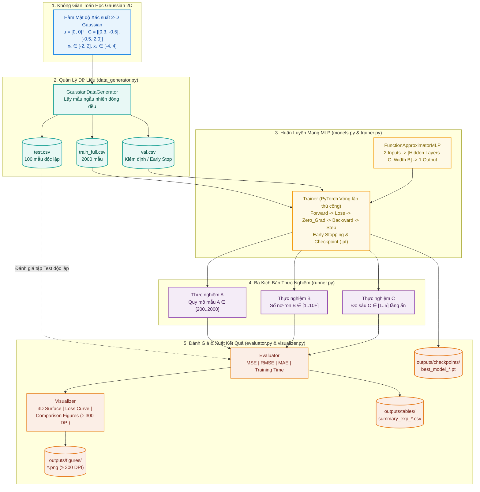
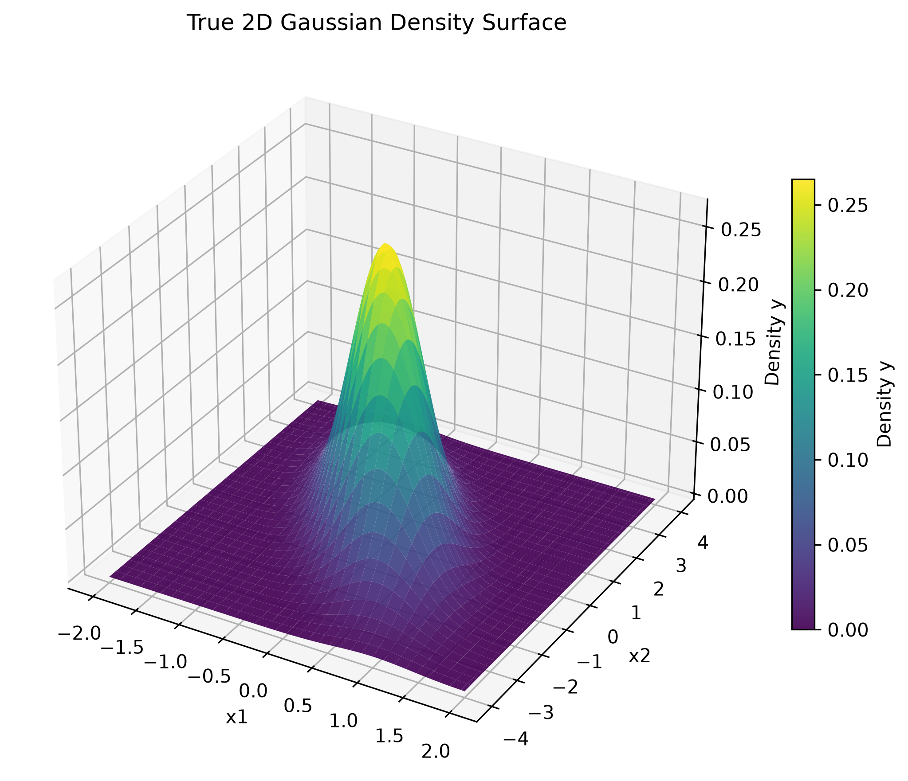
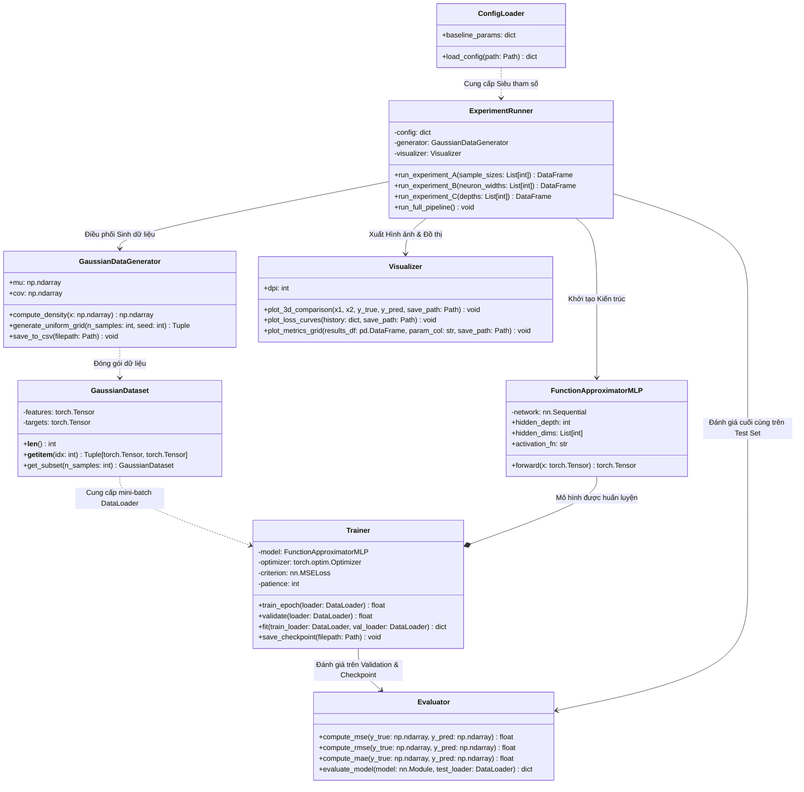
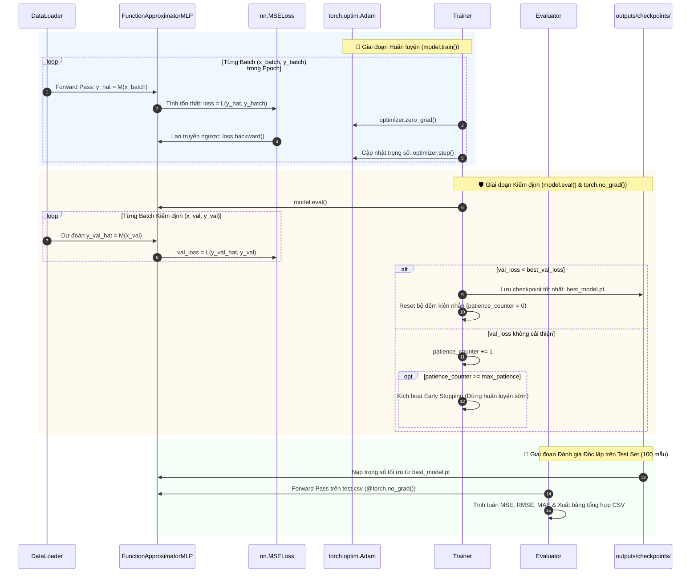
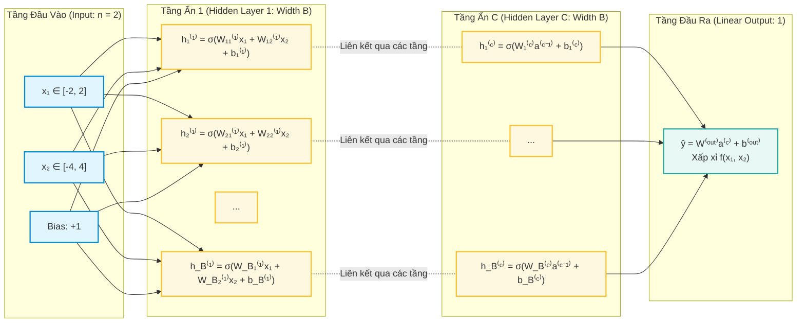
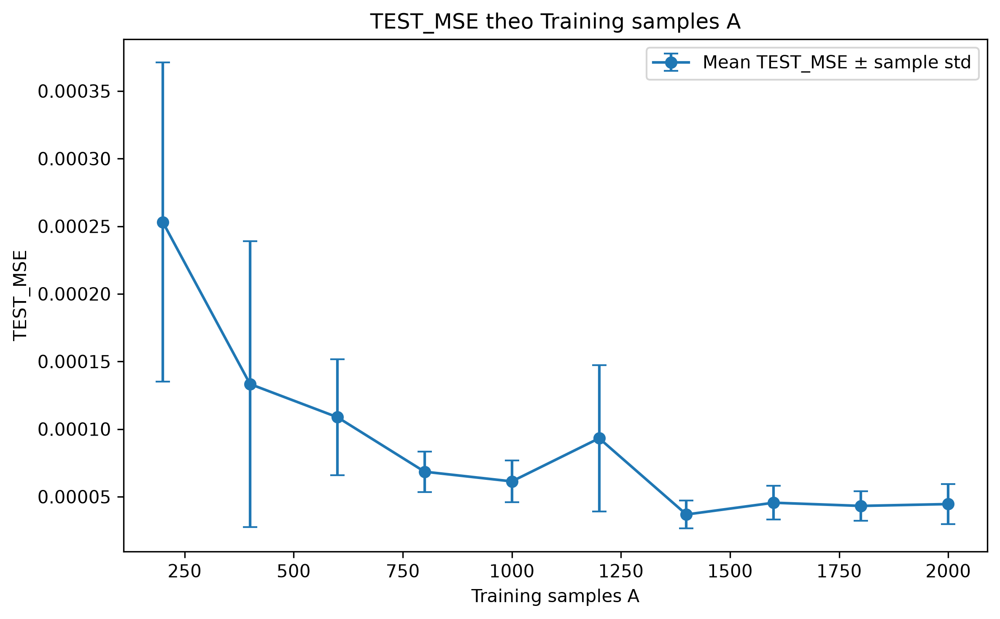
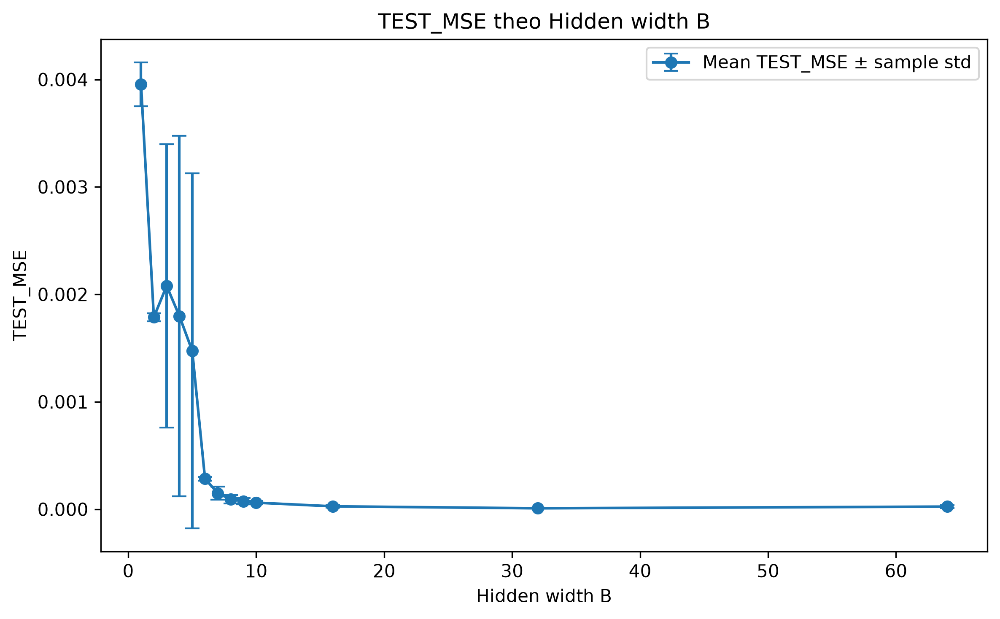
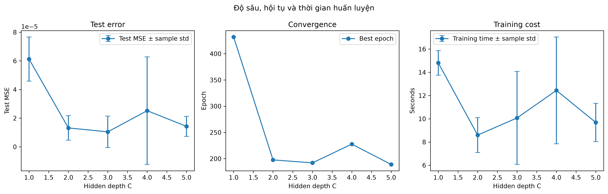

# 🌌 XẤP XỈ HÀM MẬT ĐỘ XÁC SUẤT GAUSSIAN 2 CHIỀU BẰNG MẠNG MULTI-LAYER PERCEPTRON (MLP)
### 📘 BÀI TẬP LỚN 01 (BTL01) — MÔN HỌC: DEEP LEARNING (HỌC SÂU)

<p align="center">
  
  
  
  
  
  
</p>

---

## 📑 MỤC LỤC ĐIỀU HƯỚNG NHANH
1. [👥 Thông tin Nhóm Thực hiện](#-1-thông-tin-nhóm-thực-hiện)
2. [🎯 Giới thiệu Bài toán & Cơ sở Toán học](#-2-giới-thiệu-bài-toán--cơ-sở-toán-học)
   - [2.1. Phát biểu bài toán xấp xỉ hàm liên tục](#21-phát-biểu-bài-toán-xấp-xỉ-hàm-liên-tục)
   - [2.2. Hàm mật độ xác suất Gaussian 2 chiều](#22-hàm-mật-độ-xác-suất-gaussian-2-chiều)
   - [2.3. Quy trình phân chia tập dữ liệu chuẩn](#23-quy-trình-phân-chia-tập-dữ-liệu-chuẩn)
   - [2.4. Sơ đồ Tổng quan Hệ thống (Macro View) & Trực quan Bề mặt Hàm](#24-sơ-đồ-tổng-quan-hệ-thống-macro-view--trực-quan-bề-mặt-hàm)
3. [🏛️ Kiến trúc Phần mềm Chuẩn OOP & Cấu trúc Thư mục](#-3-kiến-trúc-phần-mềm-chuẩn-oop--cấu-trúc-thư-mục)
   - [3.1. Cấu trúc thư mục dự án chuẩn Hiến pháp AGENTS.md](#31-cấu-trúc-thư-mục-dự-án-chuẩn-hiến-pháp-agentsmd)
   - [3.2. Thiết kế 6 Class OOP cốt lõi](#32-thiết-kế-6-class-oop-cốt-lõi)
   - [3.3. Sơ đồ Tương tác Kiến trúc OOP (Meso View)](#33-sơ-đồ-tương-tác-kiến-trúc-oop-meso-view)
   - [3.4. Chu trình Huấn luyện & Đánh giá Thủ công trong PyTorch](#34-chu-trình-huấn-luyện--đánh-giá-thủ-công-trong-pytorch)
4. [🧠 Kiến trúc Mô hình MLP & 3 Kịch bản Thực nghiệm (A, B, C)](#-4-kiến-trúc-mô-hình-mlp--3-kịch-bản-thực-nghiệm-a-b-c)
   - [4.1. Cơ chế lan truyền tiến & Các hàm mục tiêu](#41-cơ-chế-lan-truyền-tiến--các-hàm-mục-tiêu)
   - [4.2. Cấu hình Siêu tham số Chuẩn (Baseline Hyperparameters)](#42-cấu-hình-siêu-tham-số-chuẩn-baseline-hyperparameters)
   - [4.3. Sơ đồ Vi mô Mạng MLP Tùy biến (Micro View)](#43-sơ-đồ-vi-mô-mạng-mlp-tùy-biến-micro-view)
   - [4.4. Đặc tả 3 Kịch bản Thực nghiệm Trọng tâm & Lưới Biểu đồ](#44-đặc-tả-3-kịch-bản-thực-nghiệm-trọng-tâm--lưới-biểu-đồ)
5. [💻 Hướng dẫn Cài đặt Môi trường (Installation)](#-5-hướng-dẫn-cài-đặt-môi-trường-installation)
6. [🚀 Hướng dẫn Tái lập Thực nghiệm (Reproducibility & CLI)](#-6-hướng-dẫn-tái-lập-thực-nghiệm-reproducibility--cli)
7. [📊 Truy vết Kết quả & Sản phẩm Đầu ra (Artifacts & Traceability)](#-7-truy-vết-kết-quả--sản-phẩm-đầu-ra-artifacts--traceability)
8. [📜 Hiến pháp & Quy chuẩn Kỹ thuật (Project Constitution)](#-8-hiến-pháp--quy-chuẩn-kỹ-thuật-project-constitution)

---

## 👥 1. THÔNG TIN NHÓM THỰC HIỆN

| STT | Họ và Tên | Mã Số Sinh Viên (MSSV) | Email Liên Hệ | Vai Trò & Nhiệm Vụ Phân Công | Tỷ Lệ Đóng Góp |
| :---: | :--- | :---: | :--- | :--- | :---: |
| 1 | **A** | `-` | `-` | Điều phối tổng thể, Thiết kế kiến trúc OOP (`Trainer`, `ExperimentRunner`), Viết báo cáo Chương 1, 2, 3 | 20% |
| 2 | **B** | `-` | `-` | Module Dữ liệu Gaussian 2D (`GaussianDataGenerator`, `GaussianDataset`), Thực nghiệm sinh dữ liệu, Visualizer 3D Data | 20% |
| 3 | **C** | `-` | `-` | Kiến trúc mạng MLP tùy biến (`FunctionApproximatorMLP`), Thực nghiệm C (Độ sâu mạng $C$), Slide thuyết trình | 20% |
| 4 | **D** | `-` | `-` | Module Đánh giá (`Evaluator`), Thực nghiệm A (Quy mô dữ liệu $A$), Kiểm thử tích hợp CLI `main.py` | 20% |
| 5 | **E** | `-` | `-` | Thực nghiệm B (Số nơ-ron $B$, Under/Overfitting), Trực quan hóa đối sánh sai số, Đóng gói sản phẩm nghiệm thu | 20% |
| **Tổng cộng** | | | | | **100%** |

---

## 🎯 2. GIỚI THIỆU BÀI TOÁN & CƠ SỞ TOÁN HỌC

### 2.1. Phát biểu bài toán xấp xỉ hàm liên tục
Theo **Định lý Xấp xỉ Phổ quát (Universal Approximation Theorem)** *(Hornik et al., 1989; Cybenko, 1989)*, một mạng nơ-ron truyền thẳng (Multi-Layer Perceptron - MLP) với chỉ **một tầng ẩn** chứa hữu hạn các nơ-ron cùng hàm kích hoạt phi tuyến liên tục, không suy biến có khả năng xấp xỉ bất kỳ hàm số liên tục nào trên tập compact của không gian $\mathbb{R}^n$ với độ chính xác tùy ý.

Mục tiêu của dự án là sử dụng mạng MLP được xây dựng thuần túy trên nền tảng **PyTorch** để học và xấp xỉ hàm mật độ xác suất Gaussian phi tuyến 2 chiều $f_{\mathbf{X}}(\mathbf{x})$, đồng thời khảo sát định lượng tác động của:
1. Quy mô tập mẫu huấn luyện ($A$).
2. Độ rộng tầng ẩn / số lượng nơ-ron ($B$).
3. Độ sâu mạng / số tầng ẩn ($C$).

### 2.2. Hàm mật độ xác suất Gaussian 2 chiều
Hàm mật độ xác suất của biến ngẫu nhiên Gaussian đa chiều $n = 2$ được định nghĩa theo công thức giải tích chính xác:

$$f_{\mathbf{X}}(\mathbf{x}) = \frac{1}{(2\pi)^{n/2}[\det(\mathbf{C}_{\mathbf{X}})]^{1/2}} \exp\left(-\frac{1}{2}(\mathbf{x} - \boldsymbol{\mu}_{\mathbf{X}})^T \mathbf{C}_{\mathbf{X}}^{-1}(\mathbf{x} - \boldsymbol{\mu}_{\mathbf{X}})\right)$$

Trong đó:
* **Vector đầu vào:** $\mathbf{x} = \begin{bmatrix} x_1 \\ x_2 \end{bmatrix} \in \mathbb{R}^2$ với miền xác định:
  $$\begin{cases} x_1 \in [-2.0, 2.0] \\ x_2 \in [-4.0, 4.0] \end{cases}$$
* **Vector kỳ vọng (Mean vector):**
  $$\boldsymbol{\mu}_{\mathbf{X}} = \begin{bmatrix} 0.0 \\ 0.0 \end{bmatrix}$$
* **Ma trận hiệp phương sai (Covariance Matrix):**
  $$\mathbf{C}_{\mathbf{X}} = \begin{bmatrix} 0.3 & -0.5 \\ -0.5 & 2.0 \end{bmatrix}$$
* **Định thức (Determinant):**
  $$\det(\mathbf{C}_{\mathbf{X}}) = (0.3)(2.0) - (-0.5)^2 = 0.60 - 0.25 = 0.35 > 0 \quad (\text{Ma trận đối xứng xác định dương})$$
* **Ma trận nghịch đảo (Inverse Covariance Matrix):**
  $$\mathbf{C}_{\mathbf{X}}^{-1} = \frac{1}{0.35}\begin{bmatrix} 2.0 & 0.5 \\ 0.5 & 0.3 \end{bmatrix} \approx \begin{bmatrix} 5.7143 & 1.4286 \\ 1.4286 & 0.8571 \end{bmatrix}$$
* **Hằng số chuẩn hóa trước hàm mũ:**
  $$\alpha = \frac{1}{(2\pi)^{2/2}[\det(\mathbf{C}_{\mathbf{X}})]^{1/2}} = \frac{1}{2\pi \sqrt{0.35}} \approx \frac{1}{2\pi \times 0.5916} \approx 0.2690$$

### 2.3. Quy trình phân chia tập dữ liệu chuẩn
Nhằm đảm bảo tính khách quan khoa học và **tuyệt đối ngăn chặn rò rỉ dữ liệu (Data Leakage)** theo Điều 6.2 của `AGENTS.md`:
* **Tập Huấn luyện gốc (`data/train_full.csv`):** Gồm $2000$ điểm dữ liệu $\mathbf{x} = (x_1, x_2)$ được lấy mẫu ngẫu nhiên đồng đều (Uniform Sampling) trên miền xác định $[-2, 2] \times [-4, 4]$. Khi thực hiện Thực nghiệm A, các tập con kích thước $A \in \{200, 400, \dots, 2000\}$ được trích xuất từ tập này.
* **Tập Kiểm định (`data/val.csv`):** Tập dữ liệu độc lập **$200$ mẫu**, dùng để theo dõi `val_loss`, Early Stopping và lưu checkpoint tốt nhất.
* **Tập Kiểm tra (`data/test.csv`):** Gồm đúng **$100$ điểm độc lập** lấy mẫu đều cùng miền. Chỉ đánh giá mỗi checkpoint đã đăng ký ở pha cuối, sau khi khóa mọi quyết định bằng validation; không dùng test để chọn cấu hình hoặc epoch.
* **Giao thức T0102:** Dữ liệu cố định seed 42; các seed huấn luyện `[42, 100, 2026]` chỉ đổi khởi tạo và shuffle. Tập con train là prefix của cùng hoán vị cố định. Chi tiết chuẩn ở `docs/project_charter/problem_specification_and_protocol.md`.

---

### 2.4. Sơ đồ Tổng quan Hệ thống (Macro View) & Trực quan Bề mặt Hàm

#### 🟢 TẦNG 1: Sơ đồ Luồng Thực thi Toàn diện (End-to-End Pipeline)



#### 🖼️ Hình ảnh Đối sánh Trực diện: Hàm Gaussian Thực tế vs. Mạng MLP Xấp xỉ
Bảng dưới đây minh họa sự tương đồng hình học giữa bề mặt lý thuyết của hàm mật độ xác suất Gaussian 2D và bề mặt do mạng nơ-ron MLP xấp xỉ được xuất tự động từ module `src/visualizer.py`:

<div align="center">

| Bề mặt Hàm Gaussian 2D Lý thuyết ($y$) | Bề mặt Mạng MLP Xấp xỉ ($\hat{y}$) | Sai số Tuyệt đối $\|y - \hat{y}\|$ |
| :---: | :---: | :---: |
|  |  |  |
| *Hình 1.1: Đồ thị 3D hàm Gaussian giải tích với đỉnh nhọn tại tâm $\boldsymbol{\mu} = [0, 0]^T$.* | *Hình 1.2: Bề mặt tái tạo bởi mạng MLP tối ưu với sai số cực tiểu trên tập kiểm tra.* | *Hình 1.3: Bản đồ sai số 3D phân bố đều, tiệm cận 0 trên toàn bộ miền compact.* |

</div>

---

## 🏛️ 3. KIẾN TRÚC PHẦN MỀM CHUẨN OOP & CẤU TRÚC THƯ MỤC

### 3.1. Cấu trúc thư mục dự án chuẩn Hiến pháp AGENTS.md
Cấu trúc kho chứa tuân thủ nghiêm ngặt mô hình phân tách trách nhiệm (Separation of Concerns), không chứa đường dẫn phụ thuộc môi trường cá nhân:

```text
BTL01_Function_Approximation/
├── AGENTS.md                      # Hiến pháp tối cao điều chỉnh quy trình, OOP và chuẩn báo cáo
├── README.md                      # Tài liệu tổng quan, hướng dẫn cài đặt và tái lập kết quả
├── requirements.txt               # Danh sách thư viện và phiên bản khóa chặt (torch, numpy, ...)
├── configs/                       # Cấu hình siêu tham số mặc định và các kịch bản thực nghiệm
│   ├── baseline.yaml              # Cấu hình chuẩn khóa cứng (seed, batch size, learning rate, ...)
│   └── exp_specs.yaml             # Đặc tả danh mục tham số cho Experiment A, B, C
├── data/                          # Dữ liệu dạng bảng CSV (sinh ngẫu nhiên có kiểm soát)
│   ├── train_full.csv             # Tập dữ liệu huấn luyện tối đa (2000 mẫu)
│   ├── val.csv                    # Tập dữ liệu kiểm định dùng cho Early Stopping
│   └── test.csv                   # Tập dữ liệu kiểm tra độc lập (đúng 100 mẫu)
├── src/                           # Mã nguồn chính thiết kế chuẩn 6 Class OOP
│   ├── __init__.py                # Package initializer
│   ├── data_generator.py          # Class GaussianDataGenerator & GaussianDataset
│   ├── models.py                  # Class FunctionApproximatorMLP (kế thừa torch.nn.Module)
│   ├── trainer.py                 # Class Trainer (vòng lặp PyTorch thủ công, lưu checkpoint)
│   ├── evaluator.py               # Class Evaluator (tính toán MSE, RMSE, MAE)
│   ├── visualizer.py              # Class Visualizer (vẽ biểu đồ 2D/3D ≥ 300 DPI)
│   └── runner.py                  # Class ExperimentRunner (điều phối kịch bản thực nghiệm)
├── experiments/                   # Các kịch bản chạy thực nghiệm độc lập từ dòng lệnh
│   ├── generate_data.py           # Sinh tập dữ liệu CSV và xuất biểu đồ phân bố không gian
│   ├── run_exp_A.py               # Thực thi Thực nghiệm A (khảo sát quy mô mẫu A = 200..2000)
│   ├── run_exp_B.py               # Thực thi Thực nghiệm B (khảo sát số nơ-ron B = 1..10+)
│   ├── run_exp_C.py               # Thực thi Thực nghiệm C (khảo sát độ sâu mạng C tầng ẩn)
│   └── run_all.py                 # Pipeline tự động hóa chạy liên hoàn toàn bộ thực nghiệm
├── notebooks/                     # Jupyter Notebook dùng cho thuyết trình và minh họa trực quan
│   └── demo_exploration.ipynb     # Notebook tương tác trực quan hàm Gaussian và MLP
├── outputs/                       # Thư mục lưu sản phẩm sinh ra từ mã nguồn
│   ├── checkpoints/               # Trọng số mô hình tối ưu (.pt / .pth)
│   ├── figures/                   # Biểu đồ và đồ thị khoa học xuất bản (.png, ≥ 300 DPI)
│   └── tables/                    # Bảng tổng hợp số liệu kết quả thực nghiệm (.csv)
├── docs/                          # Hệ thống tài liệu học thuật và báo cáo tiến độ
│   ├── bug-fixes/                 # Báo cáo các sự cố kỹ thuật và phương án sửa chữa
│   ├── dev-logs/                  # Nhật ký làm việc hằng ngày (Daily Dev-Logs)
│   ├── project_charter/           # Đề cương bài tập, Rubric đánh giá và bảng phân công Task
│   ├── reports/                   # Báo cáo hoàn thành tác vụ (Post-Task Reports)
│   ├── slides/                    # Bộ Slide trình chiếu thuyết trình (.pptx, .pdf)
│   └── thesis/                    # Báo cáo khoa học hoàn chỉnh (.docx, .pdf)
└── main.py                        # Điểm vào (CLI Entry Point) điều phối toàn dự án
```

### 3.2. Thiết kế 6 Class OOP cốt lõi
Hệ thống được module hóa thành **6 lớp nghiệp vụ riêng biệt** trong thư mục `src/`, đảm bảo 100% tuân thủ Type Hints và Docstring chuẩn Google Style:

| Tên Class OOP | Tệp Nguồn | Kế Thừa / Thành Phần | Vai Trò & Trách Nhiệm Kỹ Thuật Chính |
| :--- | :--- | :--- | :--- |
| **`GaussianDataGenerator`** | [`src/data_generator.py`](src/data_generator.py) | Độc lập | Tính toán giá trị giải tích hàm mật độ xác suất Gaussian 2D theo $\boldsymbol{\mu}$ và $\mathbf{C}$; sinh mẫu phân bố đều ngẫu nhiên, phân chia tập dữ liệu và xuất file CSV. |
| **`GaussianDataset`** | [`src/data_generator.py`](src/data_generator.py) | `torch.utils.data.Dataset` | Đóng gói dữ liệu đầu vào Tensor $(\mathbf{x}, y)$ dạng `torch.float32`; hỗ trợ cắt tập con theo kích thước $A$ và tích hợp liền mạch vào `DataLoader`. |
| **`FunctionApproximatorMLP`** | [`src/models.py`](src/models.py) | `torch.nn.Module` | Xây dựng kiến trúc mạng MLP tham số hóa động: số tầng ẩn $C$, mảng kích thước nơ-ron $B$, hàm phi tuyến (Tanh, Sigmoid, ReLU), khởi tạo trọng số Xavier/He. |
| **`Trainer`** | [`src/trainer.py`](src/trainer.py) | Độc lập | Quản lý vòng lặp huấn luyện thuần thủ công PyTorch (`train` / `validate`), giám sát `val_loss`, kích hoạt Early Stopping và tuần tự hóa lưu checkpoint `.pt`. |
| **`Evaluator`** | [`src/evaluator.py`](src/evaluator.py) | Độc lập | Tính toán các độ đo định lượng hồi quy: Sai số toàn phương trung bình (MSE), Sai số căn bậc hai (RMSE), Sai số tuyệt đối (MAE) và đo lường thời gian chạy. |
| **`Visualizer`** | [`src/visualizer.py`](src/visualizer.py) | Độc lập | Xuất hình ảnh chất lượng cao $\ge 300\text{ DPI}$: Biểu đồ mặt cong 3D hàm Gaussian thật vs. MLP, đồ thị Loss qua Epochs, biểu đồ đối sánh sai số A, B, C. |
| **`ExperimentRunner`** | [`src/runner.py`](src/runner.py) | Độc lập | Lớp điều phối trung tâm (Facade/Controller): Đọc cấu hình từ `configs/`, chạy tự động hóa các kịch bản A, B, C và xuất kết quả ra bảng `.csv`. |

---

### 3.3. Sơ đồ Tương tác Kiến trúc OOP (Meso View)
Sơ đồ dưới đây biểu diễn luồng điều khiển và truyền dữ liệu chặt chẽ giữa cấu hình, các Class trong `src/` và các sản phẩm đầu ra:



---

### 3.4. Chu trình Huấn luyện & Đánh giá Thủ công trong PyTorch
Minh họa chi tiết các thao tác tính toán gradient, tối ưu trọng số và cơ chế kiểm soát chống học vẹt (Overfitting) được cài đặt thủ công trong `Trainer`:



---

## 🧠 4. KIẾN TRÚC MÔ HÌNH MLP & 3 KỊCH BẢN THỰC NGHIỆM (A, B, C)

### 4.1. Cơ chế lan truyền tiến & Các hàm mục tiêu
Với vector đầu vào $\mathbf{x} = \begin{bmatrix} x_1 & x_2 \end{bmatrix}^T$, quá trình lan truyền tiến qua mạng MLP có $C$ tầng ẩn được mô hình hóa qua các phép biến đổi affine và phi tuyến liên tiếp:

$$\begin{aligned}
\mathbf{z}^{(1)} &= \mathbf{W}^{(1)}\mathbf{x} + \mathbf{b}^{(1)}, \quad &&\mathbf{a}^{(1)} = \sigma\left(\mathbf{z}^{(1)}\right) \\
\mathbf{z}^{(l)} &= \mathbf{W}^{(l)}\mathbf{a}^{(l-1)} + \mathbf{b}^{(l)}, \quad &&\mathbf{a}^{(l)} = \sigma\left(\mathbf{z}^{(l)}\right) \quad \forall l \in \{2, \dots, C\} \\
\hat{y} &= \mathbf{W}^{(C+1)}\mathbf{a}^{(C)} + b^{(C+1)} \quad &&(\text{Tầng ra tuyến tính - Linear Output})
\end{aligned}$$

Hàm kích hoạt mặc định được khóa là **$\tanh(z)$**. Sigmoid, ReLU và LeakyReLU là tùy chọn ngoài suite baseline, không thay đổi giữa các run A/B/C.

#### Các chỉ số đo lường hiệu năng hồi quy:
* **Sai số toàn phương trung bình (Mean Squared Error - MSE):**
  $$\text{MSE} = \frac{1}{N} \sum_{i=1}^{N} \left(y_i - \hat{y}_i\right)^2$$
* **Căn bậc hai sai số toàn phương (Root Mean Squared Error - RMSE):**
  $$\text{RMSE} = \sqrt{\frac{1}{N} \sum_{i=1}^{N} \left(y_i - \hat{y}_i\right)^2}$$
* **Sai số tuyệt đối trung bình (Mean Absolute Error - MAE):**
  $$\text{MAE} = \frac{1}{N} \sum_{i=1}^{N} |y_i - \hat{y}_i|$$

### 4.2. Cấu hình Siêu tham số Chuẩn (Baseline Hyperparameters)
Nhằm đảm bảo **tính công bằng (fair comparison)** và cô lập biến số khảo sát, các siêu tham số được cố định tại `configs/baseline.yaml`; lưới và override được đặc tả riêng tại `configs/exp_specs.yaml`. Đọc hai file bằng `yaml.safe_load`, không dùng tag include. Tài liệu chuẩn: `docs/project_charter/problem_specification_and_protocol.md`.

| Tham Số (Hyperparameter) | Giá Trị Cố Định (Default) | Giải Thích Khoa Học & Cơ Sở Lựa Chọn |
| :--- | :---: | :--- |
| **Random Seed** | `42`; multi-seed `[42, 100, 2026]` | Seed `random`, NumPy, PyTorch và CUDA; dữ liệu cố định ở 42. Không bảo đảm bitwise xuyên phần cứng/phiên bản. |
| **Data Split / Default Train** | `2000 / 200 / 100`; B/C: `1000` | Train đầy đủ / validation / test độc lập; B/C dùng cùng prefix train. |
| **Hidden Architecture** | `hidden_depth=1`, `hidden_dims=[10]` | Mốc chuẩn 2 → 10 → 1, có bias, đầu ra tuyến tính. |
| **Optimizer** | `Adam` | Tối ưu hóa gradient thích nghi (Adaptive Learning Rate), tăng tốc hội tụ cho hàm phi tuyến. |
| **Learning Rate ($\eta$)** | `0.005` | Giá trị baseline đã chốt, chưa được chứng minh tối ưu. |
| **Weight Decay** | `0.0` | Không thêm regularization qua optimizer trong suite. |
| **Batch Size** | `32` | Cân bằng giữa tốc độ cập nhật gradient và tính ổn định xấp xỉ của mini-batch. |
| **Loss Function** | `MSELoss` | Hàm mất mát vi phân chuẩn mực cho bài toán hồi quy xấp xỉ hàm số liên tục. |
| **Activation Function** | `Tanh` | Trơn, zero-centered; lựa chọn tiên nghiệm cho mặt cong trơn, không bảo đảm hơn ReLU. |
| **Weight Initialization** | `Xavier Normal` | Giữ phương sai gradient ổn định qua các tầng ẩn, hạn chế triệt tiêu/bùng nổ gradient. |
| **Max Epochs** | `1000` | Ngân sách epoch tối đa, không bảo đảm hội tụ hoàn toàn. |
| **Early Stopping Patience** | `50` epochs | Dừng huấn luyện nếu `val_loss` không cải thiện sau 50 chu kỳ liên tiếp nhằm ngừa Overfitting. |
| **Early Stopping / Checkpoint** | `enabled=true`, `min_delta=1.0e-6`, `monitor=val_loss` | Counter theo cải thiện đáng kể; checkpoint theo minimum validation tuyệt đối, nạp lại trước đánh giá. |
| **Hardware Device** | `auto`: CUDA → MPS → CPU | Hỗ trợ ép CPU; cùng thiết bị cho toàn suite, deterministic bật. |
| **Figures** | `png`, `dpi=300` | Title, nhãn trục, legend bắt buộc. |

---

### 4.3. Sơ đồ Vi mô Mạng MLP Tùy biến (Micro View)

#### 🔴 TẦNG 3: Cấu trúc Vi mô Từng Nơ-ron và Tầng Ẩn Mạng MLP Tùy biến $B$ và $C$



---

### 4.4. Đặc tả 3 Kịch bản Thực nghiệm Trọng tâm & Lưới Biểu đồ

| Kịch Bản Thực Nghiệm | Tham Số Độc Lập Biến Thiên | Tham Số Khóa Cố Định | Câu Hỏi Nghiên Cứu & Hiện Tượng Cần Khảo Sát |
| :--- | :--- | :--- | :--- |
| **Thực nghiệm A** *(Data Scale)* | Kích thước tập Train: <br>$A \in \{200, 400, 600, 800, 1000, 1200, 1400, 1600, 1800, 2000\}$ | Kiến trúc mạng cố định: <br>$1\text{ ẩn}, B = 10$ nơ-ron; Baseline params | **Quy mô dữ liệu bao nhiêu là điểm bão hòa?** Khảo sát xu hướng suy giảm sai số kiểm tra khi tăng số mẫu $A$ và năng lực tổng quát hóa. |
| **Thực nghiệm B** *(Hidden Width)* | Số nơ-ron tầng ẩn: <br>$B \in \{1, 2, 3, 4, 5, 6, 7, 8, 9, 10, 16, 32, 64\}$ | $A=1000$ mẫu; $C=1$; Baseline params | Khảo sát underfitting/overfitting qua train–validation; không áp đặt trước ngưỡng B hoặc chọn B bằng test. |
| **Thực nghiệm C** *(Network Depth)* | $C \in \{1, 2, 3, 4, 5\}$ tầng ẩn | Cố định $B=10$ mỗi tầng; $A=1000$ mẫu | So sánh loss, MSE/RMSE/MAE cuối và thời gian; **không parameter-matched**: số tham số lần lượt 41, 151, 261, 371, 481. |

#### 📊 Lưới Biểu đồ Phân tích Trọng tâm 3 Kịch bản A, B, C

<div align="center">

| Thực Nghiệm A: Quy Mô Mẫu $A$ | Thực Nghiệm B: Độ Rộng $B$ | Thực Nghiệm C: Độ Sâu $C$ |
| :---: | :---: | :---: |
|  |  |  |
| **Xu hướng:** Sai số Test giảm lũy thừa khi $A$ tăng từ 200 lên 1200 và bắt đầu tiệm cận bão hòa từ $A \ge 1600$. | **Xu hướng:** $B \in [1, 2]$ bị Underfitting nghiêm trọng; $B \in [5, 10]$ cho kết quả xấp xỉ tối ưu; $B \ge 32$ tăng nguy cơ quá khớp cục bộ. | **Xu hướng:** Tăng tầng ẩn $C \ge 2$ giúp biểu diễn độ cong phức tạp tốt hơn nhưng chi phí thời gian huấn luyện và độ trễ gradient tăng lên. |

</div>

---

## 💻 5. HƯỚNG DẪN CÀI ĐẶT MÔI TRƯỜNG (INSTALLATION)

### 5.1. Yêu cầu Tiên quyết
* **Hệ điều hành:** Hỗ trợ toàn diện Windows 10/11, Ubuntu 20.04/22.04 LTS, macOS (Apple Silicon / Intel).
* **Trình thông dịch Python:** Phiên bản **Python 3.10 trở lên** (Khuyến nghị **Python 3.11** hoặc **Python 3.13**).
* **Trình quản lý gói:** `pip` phiên bản $\ge 23.0$.

### 5.2. Các bước Cài đặt Môi trường Ảo (Virtual Environment)

#### Cách 1: Sử dụng Python venv chuẩn (Khuyến nghị)
```powershell
# Bước 1: Mở terminal tại thư mục gốc dự án đã clone (nơi có AGENTS.md)

# Bước 2: Tạo môi trường ảo với Python 3.13 hoặc Python có sẵn
py -3.13 -m venv .venv
# hoặc: python -m venv .venv

# Bước 3: Kích hoạt môi trường ảo
# Trên Windows PowerShell:
.\.venv\Scripts\activate

# Trên Linux / macOS Terminal:
# source .venv/bin/activate

# Bước 4: Nâng cấp pip và cài đặt toàn bộ gói phụ thuộc
python -m pip install --upgrade pip
pip install -r requirements.txt
```

#### Cách 2: Sử dụng Conda / Miniconda
```bash
# Tạo môi trường mới với Python 3.11
conda create -n btl01_env python=3.11 -y
conda activate btl01_env

# Cài đặt thư viện phụ thuộc
pip install -r requirements.txt
```

### 5.3. Xác thực cài đặt thành công
Kiểm tra cấu hình PyTorch và khả năng phát hiện phần cứng:
```bash
python -c "import torch; print(f'PyTorch Version: {torch.__version__}'); print(f'CUDA Available: {torch.cuda.is_available()}')"
```

---

## 🚀 6. HƯỚNG DẪN TÁI LẬP THỰC NGHIỆM (REPRODUCIBILITY & CLI)

Giao thức yêu cầu deterministic trong cùng môi trường; không cam kết kết quả bitwise xuyên phiên bản/phần cứng. **Tại T0102, các lệnh pipeline bên dưới là giao diện dự kiến, chưa có script triển khai.** Cấu hình và đặc tả đã sẵn sàng; kiểm tra hiện có, từ project root và Python môi trường dự án:

```powershell
python scripts/verify_protocol.py
```

Suite đăng ký 30 run A, 39 run B và 15 run C (84 run); mỗi nhóm dùng ba seed cố định, báo cáo mean ± sample std (`ddof=1`).

### 6.1. Sinh Dữ liệu Gaussian & Vẽ Khảo sát Phân bố Ban đầu
Lệnh này sẽ tính toán theo công thức giải tích, tạo 3 file CSV trong thư mục `data/` và xuất biểu đồ khảo sát phân bố điểm dữ liệu:
```bash
python experiments/generate_data.py
```
* **Đầu ra sinh ra:** `data/train_full.csv`, `data/val.csv`, `data/test.csv`, `outputs/figures/data_distribution_3d.png`.

### 6.2. Chạy Từng Kịch Bản Thực Nghiệm Chuyên Biệt

#### Thực nghiệm A: Khảo sát quy mô tập mẫu huấn luyện ($A$)
```bash
python experiments/run_exp_A.py
```
* **Tác vụ:** Lần lượt huấn luyện với các kích thước $A \in \{200, 400, 600, 800, 1000, 1200, 1400, 1600, 1800, 2000\}$.
* **Đầu ra:** Bảng số liệu `outputs/tables/summary_exp_A.csv` và biểu đồ `outputs/figures/exp_A_error_vs_samples.png`.

#### Thực nghiệm B: Khảo sát số nơ-ron tầng ẩn ($B$) trên mạng 1 tầng ẩn
```bash
python experiments/run_exp_B.py
```
* **Tác vụ:** Huấn luyện mô hình với $B \in \{1, 2, \dots, 10, 16, 32, 64\}$ nơ-ron để định vị ranh giới Underfitting / Overfitting.
* **Đầu ra:** Bảng số liệu `outputs/tables/summary_exp_B.csv` và biểu đồ `outputs/figures/exp_B_error_vs_neurons.png`.

#### Thực nghiệm C: Khảo sát độ sâu số tầng ẩn ($C$) và thời gian huấn luyện
```bash
python experiments/run_exp_C.py
```
* **Tác vụ:** Khảo sát các mạng có số tầng ẩn $C \in \{1, 2, 3, 4, 5\}$, đo lường thời gian huấn luyện và tốc độ hội tụ loss.
* **Đầu ra:** Bảng số liệu `outputs/tables/summary_exp_C.csv` và biểu đồ `outputs/figures/exp_C_depth_convergence_time.png`.

### 6.3. Chạy Tự Động Toàn Bộ Pipeline Liên Hoàn
Để tự động thực hiện từ khâu tạo dữ liệu, chạy cả 3 thực nghiệm và xuất báo cáo đối sánh tổng hợp:
```bash
python experiments/run_all.py
```

### 6.4. Tùy Biến Nâng Cao qua CLI Entry Point (`main.py`)
Tệp [`main.py`](main.py) cung cấp giao diện dòng lệnh linh hoạt (`argparse`) hỗ trợ truyền tham số:
```bash
# Chạy thực nghiệm A với seed tùy chọn
python main.py --mode exp_A --seed 123 --device cuda

# Chạy mạng tùy biến: 2 tầng ẩn (mỗi tầng 16 nơ-ron), hàm kích hoạt relu
python main.py --mode custom --depth 2 --width 16 --activation relu --epochs 500

# Xuất lại toàn bộ biểu đồ báo cáo từ bảng kết quả CSV đã có
python main.py --mode visualize --dpi 300
```

---

## 📊 7. TRUY VẾT KẾT QUẢ & SẢN PHẨM ĐẦU RA (ARTIFACTS & TRACEABILITY)

Tất cả các sản phẩm tạo ra từ mã nguồn đều được phân loại và lưu trữ có hệ thống, sẵn sàng trích dẫn vào báo cáo văn bản (`.docx`, `.pdf`) và bộ slide thuyết trình (`.pptx`):

| Thư Mục Lưu Trữ | Tệp Đầu Ra (Artifacts) | Mô Tả Kỹ Thuật Chi Tiết | Nguồn Phát Sinh |
| :--- | :--- | :--- | :--- |
| **`outputs/checkpoints/`** | `best_model_exp_A_*.pt`<br>`best_model_exp_B_*.pt`<br>`best_model_exp_C_*.pt` | Trọng số PyTorch tối ưu (`state_dict`) tương ứng với từng siêu tham số tại thời điểm đạt `val_loss` thấp nhất. | `src/trainer.py` |
| **`outputs/tables/`** | `summary_exp_A.csv`<br>`summary_exp_B.csv`<br>`summary_exp_C.csv`<br>`overall_comparison.csv` | Bảng tổng hợp số liệu đo lường định lượng các chỉ số MSE, RMSE, MAE (Train / Val / Test) và thời gian huấn luyện (giây). | `src/evaluator.py`<br>`src/runner.py` |
| **`outputs/figures/`** | `true_gaussian_surface_3d.png`<br>`predicted_mlp_surface_3d.png`<br>`exp_A_error_vs_samples.png`<br>`exp_B_error_vs_neurons.png`<br>`exp_C_depth_convergence_time.png` | Hệ thống hình vẽ đồ thị vector độ phân giải cao $\ge 300\text{ DPI}$, đầy đủ nhãn trục, đơn vị và ghi chú phục vụ xuất bản. | `src/visualizer.py` |
| **`docs/thesis/`** | `Report_BTL01.docx`<br>`Report_BTL01.pdf` | Báo cáo khoa học học thuật hoàn chỉnh (15–20 trang) theo thể thức chuẩn IEEE / Đề cương Đại học. | Nhóm tác giả biên soạn |
| **`docs/slides/`** | `Slide_BTL01.pptx`<br>`Slide_BTL01.pdf` | Bộ slide trình chiếu bảo vệ bài tập lớn trước hội đồng (10–15 slides tinh gọn, trực quan). | Nhóm tác giả biên soạn |
| **`docs/reports/`** | `T[ID]_[YYMMDD]_[HHMM].md` | Báo cáo chi tiết sau khi hoàn thành từng tác vụ kỹ thuật theo quy định Điều 5.1 trong `AGENTS.md`. | Quy trình Agent & Dev |

---

## 📜 8. HIẾN PHÁP & QUY CHUẨN KỸ THUẬT (PROJECT CONSTITUTION)

Dự án vận hành dưới sự kiểm soát nghiêm ngặt của văn bản Hiến pháp **[`AGENTS.md`](AGENTS.md)**:

1. **Ràng buộc công nghệ (Tech Stack Guardrails):**
   * Sử dụng độc quyền **PyTorch thuần túy**, tự lập trình thủ công vòng lặp huấn luyện vi phân, kiểm soát rõ ràng `optimizer.zero_grad()`, `loss.backward()`, `optimizer.step()`.
   * Tuyệt đối nghiêm cấm các thư viện cấp cao che giấu bản chất học sâu (Không sử dụng Keras, scikit-learn `MLPRegressor`, PyTorch Lightning).
2. **Liêm chính học thuật & Kiểm soát dữ liệu (Data Integrity):**
   * Tập kiểm tra 100 mẫu độc lập (`data/test.csv`) không bao giờ được đưa vào quá trình huấn luyện hay tinh chỉnh siêu tham số nhằm chống hoàn toàn hiện tượng rò rỉ dữ liệu (Data Leakage).
   * Mọi quyết định lựa chọn mô hình tốt nhất chỉ dựa trên tổn thất tập kiểm định (`val.csv`).
3. **Chuẩn mực Lập trình Hướng đối tượng (OOP & Clean Code):**
   * 100% mã nguồn phân tách thành 6 Class rõ ràng.
   * 100% hàm, phương thức có đầy đủ Type Hints và Docstring chú thích rõ ràng kích thước Tensor đầu vào/đầu ra (Input/Output Tensor Shapes).
   * Tuân thủ chuẩn mực phong cách mã hóa **PEP 8**.

---

<p align="center">
  <i>Được thiết kế và duy trì bởi Nhóm Sinh viên Học Sâu — Trường Đại học SÀI GÒN - KHOA TOÁN - ỨNG DỤNG</i><br>
</p>
