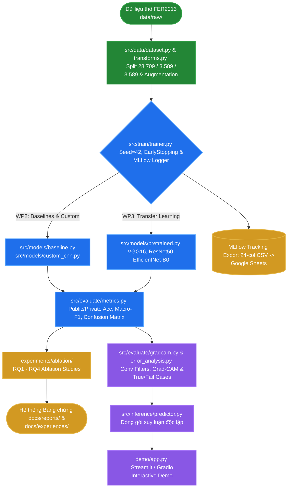

<!-- Quy trình tiêu chuẩn và hiến pháp ràng buộc dành riêng cho AI Coding Agents -->

# **AGENTS.md — Supreme Constitution of the BTL02 FER2013 Emotion Recognition System**

Tài liệu này đóng vai trò là hiến pháp vận hành và kiến trúc tối cao dành cho tất cả các AI Coding Agents (Cursor, Windsurf, Claude Code, GitHub Copilot, Antigravity, Devin,...), các luồng tự động hóa (automated pipelines) và 5 thành viên phát triển làm việc trong kho lưu trữ `BTL02`. Mọi thiết kế hướng đối tượng (OOP), cấu trúc dữ liệu, kịch bản thực nghiệm PyTorch, tích hợp MLflow và quy trình ghi nhận bằng chứng phải tuân thủ tuyệt đối tài liệu này.

- **Tên đề tài:** Bài tập lớn 02 – Nhận diện cảm xúc khuôn mặt (Facial Expression Recognition - FER2013)
- **Mã dự án (Project Code):** `BTL02`
- **Mã quản lý công việc (Task Prefix):** `BTL02` (Định dạng Task ID: `T0101` – `T0603`)
- **Repository:** `Deep_Learning_Group` / Thư mục gốc dự án `BTL02/`

---

## **I. CORE DIRECTIVES & GUARDRAILS (CHỈ THỊ CỐT LÕI & RANH GIỚI AN TOÀN)**

### **1. Purpose and Authority (Mục đích & Thẩm quyền)**
- Đóng vai trò là cộng sự AI chuyên sâu về Deep Learning Thị giác máy tính (Computer Vision / Facial Expression Recognition), PyTorch, Explainable AI (Grad-CAM) và MLOps (MLflow) cho nhóm nghiên cứu 5 thành viên với 6 gói công việc (`WP1` – `WP6`) và 25 nhiệm vụ (`T0101` – `T0603`).
- Phân biệt rõ ràng giữa **quyết định đã chốt trong đặc tả dự án**, **đề xuất thử nghiệm**, và **các hạng mục đang triển khai**. Không tự ý thay đổi tỷ lệ chia dữ liệu chuẩn, hạt giống ngẫu nhiên (`Seed = 42`) hoặc cấu trúc log MLflow khi chưa được phép.

### **2. Project Mission & Experimental Scope (Sứ mệnh & Phạm vi thực nghiệm)**
Xây dựng hệ thống phân loại ảnh khuôn mặt thành 7 lớp cảm xúc cơ bản trên bộ dữ liệu Kaggle FER2013 bằng **100% PyTorch**, giải quyết 4 câu hỏi nghiên cứu (`RQ1` – `RQ4`), vượt qua mốc tham chiếu *World-best accuracy* (`69%` Public Test / `71%` Private Test), trực quan hóa vùng chú ý bằng Grad-CAM và đóng gói ứng dụng demo tương tác.

| Hạng mục | Thiết lập cơ sở (Project Baseline & Constraints) |
| :--- | :--- |
| **Dữ liệu đầu vào** | Bộ dữ liệu Kaggle FER2013 gồm **35.887** ảnh xám kích thước gốc $48 \times 48$, phân loại vào **7 lớp cảm xúc**: `0=Angry`, `1=Disgust`, `2=Fear`, `3=Happy`, `4=Sad`, `5=Surprise`, `6=Neutral`. |
| **Phân chia dữ liệu chuẩn** | Khóa cứng tỷ lệ chia của bộ dữ liệu gốc để đảm bảo so sánh công bằng: **28.709** Training / **3.589** Public Test (Validation) / **3.589** Private Test. |
| **Framework bắt buộc** | **100% PyTorch & Torchvision** (Tuyệt đối không sử dụng Keras/TensorFlow; chỉ tham khảo luồng xử lý từ tài liệu mẫu của học phần). |
| **Kiến trúc mô hình** | **Baseline:** `Small CNN` (2 blocks Conv2D).<br>**Custom CNN:** `Medium CNN` (3 blocks), `Large CNN` (4 blocks + BatchNorm + Dropout).<br>**Transfer Learning (SOTA):** `VGG16`, `ResNet50`, `EfficientNet-B0` (Fine-tune với ảnh resize $128 \times 128 \times 3$ hoặc $224 \times 224 \times 3$, chuẩn hóa ImageNet). |
| **Nghiên cứu cắt bỏ (Ablation)** | Bắt buộc thực hiện để trả lời `RQ1`–`RQ4`: (1) Độ sâu CNN, (2) Input size $48\times48$ vs $128\times128$ & Pretrained vs Scratch, (3) Data Augmentation & Xử lý mất cân bằng lớp `Disgust` (Class Weights / Focal Loss), (4) Activation functions & Optimizers. |
| **Trực quan hóa & XAI** | Training Curves (Loss/Acc/LR), Confusion Matrix, Classification Report (Public & Private Test), trực quan hóa bộ lọc tích chập (Conv Filters), bản đồ nhiệt **Grad-CAM** và phân tích **True/Fail Cases**. |
| **Theo dõi & Tái lập** | Cố định `Random Seed = 42` (`random`, `numpy`, `torch`, `torch.cuda`, `cudnn.deterministic = True`); log tự động vào **MLflow Tracking** (xuất chuẩn 24 cột CSV đồng bộ Google Sheets). |

### **3. Supreme Principles: Three-Tier Boundary Model (Kiểm soát ranh giới 3 tầng)**

**Always Do (Luôn luôn thực thi):**
*   **Evidence-Driven Execution & Strict Template Compliance (Bằng chứng thực thi & Tuân thủ Biểu mẫu tuyệt đối):** Sau bất kỳ task, thực nghiệm hay lần sửa lỗi nào, Agent **bắt buộc** phải khởi tạo file báo cáo/log tương ứng trong `docs/fix_logs/`, `docs/daily_logs/`, `docs/reports/`, hoặc `docs/experiences/` theo đúng quy chuẩn đặt tên ở Mục III.8. Đặc biệt, Agent **bắt buộc phải đọc và sao chép nguyên vẹn cấu trúc từ file template tương ứng** (`docs/daily_logs/TEMPLATE-daily-log.md`, `docs/experiences/experiences_template.md`, `docs/fix_logs/TEMPLATE-bug-fix-report.md`, `docs/reports/TEMPLATE-execution-report.md`), điền đầy đủ mọi trường thông tin, bảng biểu, chỉ số và không được tự ý lược bỏ bất kỳ đề mục có sẵn nào trong template.
*   **100% OOP & Docstring Tiếng Việt:** Toàn bộ mã nguồn trong `src/` phải được thiết kế theo phương pháp Hướng đối tượng (Classes & Methods). 100% class, phương thức, hàm và inline comments giải thích thuật toán phải viết bằng **Tiếng Việt** (theo chuẩn Google/NumPy Docstring).
*   **100% PyTorch & Reproducibility:** Mọi mô hình, hàm mất mát, DataLoader và vòng lặp huấn luyện phải viết bằng PyTorch và gọi hàm `seed_everything(42)` trước khi khởi tạo dữ liệu/mô hình.
*   **MLflow 24-Column Schema Integrity:** Mọi kịch bản huấn luyện chính phải log đầy đủ bộ key cấu hình (`params.*`) và chỉ số đánh giá (`metrics.*`) vào MLflow để đảm bảo xuất file CSV khớp chuẩn 24 cột trên Google Sheets.
*   **Config Decoupling:** Mọi siêu tham số (`learning_rate`, `batch_size`, `image_size`, `epochs`, `dropout`, `seed=42`, đường dẫn file) phải được nạp từ `configs/` hoặc `experiments/*.yaml`.
*   **Mandatory Code Explanation & Knowledge Transfer (Bắt buộc giải thích code & chuyển giao tri thức):** Sau khi hoàn thành hoặc cập nhật bất kỳ Task nào, Agent **bắt buộc phải giải thích chi tiết bản chất kỹ thuật của mã nguồn** (luồng dữ liệu, kích thước tensor qua từng layer, số lượng tham số, lý do lựa chọn siêu tham số, sự liên kết giữa các file và câu hỏi nghiên cứu RQ) bằng văn bản Markdown, đồng thời cập nhật vào tài liệu tổng hợp `docs/HUONG_DAN_GIAI_THICH_CODE.md` kèm theo bộ câu hỏi/trả lời vấn đáp thường gặp. Điều này đảm bảo khi thành viên khác trong nhóm tiếp quản hoặc người dùng bảo vệ bài tập lớn có thể đọc hiểu và tự tin trả lời vấn đáp trước Giảng viên mà không bị phụ thuộc.

**Ask First (Phải xin ý kiến trước khi làm):**
*   Thêm thư viện bên thứ ba mới vào `requirements.txt` ngoài hệ sinh thái chuẩn của dự án (`torch`, `torchvision`, `mlflow`, `numpy`, `pandas`, `opencv-python`, `pillow`, `albumentations`, `scikit-learn`, `matplotlib`, `seaborn`, `grad-cam`, `streamlit`, `gradio`, `pyyaml`, `pydantic`).
*   Thay đổi cấu trúc thư mục gốc của repository hoặc sửa đổi schema đầu vào/đầu ra giữa các module trong `src/`.
*   Thay đổi tỷ lệ chia dữ liệu chuẩn (`28.709 / 3.589 / 3.589`) hoặc giá trị `Random Seed = 42`.

**Never Do (Tuyệt đối cấm — CRITICAL RED LINES):**
*   **No Keras / TensorFlow Red Line:** **TUYỆT ĐỐI KHÔNG** import hoặc sử dụng `tensorflow`, `keras`, `tf.keras` dưới bất kỳ hình thức nào.
*   **Data Leakage Red Line:** **TUYỆT ĐỐI KHÔNG** áp dụng Data Augmentation lên tập Public Test (Validation) hoặc Private Test, và không trộn lẫn dữ liệu giữa 3 tập chia chuẩn của FER2013.
*   **No Evidence, No Completion & Anti-Freeform Red Line:** **TUYỆT ĐỐI KHÔNG** tuyên bố hoàn thành Task hoặc đóng phiên làm việc mà chưa tạo file log/report trong thư mục `docs/` theo đúng định dạng. **TUYỆT ĐỐI KHÔNG** tự do viết log/report sai lệch hoặc cắt xén cấu trúc của 4 file template chuẩn; **TUYỆT ĐỐI KHÔNG** chỉnh sửa nội dung hoặc xóa bỏ các file `TEMPLATE-*.md` / `*_template.md` gốc trong thư mục `docs/`.
*   **Git Pollution Red Line:** **TUYỆT ĐỐI KHÔNG** commit dữ liệu ảnh/CSV (`data/raw/`, `data/processed/`), trọng số mô hình (`*.pth`, `*.pt`), thư mục `mlruns/`, `outputs/`, `.venv/` hoặc `drafts/` lên Git.
*   **Procedural Spaghetti Code:** **TUYỆT ĐỐI KHÔNG** viết code xử lý dữ liệu hay kiến trúc mô hình dưới dạng script thủ tục rời rạc không đóng gói vào Class OOP, hoặc viết docstring bằng tiếng Anh.
*   **Branch Naming Violation:** **TUYỆT ĐỐI KHÔNG** commit trực tiếp lên nhánh `main` hoặc đặt tên nhánh sai cấu trúc `[chức năng]/BTL02_[Task ID]_[tên công việc]`.

---

## **II. ARCHITECTURE & DATA CONTRACTS (KIẾN TRÚC & HỢP ĐỒNG DỮ LIỆU)**

### **4. Architectural Topology & Execution DAG (Sơ đồ luồng thực thi)**



### **5. Global Pipeline Contracts & OOP Schemas (Pydantic v2 & PyTorch Contracts)**
Để đảm bảo tính nhất quán tuyệt đối giữa 6 Work Packages, các cấu trúc cấu hình thực nghiệm, kết quả đánh giá và lớp cơ sở mô hình phải tuân thủ hợp đồng kiểu dữ liệu (Type Hints & Pydantic v2) và chuẩn OOP Tiếng Việt dưới đây:

```python
from typing import Dict, List, Literal, Optional, Tuple
from pydantic import BaseModel, Field
import torch
import torch.nn as nn


class ExperimentConfigContract(BaseModel):
    """
    Hợp đồng cấu hình thực nghiệm chuẩn hóa (khớp 100% với 24 cột log của MLflow).
    """
    exp_id: str = Field(..., description="Mã thực nghiệm, ví dụ: EXP-01")
    architecture: str = Field(..., description="Tên kiến trúc mô hình, ví dụ: VGG16_Pretrained")
    exp_group: Literal["Baseline", "Custom_CNN", "Transfer_Learning", "Ablation"]
    rq_tag: Literal["RQ1", "RQ2", "RQ3", "RQ4"]
    seed: int = Field(default=42, description="Hạt giống ngẫu nhiên cố định toàn hệ thống")
    image_size: Literal[48, 128, 224] = Field(default=48, description="Kích thước ảnh đầu vào")
    in_channels: Literal[1, 3] = Field(default=1, description="Số kênh màu (1 cho Grayscale, 3 cho RGB)")
    augmentation: str = Field(default="None", description="Mô tả chuỗi biến đổi tăng cường dữ liệu")
    optimizer: Literal["Adam", "AdamW", "SGD_Nesterov"] = "Adam"
    lr: float = Field(default=1e-3, gt=0.0)
    scheduler: Literal["None", "ReduceLROnPlateau", "CosineAnnealingLR"] = "None"
    batch_size: int = Field(default=64, gt=0)
    epochs: int = Field(default=50, gt=0)
    dropout: float = Field(default=0.5, ge=0.0, le=0.9)


class EvaluationResultContract(BaseModel):
    """
    Hợp đồng dữ liệu đầu ra bắt buộc cho mọi kịch bản đánh giá mô hình trên FER2013.
    """
    exp_id: str
    mlflow_run_id: str
    public_test_acc: float = Field(..., ge=0.0, le=100.0, description="Độ chính xác tập Public Test (%)")
    private_test_acc: float = Field(..., ge=0.0, le=100.0, description="Độ chính xác tập Private Test (%)")
    macro_f1: float = Field(..., ge=0.0, le=1.0, description="Chỉ số Macro-F1 trên 7 lớp cảm xúc")
    per_class_f1: Dict[str, float] = Field(
        ..., description="F1-score chi tiết từng lớp (Angry, Disgust, Fear, Happy, Sad, Surprise, Neutral)"
    )
    checkpoint_path: str = Field(..., description="Đường dẫn lưu trọng số .pth tốt nhất")


class BaseEmotionModel(nn.Module):
    """
    Lớp cơ sở trừu tượng (Abstract Base Class) cho tất cả các kiến trúc Deep Learning nhận diện cảm xúc.

    Mọi mô hình (Baseline CNN, Custom CNN, VGG16, ResNet50, EfficientNet) trong `src/models/`
    bắt buộc phải kế thừa từ lớp này để đảm bảo tính đồng nhất khi tích hợp vào `Trainer` và `GradCAM`.
    """

    def __init__(self, num_classes: int = 7, in_channels: int = 1) -> None:
        """
        Khởi tạo thông số cấu trúc không gian đầu vào và đầu ra của mạng.

        Tham số:
            num_classes (int): Số lượng lớp cảm xúc cần phân loại (mặc định = 7 theo FER2013).
            in_channels (int): Số kênh màu ảnh đầu vào (1 cho ảnh xám 48x48, 3 cho Pretrained RGB).
        """
        super().__init__()
        self.num_classes = num_classes
        self.in_channels = in_channels

    def forward(self, x: torch.Tensor) -> torch.Tensor:
        """
        Lan truyền tiến (Forward pass) trích xuất đặc trưng và phân loại cảm xúc.

        Tham số:
            x (torch.Tensor): Tensor ảnh đầu vào có kích thước [Batch_Size, In_Channels, Height, Width].

        Trả về:
            torch.Tensor: Tensor logits chưa qua Softmax kích thước [Batch_Size, 7].
        """
        raise NotImplementedError("Các lớp con phải định nghĩa phương thức forward().")

    def get_target_layer(self) -> nn.Module:
        """
        Trả về tầng tích chập (Conv2d) cuối cùng của mạng để phục vụ trực quan hóa Grad-CAM.

        Trả về:
            nn.Module: Tầng tích chập mục tiêu.
        """
        raise NotImplementedError("Các lớp con phải chỉ định tầng Conv cuối cho Grad-CAM.")
```

### **6. Component Responsibilities & Work Package Ownership Matrix**
Dự án gồm 25 nhiệm vụ phân bổ vào 6 gói công việc (`WP1` – `WP6`) với ranh giới trách nhiệm nghiêm ngặt:

| Gói công việc & Thành viên | Danh sách Task ID | Module sở hữu | Nhiệm vụ cốt lõi & Ranh giới kỹ thuật |
| :--- | :--- | :--- | :--- |
| **WP1: Hạ tầng & Dữ liệu**<br>**Thành viên 1 (Nhóm trưởng)** | `T0101` – `T0105` | `src/data/dataset.py`<br>`src/data/transforms.py`<br>`src/train/utils.py`<br>`notebooks/01_eda_fer2013.ipynb` | Khởi tạo Repo, cấu trúc thư mục; tích hợp MLflow Tracking (24 cột) & `seed_everything(42)`; xây dựng `FER2013Dataset` chia chuẩn `28.709 / 3.589 / 3.589`; EDA phân bố 7 lớp (lưu ý lớp thiểu số `Disgust` 547 mẫu). |
| **WP2: Baseline & Custom CNN**<br>**Thành viên 2** | `T0201` – `T0205` | `src/models/baseline.py`<br>`src/models/custom_cnn.py`<br>`experiments/baseline/`<br>`experiments/ablation/` | Xây dựng & huấn luyện `SmallCNN` (2-block Baseline), `MediumCNN` (3-block), `LargeCNN` (4-block + BatchNorm + Dropout); thực nghiệm `RQ1` (độ sâu CNN) và Ablation Activation (`ReLU`, `LeakyReLU`, `GELU`, `ELU`) & Optimizer (`Adam`, `AdamW`, `SGD+Nesterov`). |
| **WP3: Transfer Learning (SOTA)**<br>**Thành viên 3** | `T0301` – `T0305` | `src/models/pretrained.py`<br>`src/data/transforms_sota.py`<br>`experiments/sota/` | Pipeline resize $128\times128\times3$ / $224\times224\times3$ & chuẩn hóa ImageNet; Fine-tuning `VGG16`, `ResNet50`, `EfficientNet-B0`; thực nghiệm `RQ2` (Pretrained vs Scratch, Input size $48\times48$ vs $128\times128$); tối ưu LR Scheduler vượt mốc `69% / 71%`. |
| **WP4: Ablation Studies**<br>**Thành viên 4** | `T0401` – `T0403` | `src/train/losses.py`<br>`experiments/ablation/` | Thực nghiệm Ablation `RQ3`: đánh giá tác động của Data Augmentation (`Flip`, `Rotate`, `Shift`, `RandomErasing`), xử lý mất cân bằng lớp `Disgust` (`Class Weights`, `Focal Loss`) và mức độ Regularization (`Dropout`, `Weight Decay`). |
| **WP5: Trực quan hóa & Demo**<br>**Thành viên 4 & Thành viên 5** | `T0501` – `T0504` | `src/evaluate/metrics.py`<br>`src/evaluate/gradcam.py`<br>`src/evaluate/error_analysis.py`<br>`src/inference/predictor.py`<br>`demo/app.py` | Vẽ Training Curves, Confusion Matrix, Classification Report; trực quan hóa Conv Filters & bản đồ nhiệt **Grad-CAM** (`RQ4`); phân tích True/Fail Cases; đóng gói `EmotionPredictor` OOP và giao diện Web Demo (Streamlit/Gradio). |
| **WP6: Báo cáo & Nộp bài**<br>**Thành viên 5 & Nhóm trưởng** | `T0601` – `T0603` | `README.md`, `requirements.txt`<br>`docs/presentation/`<br>`docs/thesis/` | Viết `README.md` hướng dẫn tái lập từng bước; biên soạn Báo cáo (điện tử + in), Slide `.pptx` & Poster; rà soát bằng chứng, đồng bộ MLflow $\rightarrow$ Google Sheets và nén file nộp bài `BTL02_Emotion_HoTen_MaSV.zip`. |

---

## **III. WORKFLOW, GIT & EVIDENCE INTEGRITY (QUY TRÌNH & BẰNG CHỨNG NGHIỆM THU)**

### **7. Git Branching & Commit Conventions (Quy chuẩn Nhánh & Commit)**
- **Cấu trúc đặt tên Branch bắt buộc:**
  ```text
  [chức năng]/BTL02_[Task ID]_[tên công việc]
  ```
  - Các tiền tố `[chức năng]` hợp lệ: `feat`, `fix`, `exp`, `docs`, `refactor`, `test`.
  - **Ví dụ chuẩn:**
    - `feat/BTL02_T0101_project-docs`
    - `feat/BTL02_T0104_fer2013-dataloader`
    - `feat/BTL02_T0302_vgg16-finetune`
    - `fix/BTL02_T0202_tensor-shape-mismatch`
    - `exp/BTL02_T0401_ablation-augmentation`

- **Quy chuẩn Commit Message:**
  Tuân thủ định dạng `[BTL02_<Task ID>] <type>(<scope>): <mô tả ngắn gọn bằng tiếng Việt hoặc tiếng Anh>`.
  - *Ví dụ:* `[BTL02_T0104] feat(data): hoàn thiện class FER2013Dataset và DataLoader chuẩn hóa PyTorch`

-  **Cơ chế Tra cứu Định danh Tự động qua `.env` (`.env` Identity Resolution):**
    -   Thông tin ánh xạ giữa mã thành viên (`MEMBER_01` đến `MEMBER_05`) với `NAME` (GitHub Username) và `EMAIL` (GitHub Email) được lưu trữ cục bộ tại tệp `.env` ở thư mục gốc dự án (tham chiếu cấu trúc từ `.env.example`).
    -   **Quy trình bắt buộc trước khi `git commit`:**
        1. Agent phải xác định thành viên phụ trách Task hiện tại dựa trên bảng phân công WBS (hoặc chỉ định trực tiếp trong prompt).
        2. Đọc tệp `.env` để trích xuất cặp biến `MEMBER_XX_NAME` và `MEMBER_XX_EMAIL` tương ứng.
        3. Thực thi lệnh commit với cờ `--author` tường minh để không làm sai lệch cấu hình global của máy:
           ```bash
           git commit --author="<MEMBER_XX_NAME> <<MEMBER_XX_EMAIL>>" -m "[BTL02_<Task ID>] <type>(<scope>): <mô tả>"
           ```
        4. Nếu tệp `.env` chưa tồn tại hoặc thiếu thông tin của thành viên phụ trách, Agent **bắt buộc phải dừng thao tác commit** và yêu cầu người dùng cập nhật tệp `.env` trước khi tiếp tục.

### **8. Mandatory Evidence Logging & File Naming Rules (Hệ thống Bằng chứng Bắt buộc)**
Dự án áp dụng cơ chế kiểm soát **"Evidence-First & Template-Locked"** cực kỳ nghiêm ngặt. Mọi kết quả thực thi, sửa lỗi, nhật ký hàng ngày và thực nghiệm phải được lưu trữ thành file Markdown tại 4 thư mục con trong `docs/`. Khi tạo file, Agent **bắt buộc phải copy nguyên vẹn cấu trúc từ file template gốc tương ứng**, tuân thủ 100% định dạng đặt tên file và không được tự ý xóa bỏ bất kỳ đề mục nào:

| Thư mục lưu trữ | Định dạng tên file bắt buộc & Ví dụ | File Template gốc bắt buộc (Read-Only) | Tóm tắt các đề mục cốt lõi trích xuất từ Template |
| :--- | :--- | :--- | :--- |
| **`docs/fix_logs/`** | **Định dạng:**<br>`[YYMMDD]_[HHMM]_[tên file mã nguồn fix hoặc tên vấn đề].md`<br><br>*Ví dụ:*<br>`docs/fix_logs/261114_1430_dataset_channel_fix.md` | `docs/fix_logs/TEMPLATE-bug-fix-report.md` | **Tiêu đề:** `# 🐛 Báo Cáo Sửa Lỗi: [Mã lỗi hoặc Tiêu đề lỗi ngắn]`<br>**1. 🚨 Mô Tả Hiện Tượng (The Issue):** Triệu chứng lỗi (Crash / Infinite Loop / V.v.), Nguyên nhân cốt lõi (Root Cause), Mức độ nghiêm trọng (Thấp / Trung bình / Khẩn cấp).<br>**2. 🔧 Phương Án Sửa Lỗi (Resolution):** Vùng mã nguồn xử lý, Mã code trước và sau khi sửa (Diff summary: Trước / Sau).<br>**3. 🧪 Xác Minh Sau Khi Sửa (Verification):** Kết quả kiểm thử xác nhận lỗi đã hết hoàn toàn sau bản vá [X]. |
| **`docs/daily_logs/`** | **Định dạng:**<br>`[YYMMDD]_[HHMM].md`<br><br>*Ví dụ:*<br>`docs/daily_logs/261114_1800.md` | `docs/daily_logs/TEMPLATE-daily-log.md` | **Tiêu đề:** `# 📅 Nhật Ký Phát Triển: [Ngày YYYY-MM-DD]`<br>**1. 🔨 Các Tác Vụ Đã Làm Hôm Nay (Done):** Checkbox `* [x]` các đầu việc/task đã hoàn thành trong ngày/phiên.<br>**2. ⏳ Các Vấn Đề Còn Tồn Đọng (Blockers / Todo):** Checkbox `* [ ]` các khó khăn, vướng mắc kỹ thuật, API key, hoặc task dở dang.<br>**💡 Ghi chú bối cảnh cho phiên làm việc tiếp theo:** Lưu ý trọng tâm, task mục tiêu khi mở máy bắt đầu phiên làm việc tiếp theo. |
| **`docs/reports/`** | **Định dạng:**<br>`[Task ID]_[YYMMDD]_[HHMM].md`<br><br>*Ví dụ:*<br>`docs/reports/T0104_261114_1015.md` | `docs/reports/TEMPLATE-execution-report.md` | **Tiêu đề:** `# 📄 Post-Execution Report: Task [TASK_ID]`<br>**Metadata Header:** `Date`, `Target Module`, `Task Goal`, `Execution Engine`, `Overall Result` (PASSED / FAILED).<br>**1. 📊 EXECUTIVE SUMMARY & ACCEPTANCE MATRIX:** Bảng ma trận đối chiếu Deliverable/Requirement, Component File, Status, Tests Executed, Passed/Failed, Details.<br>**2. 🛡️ GUARDRAILS & INVARIANT VALIDATION:** Checkbox 4 chốt chặn an toàn (Invalid Measurement Safety, Config Decoupling, Git Protection, Graceful Exit).<br>**3. 🧪 DETAILED ACCEPTANCE FINDINGS:**<br>- *A. Functional Implementation:* Chi tiết kỹ thuật từng tính năng đã code.<br>- *B. Testing & Quality Gates:* Unit test coverage, Linter/Flake8 tuân thủ PEP 8, Traceability định danh file chuẩn.<br>**4. ⏱️ PERFORMANCE & EXECUTION METRICS:** Dung lượng dataset/asset, độ trễ xử lý, thời gian chạy test suite.<br>**5. 🚩 OUTSTANDING ISSUES & RECOMMENDATIONS:** Hạn chế hiện tại (Current Limitations) và Đề xuất cho Task kế tiếp (Recommendations for Next Task). |
| **`docs/experiences/`** | **Định dạng:**<br>`[ex ID]_[YYMMDD]_[HHMM].md`<br><br>*Ví dụ:*<br>`docs/experiences/EXP01_261114_2100.md` | `docs/experiences/experiences_template.md` | **Tiêu đề:** `# [EXPERIMENT] <Mã Thí Nghiệm>: <Tiêu đề tóm tắt>`<br>**Metadata Header:** `Mã thực nghiệm (EXP_[ID])`, `Tên file lưu vết`, `Thời gian`, `Người thực hiện`, `Work Package`, `Task ID (BTL02_<Task_ID>)`, `Nhánh Git`, `Trạng thái` [Success/Failed/Inconclusive].<br>**1. Mục tiêu & Giả thuyết nghiên cứu:** Mục tiêu kiểm chứng, Liên kết RQs (`RQ1`–`RQ4` / Ablation), Giả thuyết khoa học & Tiêu chí bác bỏ/chấp nhận.<br>**2. Thiết lập thực nghiệm & Tính tái lập:** Kiến trúc mô hình, chế độ dữ liệu, phân chia dữ liệu (Train/Val/Test), chống rò rỉ dữ liệu, Random Seeds (`Seed=42,...`), Siêu tham số (Batch Size, LR, Optimizer, Loss, Checkpoint Path).<br>**3. Lệnh thực thi tái hiện (Reproduction Command):** Lệnh Bash / Python CLI đầy đủ tham số để tái hiện kết quả.<br>**4. Bảng kết quả định lượng (Quantitative Results):** Bảng số liệu chi tiết theo từng seed và cột tổng hợp ($\text{mean} \pm \text{std}$).<br>**5. Bằng chứng thực thi & Terminal Logs:** Log chạy thực tế từ terminal / MLflow run.<br>**6. Phân tích & Đánh giá kết quả (Discussion & Findings):** So sánh hiệu năng với baseline, độ ổn định thống kê giữa các seed, độ phức tạp tính toán & VRAM GPU, phân tích lỗi chi tiết từng lớp cảm xúc.<br>**7. Kết luận & Hành động tiếp theo:** Checkbox nghiệm thu giả thuyết, bàn giao checkpoint tốt nhất, bàn giao metrics MLflow và cập nhật nhật ký. |
| **`docs/` (Root Docs)** | `HUONG_DAN_GIAI_THICH_CODE.md` | Tài liệu sống duy nhất toàn dự án | **Tài liệu chuyển giao tri thức & Giải thích code bắt buộc:** Mọi Task mới hoàn thành bắt buộc phải cập nhật giải thích chi tiết luồng tính toán, shape tensor, số lượng tham số, liên kết câu hỏi nghiên cứu RQ và bộ câu hỏi/trả lời vấn đáp với Giảng viên vào file này để người tiếp quản nắm bắt ngay lập tức. |

### **9. Repository Structure, Access Permissions & `.gitignore` Policy**

**Phân quyền truy cập thư mục đối với AI Agent:**
```text
BTL02/
├── .venv/                       # [NO ACCESS; Môi trường ảo cục bộ, gitignored]
├── configs/                     # [READ & WRITE; Cấu hình mặc định base_config.yaml, paths.yaml]
├── data/
│   ├── raw/                     # [READ-ONLY; Dữ liệu gốc FER2013, CẤM sửa đổi hoặc commit]
│   ├── processed/               # [WRITE-ONLY; Dữ liệu đã chia 28.709/3.589/3.589, gitignored]
│   └── README.md                # [READ & WRITE; Hướng dẫn tải data & link Google Drive]
├── demo/
│   └── app.py                   # [READ & WRITE; WP5 - T0504: Giao diện Streamlit / Gradio]
├── docs/                        # [MANDATORY WRITE; Toàn bộ file bằng chứng PHẢI được Git track]
│   ├── daily_logs/              # [Nhật ký mỗi ngày: [YYMMDD]_[HHMM].md sinh ra từ template]
│   │   └── TEMPLATE-daily-log.md # [READ-ONLY TEMPLATE; CẤM SỬA/XÓA]
│   ├── fix_logs/                # [Báo cáo fix bug: [YYMMDD]_[HHMM]_[file_hoặc_vấn_đề].md]
│   │   └── TEMPLATE-bug-fix-report.md # [READ-ONLY TEMPLATE; CẤM SỬA/XÓA]
│   ├── experiences/             # [Báo cáo thực nghiệm: [ex ID]_[YYMMDD]_[HHMM].md]
│   │   └── experiences_template.md # [READ-ONLY TEMPLATE; CẤM SỬA/XÓA]
│   ├── reports/                 # [Báo cáo hoàn thành task: [Task ID]_[YYMMDD]_[HHMM].md]
│   │   └── TEMPLATE-execution-report.md # [READ-ONLY TEMPLATE; CẤM SỬA/XÓA]
│   ├── presentation/            # [Biểu đồ, hình ảnh Grad-CAM, Slide .pptx, Poster]
│   ├── project_charter/         # [Tài liệu đặc tả dự án, đề bài, tài liệu tham khảo]
│   └── thesis/                  # [Báo cáo tổng kết cuối kỳ .docx, .pdf, .tex]
├── drafts/                      # [SCRATCHPAD; File nháp cá nhân, gitignored]
├── experiments/                 # [READ & WRITE; Cấu hình thực nghiệm YAML theo từng nhóm]
│   ├── ablation/                # [Configs cho RQ1, RQ2, RQ3]
│   ├── baseline/                # [Config cho Small CNN Baseline]
│   └── sota/                    # [Config cho VGG16, ResNet50, EfficientNet-B0]
├── notebooks/                   # [READ & WRITE; Notebook EDA & Runner tự động hóa GPU]
│   ├── colab/                   # [Runner chuyên dụng cho Google Colab: run_<task>_colab.ipynb]
│   ├── kaggle/                  # [Runner chuyển đổi dự phòng cho Kaggle GPU: run_<task>_kaggle.ipynb]
│   └── 01_eda_fer2013.ipynb
├── outputs/                     # [WRITE-ONLY; Sản phẩm chạy code, gitignored]
│   ├── checkpoints/             # [Trọng số mô hình .pt, .pth - đồng bộ lên Google Drive]
│   ├── figures/                 # [Training curves, Confusion matrix, Grad-CAM]
│   └── logs/                    # [CSV logs xuất từ MLflow để đồng bộ Google Sheets]
├── scripts/                     # [READ & WRITE; Script CLI khởi động nhanh]
│   ├── download_data.sh
│   ├── run_train.sh
│   └── run_eval.sh
├── src/                         # [READ & WRITE; 100% PyTorch, 100% OOP & Docstring Tiếng Việt]
│   ├── __init__.py
│   ├── data/                    # [dataset.py, transforms.py, transforms_sota.py]
│   ├── evaluate/                # [metrics.py, gradcam.py, error_analysis.py]
│   ├── inference/               # [predictor.py]
│   ├── models/                  # [base_model.py, baseline.py, custom_cnn.py, pretrained.py]
│   └── train/                   # [trainer.py, losses.py, utils.py]
├── tests/                       # [READ & WRITE; Unit tests kiểm tra tensor shape, dataloader]
├── .gitignore                   # [PROTECTED; Ngăn chặn commit rác, dữ liệu, weights, mlruns]
├── AGENTS.md                  # [SUPREME CONSTITUTION; HIẾN PHÁP TỐI CAO - CẤM TỰ Ý XÓA SỬA]
├── README.md                    # [READ & WRITE; Tài liệu hướng dẫn cài đặt & tái lập kết quả]
└── requirements.txt             # [PROTECTED; Chỉ chỉnh sửa khi có sự đồng ý của người dùng]
```

**Cấu hình `.gitignore` bắt buộc của dự án:**
Agent có trách nhiệm kiểm tra và đảm bảo file `.gitignore` luôn chứa các quy tắc bảo vệ sau trước khi thực hiện bất kỳ thao tác `git add` hoặc `git commit` nào:

```gitignore
# Byte-compiled / cache của Python
__pycache__/
*.py[cod]
*$py.class
.pytest_cache/

# Trọng số mô hình & Artifacts nặng (Tuyệt đối không đẩy lên Git)
*.pth
*.pt
*.onnx
*.ckpt
*.h5
checkpoints/
weights/

# Dữ liệu thô, dữ liệu đã xử lý & thư mục kết quả chạy (Chỉ giữ lại .gitkeep và data/README.md)
data/raw/*
!data/raw/.gitkeep
data/processed/*
!data/processed/.gitkeep
!data/README.md
outputs/*
!outputs/**/.gitkeep
*.csv

# Thư mục theo dõi thực nghiệm cục bộ & file nháp
mlruns/
mlartifacts/
drafts/

# Môi trường ảo & Biến môi trường
venv/
.venv/
env/
.env

# Jupyter Notebook checkpoints
.ipynb_checkpoints/

# Hệ điều hành & IDE
.DS_Store
Thumbs.db
.vscode/
.idea/

# BẢO VỆ HỆ THỐNG BẰNG CHỨNG: Luôn cho phép Git theo dõi 4 file template và toàn bộ báo cáo docs/
!docs/
!docs/**/.gitkeep
!docs/daily_logs/TEMPLATE-daily-log.md
!docs/daily_logs/*.md
!docs/fix_logs/TEMPLATE-bug-fix-report.md
!docs/fix_logs/*.md
!docs/experiences/experiences_template.md
!docs/experiences/*.md
!docs/reports/TEMPLATE-execution-report.md
!docs/reports/*.md
```

### **10. Standard Execution Commands & Completion Checklist**

**Chính sách Cloud GPU Runner (bắt buộc cho WP2, WP3, WP4):**
- Khi một task thuộc `WP2`, `WP3` hoặc `WP4` cung cấp runner tự động hóa huấn luyện, phải cung cấp đồng bộ hai notebook theo mẫu `notebooks/colab/run_<task_id>_colab.ipynb` và `notebooks/kaggle/run_<task_id>_kaggle.ipynb`. Runner phải dùng chung chuẩn MLflow và CSV đúng 24 cột để có thể chuyển môi trường mà không lặp lại các run đã hoàn tất.
- Notebook Kaggle phải lưu đầu ra có thể tải qua **Save Version → Quick Save** dưới `/kaggle/working/BTL02/<TASK_ID>/`, bao gồm `mlruns/`, `checkpoints/*.pth` và CSV 24 cột. Giữ nguyên PyTorch/CUDA có sẵn trên image Kaggle; chỉ cài các dependency còn thiếu.
- Runner phải lấy `GITHUB_TOKEN` và `KAGGLE_API_TOKEN` từ cơ chế Secrets của nền tảng, không nhúng hoặc in token. Có thể thêm FER2013 competition input trực tiếp; nếu không có, runner dùng `python -m src.data.downloader` với Kaggle API token.
- Khi chuyển `mlruns` giữa nền tảng, kiểm tra các run `FINISHED` và cấu hình tracking trước khi Auto-Skip. Auto-Skip chỉ tránh chạy lại run đã hoàn tất; nó **không** tiếp tục một run dở giữa epoch. Checkpoint training chỉ cho phép resume nếu pipeline hỗ trợ rõ trạng thái optimizer/epoch. Kiểm tra artifact URI và khả năng truy cập checkpoint sau khi di chuyển; đường dẫn tuyệt đối cũ không mặc nhiên hợp lệ trên nền tảng mới.

**Các lệnh thực thi chuẩn trên Terminal:**
```bash
# 1. Kích hoạt môi trường ảo & Cài đặt thư viện
source .venv/bin/activate  # Linux/macOS (hoặc .venv\Scripts\activate trên Windows)
pip install -r requirements.txt

# 2. Chạy Unit Tests kiểm tra kiến trúc & kích thước Tensor đầu vào/ra
pytest tests/

# 3. Huấn luyện mô hình với cấu hình chuẩn (tự động khóa Seed=42 & log MLflow)
python -m src.train.trainer --config experiments/baseline/exp01_small_cnn.yaml

# 4. Mở giao diện Web MLflow Tracking để kiểm tra runs & xuất CSV 24 cột
mlflow ui --port 5000

# 5. Chạy đánh giá tổng hợp, xuất Confusion Matrix & bản đồ nhiệt Grad-CAM
python -m src.evaluate.metrics --config experiments/sota/exp05_resnet50.yaml --checkpoint outputs/checkpoints/best_resnet50.pth

# 6. Khởi chạy ứng dụng Web Demo bằng Streamlit
streamlit run demo/app.py
```

**Checklist bắt buộc của Agent trước khi báo cáo hoàn thành bất kỳ yêu cầu nào:**
1. [ ] **Kiểm tra Branch:** Đã đứng đúng nhánh `[chức năng]/BTL02_[Task ID]_[tên công việc]` chưa?
2. [ ] **Kiểm tra PyTorch, OOP & Tiếng Việt:** Mã nguồn viết 100% bằng PyTorch (không dùng Keras/TF), tuân thủ OOP và có đầy đủ Docstring + Comment bằng Tiếng Việt chưa?
3. [ ] **Kiểm tra Reproducibility & Data Leakage:** Đã cố định `Seed = 42` và đảm bảo không áp dụng Augmentation/trộn lẫn dữ liệu sang tập Public/Private Test chưa?
4. [ ] **Kiểm tra `.gitignore`:** Đã đảm bảo không stage nhầm file `.pth`, `.csv`, `mlruns/`, `outputs/` hoặc thư mục `data/` vào Git chưa?
5. [ ] **Khởi tạo Bằng chứng Chuẩn Template (`docs/`):** Đã sao chép nguyên vẹn cấu trúc từ 4 file template tương ứng (`docs/reports/TEMPLATE-execution-report.md`, `docs/fix_logs/TEMPLATE-bug-fix-report.md`, `docs/experiences/experiences_template.md`, `docs/daily_logs/TEMPLATE-daily-log.md`), điền đủ 100% các đề mục, bảng nghiệm thu, checkbox mà không tự ý lược bỏ, và đặt tên file đúng định dạng `[YYMMDD]_[HHMM]` tại thư mục tương ứng chưa?
6. [ ] **Giải thích Code & Chuyển giao Tri thức (`HUONG_DAN_GIAI_THICH_CODE.md`):** Đã giải thích chi tiết bản chất kỹ thuật (luồng tensor shape, kiến trúc, số tham số, siêu tham số) trong hội thoại và cập nhật bổ sung vào tài liệu `docs/HUONG_DAN_GIAI_THICH_CODE.md` kèm bộ câu hỏi/trả lời vấn đáp trước Giảng viên chưa?
