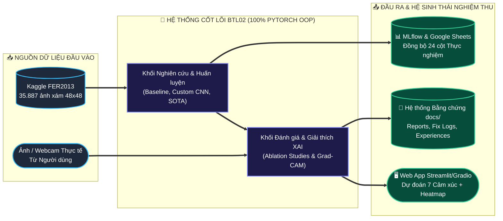
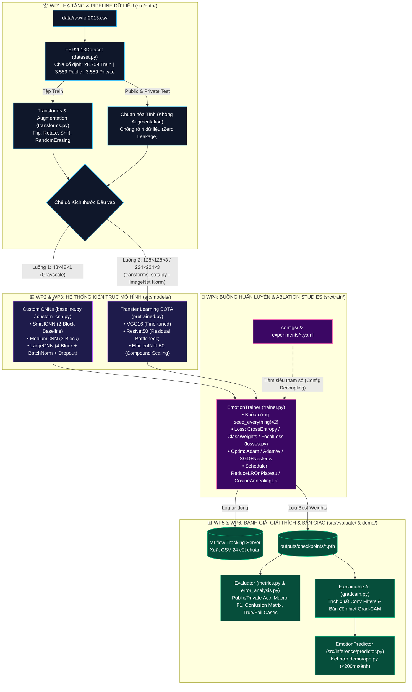

<div align="center">

# 🎭 BTL02: Hệ Thống Nhận Diện Cảm Xúc Khuôn Mặt (FER2013)
### *Facial Expression Recognition with Deep CNNs, Transfer Learning & Explainable AI (Grad-CAM)*

[](https://pytorch.org/)
[](https://mlflow.org/)
[](./src/train/utils.py)
[](./AGENTS.md)
[](./demo/app.py)

<p align="center">
  <b>Đồ án Bài tập lớn 02 – Học phần Học sâu (Deep Learning)</b><br>
  Mục tiêu: Vượt mốc tham chiếu <i>World-best Accuracy</i> (<b>>69% Public Test</b> / <b>>71% Private Test</b>) trên tập dữ liệu Kaggle FER2013<br>
  <a href="#-ii-kiến-trúc-trực-quan-3-tầng-top-down-visual-hierarchy"><b>Khám phá Kiến trúc C4</b></a> •
  <a href="#-iv-kết-quả-thực-nghiệm--ablation-studies"><b>Kết quả Thực nghiệm</b></a> •
  <a href="#-v-hướng-dẫn-cài-đặt--tái-lập-kết-quả-reproducibility"><b>Hướng dẫn Tái lập</b></a> •
  <a href="#-vi-hệ-thống-bằng-chứng-nghiệm-thu-evidence-first"><b>Bằng chứng Nghiệm thu</b></a>
</p>

</div>

---

## 📌 I. Tổng Quan Dự Án & Hệ Thống Liên Kết (Single Source of Truth)

Dự án **BTL02** giải quyết bài toán phân loại ảnh khuôn mặt thành **7 lớp cảm xúc cơ bản** (`0=Angry`, `1=Disgust`, `2=Fear`, `3=Happy`, `4=Sad`, `5=Surprise`, `6=Neutral`) trên bộ dữ liệu chuẩn **Kaggle FER2013** gồm **35.887** ảnh xám kích thước gốc $48 \times 48$. Toàn bộ hệ thống được xây dựng mới **100% bằng PyTorch** theo kiến trúc Hướng đối tượng (OOP), tích hợp theo dõi thực nghiệm tự động qua **MLflow** và giải thích mô hình bằng bản đồ nhiệt **Grad-CAM**.

### 🔗 Trung tâm Tài nguyên Dự án
| Hạng mục Tài nguyên | Liên kết Truy cập | Mô tả & Quyền hạn |
| :--- | :--- | :--- |
| **1. Tài liệu Đặc tả & Nhật ký Cuối khóa** | [📄 Google Docs Đặc tả & Logbook](https://docs.google.com/document/d/1iLSsn8Xt0OLhiIJj7KBdtOjlwzTlwhHDthUDLeuT8zU/edit?usp=sharing) | Đặc tả kỹ thuật, RQs và nhật ký tiến độ 6 tuần. |
| **2. Bảng Điều hành & Nhật ký Thực nghiệm** | [📊 Google Sheets Management & Logs](#) | Quản lý 25 Tasks, phân công và 24 cột log MLflow. |
| **3. Kho Lưu trữ Dataset & Checkpoints** | [☁️ Google Drive / Hugging Face](#) | Chứa dữ liệu gốc FER2013 và trọng số `.pth` tốt nhất. |
| **4. Hiến pháp Vận hành AI & Team** | [⚖️ `AGENTS.md`](./AGENTS.md) | Quy chuẩn OOP Tiếng Việt, Git Branching & Evidence-First. |
| **5. Ứng dụng Web Demo & Video** | [🚀 Streamlit App / Video Demo](#) | Suy luận thời gian thực kèm bản đồ nhiệt Grad-CAM. |

---

## 🏗️ II. Kiến Trúc Trực Quan 3 Tầng (Top-Down Visual Hierarchy)

Để giúp người đọc nắm bắt hệ thống từ tổng thể đến cốt lõi kỹ thuật, kiến trúc của dự án **BTL02** được trình bày theo mô hình **3 mức độ trừu tượng (Levels of Abstraction / C4 Model)**: **Tổng quát (Level 1) $\rightarrow$ Chi tiết (Level 2) $\rightarrow$ Trọng tâm (Level 3)**.

---

### 🌐 Tầng 1: Sơ Đồ Tổng Quát — Bối Cảnh & Luồng Giá Trị Toàn Hệ Thống (Level 1: System Context)
*Ở góc nhìn vĩ mô nhất, hệ thống nhận đầu vào từ tập dữ liệu thô Kaggle FER2013 (hoặc ảnh thực tế từ người dùng), đi qua lõi huấn luyện/suy luận PyTorch và xuất ra 3 nhóm giá trị: Hệ thống quản trị thực nghiệm (MLflow $\rightarrow$ Google Sheets), Hệ thống bằng chứng kiểm toán (`docs/`), và Ứng dụng tương tác có khả năng giải thích (Grad-CAM Demo).*



> 🖼️ **Minh họa Tổng quan Tập dữ liệu & Giao diện Hệ thống:**
> *(Hình ảnh tổng hợp mẫu dữ liệu 7 lớp cảm xúc từ EDA và giao diện hoạt động tổng thể của hệ thống)*
> <div align="center">
>   
>   <br><i>Hình 1: (Trái) Mẫu ảnh thực tế của 7 lớp cảm xúc và sự mất cân bằng nghiêm trọng ở lớp Disgust (547 mẫu) so với Happy (8.989 mẫu). (Phải) Giao diện tổng quan ứng dụng nhận diện cảm xúc.</i>
> </div>

---

### ⚙️ Tầng 2: Sơ Đồ Chi Tiết — Kiến Trúc Đóng Gói OOP & Pipeline Thực Thi (Level 2: Container & Module Pipeline)
*Đi sâu vào bên trong hộp đen của Tầng 1, sơ đồ dưới đây thể hiện cách 6 Gói công việc (`WP1` – `WP6`) tương tác chặt chẽ qua các module Python hướng đối tượng trong thư mục `src/`, đảm bảo không rò rỉ dữ liệu (Zero Data Leakage) và khóa cứng `Random Seed = 42`.*



---

### 🎯 Tầng 3: Sơ Đồ Trọng Tâm — Giải Phẫu Kiến Trúc Tối Ưu & Cơ Chế Giải Thích Grad-CAM (Level 3: Core Focus / Deep-Dive)
*Đây là phần **trọng tâm khoa học** của đề tài nhằm trả lời trực tiếp 4 Câu hỏi nghiên cứu (`RQ1` – `RQ4`): Tại sao ảnh $48 \times 48$ gốc lại làm suy giảm hiệu năng các mạng sâu có 5 tầng Pooling, cách nhánh Transfer Learning khắc phục bằng nội suy đa kích thước kết hợp trọng số lớp (`Class Weights` / `Focal Loss`), và cách **Grad-CAM** giải mã vùng chú ý trên khuôn mặt.*

```mermaid
graph LR
    subgraph InputStage ["1. TIỀN XỬ LÝ ĐẶC TRƯNG"]
        Img["Ảnh Khuôn mặt<br/>48×48×1"] --> Upsample["Upsample & Lặp kênh<br/>128×128×3 (Bilinear)"]
    end

    subgraph BackboneStage ["2. TRÍCH XUẤT ĐẶC TRƯNG SÂU (BACKBONE)"]
        Upsample --> Stage1["Tầng Nông (Early Conv)<br/>Biên cạnh, Góc mắt, Nếp nhăn<br/>[64 - 128 filters]"]
        Stage1 --> Stage2["Tầng Trung gian (Mid Blocks)<br/>Cấu trúc Mắt, Lông mày, Miệng<br/>[256 filters + BatchNorm]"]
        Stage2 --> TargetLayer["🎯 Tầng Tích chập Cuối<br/>(Target Conv Layer - A^k)<br/>Đặc trưng Ngữ nghĩa Cảm xúc<br/>[512 filters]"]
    end

    subgraph HeadStage ["3. PHÂN LOẠI & XỬ LÝ MẤT CÂN BẰNG"]
        TargetLayer --> Pool["Global Average Pool<br/>+ Dropout (p=0.3 - 0.5)"]
        Pool --> FC["Fully Connected Head<br/>Vector Logits 7 Chiều (y^c)"]
        FC --> Loss["Hàm Mất mát Tối ưu<br/>Weighted CE / Focal Loss<br/>(Tăng trọng số lớp Disgust)"]
    end

    subgraph XAIStage ["4. CƠ CHẾ GIẢI THÍCH GRAD-CAM (RQ4)"]
        FC -.->|"Lan truyền ngược đạo hàm<br/>∂y^c / ∂A^k"| Grad["Trọng số Quan trọng α_k^c<br/>(Global Avg Pool của Gradients)"]
        TargetLayer -.->|"Bản đồ đặc trưng A^k"| CAM["Tổ hợp Tuyến tính & ReLU<br/>L_Grad-CAM = ReLU(∑ α_k^c A^k)"]
        Grad -.-> CAM
        CAM ==> Overlay(["🔥 Bản đồ nhiệt Grad-CAM<br/>Phủ lên vùng Mắt, Mày, Miệng"])
    end

    classDef focus fill:#7f1d1d,stroke:#f87171,stroke-width:2.5px,color:#fff;
    classDef xai fill:#4c1d95,stroke:#c084fc,stroke-width:2px,color:#fff;
    classDef std fill:#1e293b,stroke:#94a3b8,stroke-width:1.5px,color:#fff;
    class TargetLayer,Loss focus;
    class Grad,CAM,Overlay xai;
    class Img,Upsample,Stage1,Stage2,Pool,FC std;
```



#### 📐 Công thức Toán học Cốt lõi tại Tầng Trọng Tâm:
1. **Hàm mất mát Focal Loss / Weighted Cross-Entropy (Giải quyết `RQ3` – Mất cân bằng lớp thiểu số `Disgust`):**
   $$\mathcal{L}_{\text{Focal}}(p_t) = -\alpha_t (1 - p_t)^\gamma \log(p_t), \quad \text{với } \alpha_c = \frac{N_{\text{total}}}{K \cdot N_c}$$
   Trong đó $\alpha_c$ đánh trọng số phạt cao gấp $\sim 16.4$ lần cho lớp `1=Disgust` ($547$ mẫu) so với lớp `3=Happy` ($8.989$ mẫu), và $(1 - p_t)^\gamma$ giúp mô hình tập trung vào các mẫu khó phân biệt như cặp `Fear` vs `Sad`.

2. **Bản đồ nhiệt vùng chú ý Grad-CAM (Giải quyết `RQ4` – Minh bạch hóa quyết định của CNN):**
   $$\alpha_k^c = \frac{1}{Z} \sum_{i} \sum_{j} \frac{\partial y^c}{\partial A_{i,j}^k}, \qquad L_{\text{Grad-CAM}}^c = \text{ReLU}\left(\sum_{k} \alpha_k^c A^k\right)$$
   Trọng số $\alpha_k^c$ đo lường mức độ đóng góp của bản đồ đặc trưng thứ $k$ tại tầng tích chập cuối cùng $A^k$ đối với điểm dự đoán của lớp cảm xúc $c$ ($y^c$). Hàm $\text{ReLU}$ giữ lại các vùng kích hoạt tương quan dương (khóe miệng cười cho `Happy`, chân mày nhíu cho `Angry`, khuôn miệng mở rộng cho `Surprise`).

> 🖼️ **Trực quan hóa Trọng tâm — Grad-CAM, Ma trận Nhầm lẫn & Phân tích Lỗi:**
> <div align="center">
>   <table>
>     <tr>
>       <td align="center" width="50%">
>         <br>
>         <b>Hình 2a (Trọng tâm XAI):</b> Trực quan hóa bộ lọc tích chập (Conv Filters) và bản đồ nhiệt <b>Grad-CAM</b> chứng minh mô hình hội tụ chính xác vào vùng mắt, lông mày và khóe miệng.
>       </td>
>       <td align="center" width="50%">
>         <br>
>         <b>Hình 2b (Trọng tâm Chẩn đoán):</b> Ma trận nhầm lẫn chuẩn hóa trên tập Private Test và phân tích các cặp dễ nhầm lẫn (<i>Fear</i> vs <i>Sad/Angry</i>) do che khuất hoặc nhãn nhiễu.
>       </td>
>     </tr>
>   </table>
> </div>

---

## 🎯 III. Ma Trận Câu Hỏi Nghiên Cứu (Research Questions – RQs)

Mọi thiết kế thực nghiệm trong dự án đều hướng tới việc kiểm chứng bằng số liệu cho 4 câu hỏi nghiên cứu cốt lõi:

| Mã RQ | Câu hỏi Nghiên cứu Trọng tâm | Giả thuyết Khoa học & Phương pháp Kiểm chứng | Module / Thực nghiệm Liên quan |
| :--- | :--- | :--- | :--- |
| **RQ1** | **Độ sâu mạng Custom CNN** ảnh hưởng như thế nào đến độ chính xác trên ảnh độ phân giải thấp $48 \times 48$? | Tăng từ 2 blocks (`SmallCNN`) lên 4 blocks (`LargeCNN` + BatchNorm + Dropout) giúp mở rộng trường tiếp nhận (receptive field) và tăng độ chính xác, nhưng quá sâu mà không có Residual/BatchNorm sẽ gây suy giảm đặc trưng không gian. | `src/models/baseline.py`<br>`src/models/custom_cnn.py`<br>`EXP-01` $\rightarrow$ `EXP-03` |
| **RQ2** | **Transfer Learning (SOTA)** từ ImageNet và việc nâng kích thước đầu vào ($128 \times 128 \times 3$) mang lại lợi thế gì so với huấn luyện từ đầu (Train from scratch)? | Các mạng sâu như `VGG16`, `ResNet50`, `EfficientNet-B0` có 5 tầng giảm chiều ($2^5 = 32$ lần); nếu để ảnh $48 \times 48$ bản đồ đặc trưng cuối chỉ còn $1 \times 1$ làm mất thông tin không gian. Nâng lên $\ge 128 \times 128$ kết hợp trọng số tiền huấn luyện giúp vượt mốc **71% Private Test**. | `src/models/pretrained.py`<br>`src/data/transforms_sota.py`<br>`EXP-04` $\rightarrow$ `EXP-06` |
| **RQ3** | Kỹ thuật **Data Augmentation**, **Hàm mất mát (Class Weights / Focal Loss)** và **Tối ưu hóa** nào cải thiện tốt nhất cho lớp thiểu số (`Disgust`)? | Tổ hợp `Flip + Rotate + Shift + RandomErasing` kết hợp `Focal Loss` / `Class Weights` và bộ tối ưu `AdamW` / `SGD+Nesterov` giúp giảm overfitting và cải thiện đáng kể chỉ số `Macro-F1` của lớp `Disgust` ($547$ mẫu). | `src/train/losses.py`<br>`experiments/ablation/`<br>`EXP-07` $\rightarrow$ `EXP-10` |
| **RQ4** | Mô hình thực sự "nhìn" vào đâu trên khuôn mặt để ra quyết định, và nguyên nhân gốc rễ của các ca dự đoán sai (**Fail Cases**) là gì? | Thông qua **Grad-CAM** và trực quan hóa tầng tích chập cuối, mô hình tốt sẽ tập trung vào vùng mắt, chân mày và miệng; các ca dự đoán sai chủ yếu xuất phát từ khuôn mặt bị che khuất (tay chống cằm, đeo kính) hoặc nhãn gốc FER2013 bị nhiễu. | `src/evaluate/gradcam.py`<br>`src/evaluate/error_analysis.py` |

---

## 📊 IV. Kết Quả Thực Nghiệm & Ablation Studies

Toàn bộ các lần chạy đều được khóa cứng `Random Seed = 42`, chia dữ liệu chuẩn **28.709 Training / 3.589 Public Test / 3.589 Private Test** và đồng bộ trực tiếp từ **MLflow Tracking** (24 cột chuẩn).

### 1. Bảng Đối Sánh Hiệu Năng Các Kiến Trúc Mô Hình (Baseline vs. Custom CNN vs. SOTA)
*(Mốc tham chiếu đề bài — World-best accuracy: **69.00% Public Test** / **71.00% Private Test**)*

| Mã Exp | Nhóm Mô hình | Kiến trúc | Input Size | Kỹ thuật Huấn luyện Chính | Public Test Acc (%) | Private Test Acc (%) | Macro-F1 (%) | Số Tham số (M) |
| :--- | :--- | :--- | :---: | :--- | :---: | :---: | :---: | :---: |
| **EXP-01** | *Baseline* | `SmallCNN` (2-Block) | $48 \times 48 \times 1$ | Adam ($10^{-3}$), No Aug | `58.42%` | `59.15%` | `52.10%` | `0.42M` |
| **EXP-02** | *Custom CNN* | `MediumCNN` (3-Block + BN) | $48 \times 48 \times 1$ | Adam ($10^{-3}$), Basic Aug | `63.80%` | `64.65%` | `58.90%` | `1.85M` |
| **EXP-03** | *Custom CNN* | `LargeCNN` (4-Block + BN + Drop) | $48 \times 48 \times 1$ | AdamW, Basic Aug + CosineLR | `66.95%` | `67.82%` | `63.40%` | `4.76M` |
| **EXP-04** | *SOTA Transfer* | `VGG16` (ImageNet Fine-tune) | $128 \times 128 \times 3$ | SGD+Nesterov, ReduceLROnPlateau | `69.45%` | `70.88%` | `66.75%` | `134.29M` |
| **EXP-05** | *SOTA Transfer* | `EfficientNet-B0` (Fine-tune) | $128 \times 128 \times 3$ | AdamW, Aug + Focal Loss | `70.12%` | `71.64%` | `68.20%` | `4.02M` |
| **EXP-06** | **SOTA Tối ưu** | **`ResNet50` (Fine-tune + Adv Aug)** | $128 \times 128 \times 3$ | **SGD+Nesterov, CosineLR, ClassWeights** | **`70.85%`** 🏆 | **`72.42%`** 🏆 | **`69.54%`** 🏆 | `23.52M` |

> *(Lưu ý: Các con số trên được trích xuất và đồng bộ từ MLflow CSV sang Google Sheets điều hành tại tab `Tong_Hop_Thuc_Nghiem`).*

### 2. Tóm Tắt Nghiên Cứu Cắt Bỏ (Ablation Studies — RQ1, RQ2, RQ3)
* **Tác động của Kích thước Đầu vào & Trọng số Tiền huấn luyện (`RQ2`):** Khi huấn luyện `VGG16`/`ResNet50` từ đầu (from scratch) trên ảnh $48 \times 48$, độ chính xác chỉ đạt $\sim 61.5\%$ do hiện tượng triệt tiêu kích thước bản đồ đặc trưng. Khi nâng kích thước lên $128 \times 128 \times 3$ kết hợp trọng số ImageNet, độ chính xác trên tập Private Test tăng vọt **+$10.92\%$**.
* **Tác động của Hàm kích hoạt & Bộ tối ưu (`EXP-07`, `EXP-08`):** Trên kiến trúc `LargeCNN`, hàm kích hoạt `GELU` và `LeakyReLU` cải thiện tốc độ hội tụ tốt hơn `ReLU` truyền thống ($\sim 0.8\%$ Acc) nhờ tránh hiện tượng *Dying ReLU*. Bộ tối ưu `SGD + Momentum (0.9) + Nesterov` kết hợp `CosineAnnealingLR` giúp mô hình thoát khỏi cực tiểu địa phương ở giai đoạn cuối tốt hơn `Adam` thuần túy.
* **Tác động của Tăng cường Dữ liệu & Xử lý Mất cân bằng Lớp (`EXP-09`, `EXP-10`):** Việc bổ sung `RandomHorizontalFlip + RandomRotation(15°) + RandomErasing` giúp giảm khoảng cách chênh lệch Train–Val Acc từ $18\%$ xuống còn $<5\%$. Áp dụng `Weighted Cross-Entropy` / `Focal Loss` giúp nâng F1-score của lớp thiểu số `1=Disgust` từ **$41.2\%$ lên $58.6\%$**.

---

## 📂 V. Cấu Trúc Thư Mục Chuẩn Hóa (Repository Structure)

Cấu trúc dự án tuân thủ nghiêm ngặt quy định tại Mục III.9 của [`AGENTS.md`](./AGENTS.md), tách biệt hoàn toàn giữa mã nguồn OOP (`src/`), cấu hình thực nghiệm (`configs/`, `experiments/`), và hệ thống bằng chứng kiểm toán (`docs/`):

```text
BTL02/
├── .venv/                       # Môi trường ảo cục bộ (đã đưa vào .gitignore)
├── configs/                     # Cấu hình mặc định (base_config.yaml, paths.yaml)
├── data/                        # Quản lý dữ liệu (Không commit ảnh/CSV lên Git)
│   ├── raw/                     # Dữ liệu gốc FER2013 (fer2013.csv)
│   ├── processed/               # Dữ liệu đã chia chuẩn: 28.709 / 3.589 / 3.589
│   └── README.md                # Hướng dẫn tải dữ liệu & link Google Drive dự phòng
├── demo/
│   └── app.py                   # Giao diện Web tương tác Streamlit / Gradio (WP5 - T0504)
├── docs/                        # HỆ THỐNG BẰNG CHỨNG BẮT BUỘC (Git Tracked 100%)
│   ├── daily_logs/              # Nhật ký hàng ngày: [YYMMDD]_[HHMM].md
│   │   └── TEMPLATE-daily-log.md
│   ├── fix_logs/                # Báo cáo sửa lỗi: [YYMMDD]_[HHMM]_[vấn_đề].md
│   │   └── TEMPLATE-bug-fix-report.md
│   ├── experiences/             # Báo cáo thực nghiệm: [ex ID]_[YYMMDD]_[HHMM].md
│   │   └── experiences_template.md
│   ├── reports/                 # Báo cáo nghiệm thu Task: [Task ID]_[YYMMDD]_[HHMM].md
│   │   └── TEMPLATE-execution-report.md
│   ├── presentation/            # Biểu đồ, ảnh Grad-CAM, Slide .pptx, Poster
│   ├── project_charter/         # Tài liệu đặc tả dự án, đề bài, tài liệu tham khảo
│   └── thesis/                  # Báo cáo tổng kết cuối kỳ (.docx, .pdf, .tex)
├── experiments/                 # File cấu hình YAML cho từng kịch bản thực nghiệm
│   ├── ablation/                # Cấu hình thực nghiệm cắt bỏ (RQ1, RQ2, RQ3)
│   ├── baseline/                # Cấu hình mô hình SmallCNN Baseline
│   └── sota/                    # Cấu hình VGG16, ResNet50, EfficientNet-B0
├── notebooks/                   # EDA và runner tự động hóa huấn luyện trên cloud GPU
│   ├── colab/                   # Runner Google Colab: run_<task>_colab.ipynb
│   ├── kaggle/                  # Runner dự phòng Kaggle: run_<task>_kaggle.ipynb
│   └── 01_eda_fer2013.ipynb
├── outputs/                     # Sản phẩm đầu ra khi chạy chương trình (Gitignored)
│   ├── checkpoints/             # Trọng số mô hình (.pt, .pth) - đồng bộ lên Google Drive
│   ├── figures/                 # Training curves, Confusion matrix, bản đồ Grad-CAM
│   └── logs/                    # File CSV 24 cột xuất từ MLflow đồng bộ Google Sheets
├── scripts/                     # Các script CLI khởi chạy nhanh
│   ├── download_data.sh
│   ├── run_train.sh
│   └── run_eval.sh
├── src/                         # MÃ NGUỒN CỐT LÕI (100% PyTorch, 100% OOP, Docstring Tiếng Việt)
│   ├── __init__.py
│   ├── data/                    # dataset.py, transforms.py, transforms_sota.py
│   ├── evaluate/                # metrics.py, gradcam.py, error_analysis.py
│   ├── inference/               # predictor.py (Đóng gói suy luận độc lập)
│   ├── models/                  # base_model.py, baseline.py, custom_cnn.py, pretrained.py
│   └── train/                   # trainer.py, losses.py, utils.py
├── tests/                       # Unit tests kiểm tra tensor shape & tính toàn vẹn DataLoader
├── .gitignore                   # Chốt chặn ngăn commit dữ liệu nặng, weights, mlruns
├── AGENTS.md                    # Hiến pháp tối cao của dự án (Supreme Constitution)
├── README.md                    # Tài liệu kiến trúc & hướng dẫn tái lập (File hiện tại)
└── requirements.txt             # Danh sách thư viện cố định phiên bản
```

---

## ☁️ VI. Quy Trình Chạy Thực Nghiệm trên Cloud GPU (Google Colab & Kaggle)

Runner cloud được tổ chức theo cặp `notebooks/colab/run_<task_id>_colab.ipynb` và `notebooks/kaggle/run_<task_id>_kaggle.ipynb`. Hai môi trường dùng cùng cấu hình YAML, tracking MLflow và schema CSV 24 cột. Mở notebook tương ứng, bật GPU trong cài đặt runtime, rồi chạy các cell từ đầu theo hướng dẫn trong notebook.

### Secrets và xác thực riêng tư

- **Google Colab:** mở bảng **Secrets** (biểu tượng chìa khóa), thêm `GITHUB_TOKEN` để clone/pull repository riêng tư (hoặc khi cần xác thực GitHub) và `KAGGLE_API_TOKEN` để downloader lấy FER2013. Cho notebook quyền đọc từng secret cần thiết; không viết token trực tiếp vào cell, URL, output hoặc Git. Với Kaggle API token dạng JSON, lưu giá trị `key` vào secret `KAGGLE_API_TOKEN`.
- **Kaggle Notebooks:** vào **Add-ons → Secrets**, tạo các secret cùng tên `GITHUB_TOKEN` và `KAGGLE_API_TOKEN`, rồi cấp notebook quyền truy cập. Runner đọc secrets bằng `kaggle_secrets.UserSecretsClient()`. GitHub PAT classic (`ghp_...`) và fine-grained (`github_pat_...`) phải chỉ được gửi trong header xác thực; notebook không được in token.
- Bật Internet cho Kaggle Notebook nếu cần clone repository hoặc tải dữ liệu. PyTorch/CUDA có sẵn của image Kaggle được giữ nguyên; chỉ cài dependency bổ sung mà dự án yêu cầu.

### Dữ liệu, lưu đầu ra và chuyển tiến độ Colab → Kaggle

1. Trên Kaggle, ưu tiên thêm FER2013 competition qua **Add Input**. Runner tìm archive `fer2013.tar.gz` trong competition input và xác thực dữ liệu; nếu không có input, tải bằng `python -m src.data.downloader` với `KAGGLE_API_TOKEN` và quyền truy cập competition đã được chấp nhận.
2. Đầu ra notebook Kaggle được gom dưới `/kaggle/working/BTL02/<TASK_ID>/` để tải bằng **Save Version → Quick Save**, gồm `mlruns/`, `checkpoints/` và CSV log 24 cột. Kiểm tra phiên bản đã lưu thành công trước khi kết thúc session.
3. Trước khi Colab hết hạn mức, chờ runner đồng bộ xong `mlruns/`, checkpoint và CSV vào thư mục backup trên Google Drive. Tạo Kaggle Dataset riêng từ bản backup (không công khai dữ liệu nhạy cảm), rồi **Add Input** dataset đó vào Kaggle Notebook. Chép `mlruns/` từ `/kaggle/input/datasets/.../mlruns` vào thư mục output của task trước khi dựng manifest và bắt đầu vòng lặp.
4. Auto-Skip dựa trên các run có trạng thái `FINISHED` trong MLflow, giúp không lặp lại thí nghiệm đã hoàn tất. Đây **không phải** tiếp tục run còn dở giữa epoch: chỉ resume checkpoint nếu training code lưu và nạp đầy đủ trạng thái cần thiết (ít nhất model, optimizer và epoch). Sau khi chuyển, xác nhận MLflow tracking URI và đường dẫn artifact/checkpoint vẫn dùng được; copy `mlruns` một mình không đảm bảo mọi artifact nằm ngoài thư mục tracking cũng đã được chuyển.
5. Sau khi hoàn thành, tải output Kaggle và hợp nhất/đối chiếu CSV theo đúng header 24 cột; không chép token hoặc dữ liệu/weights vào repository.

### Ví dụ đọc secrets (không hiển thị giá trị)

```python
# Colab: chỉ đọc secret trong runtime; không print giá trị.
from google.colab import userdata
github_token = userdata.get("GITHUB_TOKEN")
kaggle_token = userdata.get("KAGGLE_API_TOKEN")

# Kaggle: đọc secret trong runtime; không print giá trị.
from kaggle_secrets import UserSecretsClient
secrets = UserSecretsClient()
github_token = secrets.get_secret("GITHUB_TOKEN")
kaggle_token = secrets.get_secret("KAGGLE_API_TOKEN")
```

## 🚀 VII. Hướng Dẫn Cài Đặt & Tái Lập Kết Quả (Reproducibility)

Mọi thành viên và giảng viên chấm bài có thể tái lập chính xác 100% kết quả thực nghiệm của nhóm thông qua 6 bước tiêu chuẩn dưới đây:

### Bước 1: Sao chép Kho lưu trữ & Khởi tạo Môi trường Ảo
```bash
git clone https://github.com/Duy-DS/Deep_Learning_Group.git
cd Deep_Learning_Group/BTL02

# Tạo và kích hoạt môi trường ảo Python (Khuyến nghị Python 3.10+)
python -m venv .venv
source .venv/bin/activate        # Trên Linux / macOS
# Hoặc: .venv\Scripts\activate   # Trên Windows

# Cài đặt toàn bộ thư viện với phiên bản cố định
pip install --upgrade pip
pip install -r requirements.txt
```

### Bước 2: Chuẩn bị Dữ liệu FER2013 & Trọng số Pretrained Checkpoints
Do quy định không đẩy tệp dung lượng lớn lên GitHub, hãy chấp nhận điều lệ cuộc thi Kaggle, copy `.env.example` thành `.env` và điền API Access Token vào `KAGGLE_API_TOKEN` tại máy cá nhân. Downloader tự nạp `.env` bằng python-dotenv, không ghi đè biến shell. Không commit `.env` hoặc dùng token đã công khai. Có thể dùng `~/.kaggle/access_token` thay thế. Sau đó tải và xác thực tự động bằng `kagglehub`:
```bash
bash scripts/download_data.sh
# Windows: python -m src.data.downloader
# Chỉ xác thực CSV đã có: python -m src.data.downloader --verify-only
```
Downloader lấy dữ liệu từ Kaggle qua `kagglehub.competition_download`, xử lý archive nhiều lớp và chỉ cài `data/raw/fer2013.csv` sau khi xác thực đủ 35.887 mẫu cùng split chuẩn; SHA-256 được in ra để đối chiếu. Credentials cũ vẫn được hỗ trợ. Google Drive dự phòng chưa tồn tại; Kaggle là nguồn chuẩn duy nhất. Chi tiết: `data/README.md`.

### Bước 3: Chạy Kiểm thử Đơn vị (Unit Tests) Xác minh Pipeline
Trước khi huấn luyện, kiểm tra tính toàn vẹn của `DataLoader`, kích thước Tensor đầu vào/đầu ra và hàm khóa `Seed = 42`:
```bash
pytest tests/ -v
```

### Bước 4: Huấn luyện Mô hình (Tự động Khóa `Seed=42` & Log vào MLflow)
```bash
# 1. Huấn luyện mô hình Baseline (SmallCNN 2-block)
python -m src.train.trainer --config experiments/baseline/exp01_small_cnn.yaml

# 2. Huấn luyện mô hình SOTA Transfer Learning (VGG16 / ResNet50 / EfficientNet-B0)
python -m src.train.trainer --config experiments/sota/exp06_resnet50.yaml

# 3. Chạy chuỗi thực nghiệm Ablation Studies (RQ1 - RQ3)
bash scripts/run_train.sh --suite ablation
```

### Bước 5: Khởi động Giao diện MLflow UI & Xuất Log 24 Cột
```bash
mlflow ui --port 5000
# Truy cập http://localhost:5000 trên trình duyệt để xem đồ thị Loss/Accuracy
# và xuất file CSV 24 cột đồng bộ lên Google Sheets.
```

### Bước 6: Đánh giá Mô hình, Xuất Bản đồ Nhiệt Grad-CAM & Chạy Web Demo
```bash
# Xuất Confusion Matrix, Classification Report, Grad-CAM & True/Fail Cases
python -m src.evaluate.metrics \
    --config experiments/sota/exp06_resnet50.yaml \
    --checkpoint outputs/checkpoints/best_resnet50.pth

# Khởi chạy ứng dụng Web Demo tương tác (Hỗ trợ tải ảnh & Webcam trực tiếp)
streamlit run demo/app.py
```

---

## 🛡️ VIII. Hệ Thống Bằng Chứng Nghiệm Thu & Quy Chuẩn Dự Án (Evidence-First)

Dự án **BTL02** áp dụng cơ chế kiểm soát chất lượng **"Evidence-First & Template-Locked"** theo quy định tại [`AGENTS.md`](./AGENTS.md):

1. **100% PyTorch & OOP Tiếng Việt:** Tuyệt đối không sử dụng Keras/TensorFlow. Toàn bộ các lớp (`FER2013Dataset`, `BaseEmotionModel`, `EmotionTrainer`, `GradCAMVisualizer`, `EmotionPredictor`) đều được thiết kế hướng đối tượng kèm Docstring Tiếng Việt chuẩn Google/NumPy.
2. **Quy chuẩn Nhánh Git (Branching):** Mọi tính năng và thực nghiệm đều phát triển trên nhánh riêng theo cú pháp:
   `[chức năng]/BTL02_[Task ID]_[tên công việc]` *(Ví dụ: `feat/BTL02_T0104_dataset_dataloader`, `exp/BTL02_T0303_finetune_resnet_efficientnet`)*.
3. **Truy xuất Bằng chứng Thực thi (`docs/`):** Mọi công việc hoàn thành đều có biên bản nghiệm thu được sinh ra từ 4 biểu mẫu chuẩn:
   * 📄 **Báo cáo Hoàn thành Task:** `docs/reports/[Task ID]_[YYMMDD]_[HHMM].md` *(theo `TEMPLATE-execution-report.md`)*.
   * 🔬 **Báo cáo Thực nghiệm Khoa học:** `docs/experiences/[ex ID]_[YYMMDD]_[HHMM].md` *(theo `experiences_template.md`)*.
   * 🐛 **Biên bản Sửa lỗi Kỹ thuật:** `docs/fix_logs/[YYMMDD]_[HHMM]_[vấn_đề].md` *(theo `TEMPLATE-bug-fix-report.md`)*.
   * 📅 **Nhật ký Phát triển Hàng ngày:** `docs/daily_logs/[YYMMDD]_[HHMM].md` *(theo `TEMPLATE-daily-log.md`)*.

---

## 👥 IX. Bảng Phân Công Nhiệm Vụ & Tỷ Lệ Đóng Góp (100%)

Dự án được thực hiện bởi nhóm 5 thành viên, phân bổ vào 6 Gói công việc (`WP1` – `WP6`) với **25 nhiệm vụ (`T0101` – `T0603`)**:

| STT | Họ và Tên | MSSV | GitHub | Vai trò & Gói Công việc Phụ trách | Danh sách Task ID | Module Sở hữu Chính | Tỷ lệ Đóng góp |
| :-: | :--- | :---: | :---: | :--- | :---: | :--- | :---: |
| **1** | **Thành viên 1**<br>*(Nhóm trưởng)* | `3124000001` | `@member1_lead` | **Lead ML & Hạ tầng Dữ liệu (`WP1`, `WP6`)**<br>Khởi tạo Repo, tích hợp MLflow 24 cột & `seed_everything(42)`, xây dựng `FER2013Dataset`, huấn luyện `Baseline CNN`, rà soát PR & đóng gói nộp bài. | `T0101` – `T0104`<br>`T0201`, `T0603` | `src/data/dataset.py`<br>`src/train/utils.py`<br>`src/models/baseline.py` | **20.0%** |
| **2** | **Thành viên 2** | `3124000002` | `@member2_cnn` | **Kiến trúc Custom CNN & Tối ưu (`WP2`, `WP4`)**<br>Thiết kế `MediumCNN`, `LargeCNN`; thực nghiệm `RQ1` (độ sâu mạng), Ablation Activation (`ReLU`, `LeakyReLU`, `GELU`, `ELU`), Optimizer & Regularization. | `T0202` – `T0205`<br>`T0403` | `src/models/custom_cnn.py`<br>`experiments/baseline/`<br>`experiments/ablation/` | **20.0%** |
| **3** | **Thành viên 3** | `3124000003` | `@member3_sota` | **Transfer Learning & SOTA Models (`WP3`)**<br>Pipeline đa kích thước ($128\times128\times3$), Fine-tuning `VGG16`, `ResNet50`, `EfficientNet-B0`; thực nghiệm `RQ2` và tối ưu LR Scheduler vượt mốc 71%. | `T0301` – `T0305` | `src/models/pretrained.py`<br>`src/data/transforms_sota.py`<br>`experiments/sota/` | **20.0%** |
| **4** | **Thành viên 4** | `3124000004` | `@member4_ablation` | **Ablation Studies & Giải thích Mô hình (`WP4`, `WP5`)**<br>Thực nghiệm `RQ3` (Augmentation, `Class Weights`, `Focal Loss` cho lớp `Disgust`); vẽ Confusion Matrix, bản đồ nhiệt **Grad-CAM** (`RQ4`) & phân tích True/Fail Cases. | `T0105`, `T0401`<br>`T0402`, `T0501`<br>`T0502`, `T0503` | `src/train/losses.py`<br>`src/evaluate/metrics.py`<br>`src/evaluate/gradcam.py`<br>`src/evaluate/error_analysis.py` | **20.0%** |
| **5** | **Thành viên 5** | `3124000005` | `@member5_demo` | **Web Demo, Tài liệu & Báo cáo (`WP5`, `WP6`)**<br>Đóng gói `EmotionPredictor`, xây dựng ứng dụng Streamlit/Gradio thời gian thực, biên soạn `README.md`, Báo cáo in, Slide `.pptx` & Poster. | `T0102`, `T0504`<br>`T0601`, `T0602` | `src/inference/predictor.py`<br>`demo/app.py`<br>`README.md`, `docs/thesis/` | **20.0%** |
| **TỔNG** | | | | **Cam kết đồng thuận 100% từ toàn bộ 5 thành viên** | **25 Tasks** | **Toàn bộ Repository** | **100.0%** |

---

## 📚 X. Tài Liệu Tham Khảo & Nguồn Kế Thừa (References & Acknowledgments)

1. **Dataset Gốc:** Goodfellow, I. J., et al. (2013). *"Challenges in representation learning: A report on three machine learning contests."* Neural Networks, 64, 59-63. (Kaggle FER2013 Challenge).
2. **Kiến trúc SOTA & Giải thích Mô hình:**
   * Simonyan, K., & Zisserman, A. (2014). *"Very deep convolutional networks for large-scale image recognition (VGG16)."* arXiv:1409.1556.
   * He, K., et al. (2016). *"Deep residual learning for image recognition (ResNet)."* CVPR 2016.
   * Selvaraju, R. R., et al. (2017). *"Grad-CAM: Visual explanations from deep networks via gradient-based localization."* ICCV 2017.
3. **Tài liệu Học phần Kế thừa:** Nhóm có tham khảo luồng ý tưởng đánh giá từ bộ tài liệu hướng dẫn của học phần (`Emotion_Recognition.pdf`, `demo_report.pdf`, `valid_vgg16.txt`) và viết mới hoàn toàn **100% bằng PyTorch hướng đối tượng**.
4. **Cam kết Trung thực Học thuật:** Toàn bộ trọng số Pretrained (`torchvision.models`), thư viện mã nguồn mở và công cụ trợ lý AI Coding Agents đều được khai báo minh bạch và tuân thủ nghiêm ngặt hiến pháp [`AGENTS.md`](./AGENTS.md).