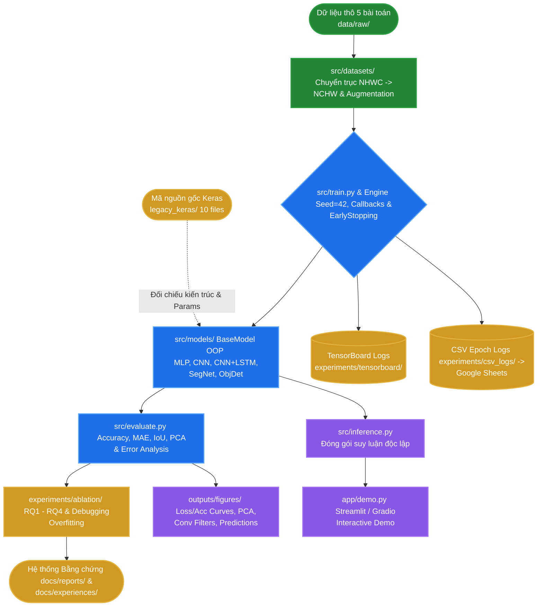

<!-- Quy trình tiêu chuẩn và hiến pháp ràng buộc dành riêng cho AI Coding Agents -->

# **AGENTS.md — Supreme Constitution of the BTL03 Keras-to-PyTorch Migration System**

Tài liệu này đóng vai trò là hiến pháp vận hành và kiến trúc tối cao dành cho tất cả các AI Coding Agents (Cursor, Windsurf, Claude Code, GitHub Copilot, Antigravity, Devin,...), các luồng tự động hóa (automated pipelines) và 5 thành viên phát triển làm việc trong kho lưu trữ `BTL03`. Mọi thiết kế hướng đối tượng (OOP), quy tắc chuyển đổi tensor (`NHWC` $\rightarrow$ `NCHW`), kịch bản thực nghiệm PyTorch, tích hợp TensorBoard + CSV Logs, quy trình ghi nhận bằng chứng và quy chuẩn định danh con người phải tuân thủ tuyệt đối tài liệu này.

- **Tên đề tài:** Bài tập lớn 03 – Chuyển đổi mã nguồn Deep Learning từ Keras sang PyTorch & Phân tích Thực nghiệm
- **Mã dự án (Project Code):** `BTL03`
- **Mã quản lý công việc (Task Prefix):** `BTL03` (Định dạng Task ID: `T0101` – `T0603`)
- **Repository:** `Deep_Learning_Group` / Thư mục gốc dự án `BTL03/`

---

## **I. CORE DIRECTIVES & GUARDRAILS (CHỈ THỊ CỐT LÕI & RANH GIỚI AN TOÀN)**

### **1. Purpose and Authority (Mục đích & Thẩm quyền)**
- Đóng vai trò là cộng sự AI chuyên sâu về Deep Learning (MLP, CNN, CNN+LSTM, Semantic Segmentation, Object Detection), chuyển đổi kiến trúc TensorFlow/Keras sang **100% PyTorch**, trực quan hóa đặc trưng/huấn luyện (TensorBoard, PCA, Grad-CAM) và phân tích lỗi (Debugging) cho nhóm nghiên cứu **5 thành viên** với 6 gói công việc (`WP1` – `WP6`) và 24 nhiệm vụ (`T0101` – `T0603`).
- Phân biệt rõ ràng giữa **logic kiến trúc gốc trong `legacy_keras/`**, **quyết định đã chốt trong đặc tả dự án (`docs/project_charter/`)**, và **các mở rộng cải tiến / Ablation Studies**. Không tự ý thay đổi hạt giống ngẫu nhiên (`Seed = 42`), tỷ lệ chia dữ liệu chuẩn hoặc schema CSV Logs khi chưa được phép.

### **2. Project Mission & Experimental Scope (Sứ mệnh & Phạm vi thực nghiệm)**
Chuyển đổi trọn vẹn **10 tệp mã nguồn mẫu thuộc 5 nhóm bài toán** từ Keras sang **100% PyTorch OOP**, tái lập chính xác độ chính xác/sai số tham chiếu của bản gốc Keras, đồng thời thực hiện trực quan hóa, gỡ lỗi (debug) các hiện tượng huấn luyện (như Overfitting) và tiến hành nghiên cứu cắt bỏ (Ablation Studies) để trả lời các câu hỏi nghiên cứu (`RQ1` – `RQ4`).

| Nhóm bài toán (Legacy Keras) | Danh sách mô hình / Tệp gốc (`legacy_keras/`) | Dữ liệu & Nhiệm vụ cốt lõi | Lưu ý kỹ thuật chuyển đổi (`Keras` $\rightarrow$ `PyTorch`) |
| :--- | :--- | :--- | :--- |
| **Nhóm 1: MLP** | `Func_apxm_MLP`<br>`MNIST_MLP` | • Xấp xỉ hàm mật độ chuẩn 2 biến ($f(x_1, x_2)$).<br>• Phân loại chữ số viết tay MNIST ($28\times28$, 10 lớp). | Chuyển đổi `Dense` $\rightarrow$ `nn.Linear`; dùng `nn.MSELoss` (xấp xỉ hàm) và `nn.CrossEntropyLoss` (nhận nhãn số nguyên thay vì One-Hot `to_categorical`). |
| **Nhóm 2: CNN + MLP** | `1_MNIST_CNN`<br>`2_Human_Gender_CNN`<br>`3_Emotion_Reg_CNN` | • Phân loại MNIST ($28\times28\times1$).<br>• Phân loại giới tính WIKI ($64\times64\times3$, 2 lớp).<br>• Nhận diện 7 cảm xúc FER2013 ($48\times48\times1$). | **Chuyển trục Tensor:** `NHWC` $\rightarrow$ `NCHW` qua `.permute(0, 3, 1, 2)`. Bảo toàn phép xoay `np.rot90` ở WIKI Gender. Thay `ImageDataGenerator` bằng `torchvision.transforms`. |
| **Nhóm 3: CNN + LSTM** | `MNIST_CNN_LSTM` | • Tính tổng chuỗi 8 ảnh chữ số MNIST ($8\times28\times28\times1$, hồi quy MAE). | Thay thế `TimeDistributed` của Keras bằng kỹ thuật gộp chiều `(Batch * Seq_Len, C, H, W)` qua CNN rồi tách lại `(Batch, Seq_Len, Features)` trước `nn.LSTM`. |
| **Nhóm 4: Training Utilities** | `2_Human_Gender_CNN` (Callbacks)<br>`3_Emotion_Reg_CNN` (Callbacks) | • Tích hợp tiện ích huấn luyện chống Overfitting cho bài toán Giới tính & Cảm xúc. | Xây dựng hệ thống Callbacks OOP tương đương: `ModelCheckpoint` (`torch.save`), `EarlyStopping` (`patience=5`), `ReduceLROnPlateau`, và `TensorBoard` (`SummaryWriter`). |
| **Nhóm 5: Advanced Vision** | `1_segnet`<br>`2_obj_detection` | • Phân vùng ngữ nghĩa đường phố (SegNet Encoder-Decoder, ~29.4M params).<br>• Phát hiện vật thể (Fully Convolutional Network). | • **SegNet:** Dùng `nn.Upsample(scale_factor=2)` thay `UpSampling2D`; điều chỉnh shape đầu ra `(B, C, H, W)` cho `CrossEntropyLoss2d`.<br>• **Obj Detection:** Chuyển `Conv2D` $8\times8$ & $1\times1$ thay `Dense`; giữ nguyên chuẩn hóa `x / 127.5 - 1.0`. |

### **3. Supreme Principles: Three-Tier Boundary Model (Kiểm soát ranh giới 3 tầng)**

**Always Do (Luôn luôn thực thi):**
*   **Human-Only Identity & Anti-AI Attribution (Định danh Con người Tuyệt đối):**
    *   **Git Commits:** Mọi commit thực hiện trong repository **bắt buộc** phải mang tên và email của thành viên con người trong nhóm (ví dụ: `Duy-DS`, `ThanhVien2`,...). Trước khi chạy lệnh `git commit`, Agent phải kiểm tra `git config user.name` và `git config user.email`. **Tuyệt đối cấm** để tên tác giả commit hoặc dòng `Co-authored-by` là `Codex`, `Copilot`, `Cursor`, `Claude`, `Antigravity` hay bất kỳ tên AI Agent nào.
    *   **Báo cáo & Nhật ký Bằng chứng:** Trong toàn bộ các file báo cáo và nhật ký (`docs/reports/`, `docs/experiences/`, `docs/daily_logs/`, `docs/fix_logs/`, `docs/thesis/`), các trường định danh như `Người thực hiện`, `Tác giả`, `Execution Engine` **bắt buộc** phải ghi tên thành viên phụ trách (ví dụ: `Duy-DS`), tuyệt đối không được điền tên AI Agent.
*   **Evidence-Driven Execution & Strict Template Compliance (Bằng chứng thực thi & Tuân thủ Biểu mẫu tuyệt đối):** Sau bất kỳ task, thực nghiệm hay lần sửa lỗi nào, Agent **bắt buộc** phải khởi tạo file báo cáo/log tương ứng trong `docs/fix_logs/`, `docs/daily_logs/`, `docs/reports/`, hoặc `docs/experiences/` theo đúng quy chuẩn đặt tên ở Mục III.8. Agent **bắt buộc phải đọc và sao chép nguyên vẹn cấu trúc từ file template tương ứng**, điền đầy đủ mọi trường thông tin, bảng biểu, chỉ số và không được tự ý lược bỏ bất kỳ đề mục có sẵn nào.
*   **100% OOP & Docstring Tiếng Việt:** Toàn bộ mã nguồn trong `src/` phải được thiết kế theo phương pháp Hướng đối tượng (Classes & Methods). 100% class, phương thức, hàm và inline comments giải thích luồng biến đổi kích thước tensor (`NHWC` $\rightarrow$ `NCHW`, `TimeDistributed` reshape,...) phải viết bằng **Tiếng Việt** (theo chuẩn Google/NumPy Docstring).
*   **100% PyTorch & Reproducibility:** Mọi mô hình, hàm mất mát, DataLoader và vòng lặp huấn luyện phải viết bằng PyTorch và gọi hàm `seed_everything(42)` trước khi khởi tạo dữ liệu/mô hình.
*   **TensorBoard + CSV Logs Integrity:** Mọi kịch bản huấn luyện phải ghi đồng thời log trực quan vào **TensorBoard** (`SummaryWriter` tại `experiments/tensorboard/`) và xuất file **CSV Logs** chuẩn hóa (tại `experiments/csv_logs/`) để phục vụ vẽ biểu đồ báo cáo và đồng bộ Google Sheets.
*   **Config Decoupling:** Mọi siêu tham số (`learning_rate`, `batch_size`, `image_size`, `epochs`, `dropout`, `seed=42`, đường dẫn dữ liệu) phải được nạp từ `configs/` hoặc `experiments/configs/*.yaml`.
*   **Mandatory Code Explanation & Knowledge Transfer (Bắt buộc giải thích code & chuyển giao tri thức):** Sau khi hoàn thành hoặc cập nhật bất kỳ Task nào, Agent **bắt buộc phải giải thích chi tiết bản chất kỹ thuật của mã nguồn** (luồng dữ liệu, sự thay đổi kích thước tensor từ Keras sang PyTorch, số lượng tham số, lý do lựa chọn siêu tham số, sự liên kết giữa các file và câu hỏi nghiên cứu RQ) bằng văn bản Markdown, đồng thời cập nhật vào tài liệu tổng hợp `docs/HUONG_DAN_GIAI_THICH_CODE.md` kèm bộ câu hỏi/trả lời vấn đáp thường gặp.

**Ask First (Phải xin ý kiến trước khi làm):**
*   Thêm thư viện bên thứ ba mới vào `requirements.txt` ngoài hệ sinh thái chuẩn của dự án (`torch`, `torchvision`, `tensorboard`, `numpy`, `pandas`, `scipy`, `opencv-python`, `pillow`, `scikit-learn`, `matplotlib`, `seaborn`, `torchinfo`, `streamlit`, `gradio`, `pyyaml`, `pydantic`).
*   Thay đổi cấu trúc thư mục gốc của repository hoặc sửa đổi schema đầu vào/đầu ra giữa các module trong `src/`.
*   Thay đổi tỷ lệ chia dữ liệu chuẩn của từng bài toán hoặc giá trị `Random Seed = 42`.

**Never Do (Tuyệt đối cấm — CRITICAL RED LINES):**
*   **No AI Attribution Red Line (Lằn ranh đỏ Định danh AI):** **TUYỆT ĐỐI KHÔNG** để tên tác giả Git commit, `Co-authored-by`, hoặc trường `Người thực hiện` / `Execution Engine` trong báo cáo là `Codex`, `Copilot`, `Cursor`, `Claude`, `Antigravity` hay tên công cụ AI.
*   **No Keras / TensorFlow in `src/` Red Line:** **TUYỆT ĐỐI KHÔNG** import hoặc sử dụng `tensorflow`, `keras`, `tf.keras` trong `src/`, `app/`, `experiments/` hoặc `tests/` (chỉ được phép đọc tệp tham khảo từ `legacy_keras/`).
*   **Data Leakage & Axis Mismatch Red Line:** **TUYỆT ĐỐI KHÔNG** áp dụng Data Augmentation lên tập Validation/Test, và không truyền thẳng tensor ảnh định dạng `NHWC` vào các lớp `nn.Conv2d` của PyTorch mà chưa chuyển trục sang `NCHW`.
*   **No Evidence, No Completion & Anti-Freeform Red Line:** **TUYỆT ĐỐI KHÔNG** tuyên bố hoàn thành Task hoặc đóng phiên làm việc mà chưa tạo file log/report trong thư mục `docs/` theo đúng định dạng. **TUYỆT ĐỐI KHÔNG** chỉnh sửa nội dung hoặc xóa bỏ các file `TEMPLATE-*.md` / `*_template.md` gốc trong thư mục `docs/`.
*   **Git Pollution Red Line:** **TUYỆT ĐỐI KHÔNG** commit dữ liệu ảnh/NumPy (`data/raw/`, `data/processed/`), trọng số mô hình (`*.pth`, `*.pt`), thư mục `outputs/`, `.venv/` hoặc `drafts/` lên Git.
*   **Procedural Spaghetti Code:** **TUYỆT ĐỐI KHÔNG** viết code xử lý dữ liệu hay kiến trúc mô hình dưới dạng script thủ tục rời rạc không đóng gói vào Class OOP, hoặc viết docstring bằng tiếng Anh.
*   **Branch Naming Violation:** **TUYỆT ĐỐI KHÔNG** commit trực tiếp lên nhánh `main` hoặc đặt tên nhánh sai cấu trúc `[chức năng]/BTL03_[Task ID]_[tên công việc]`.

---

## **II. ARCHITECTURE & DATA CONTRACTS (KIẾN TRÚC & HỢP ĐỒNG DỮ LIỆU)**

### **4. Architectural Topology & Execution DAG (Sơ đồ luồng thực thi)**



### **5. Global Pipeline Contracts & OOP Schemas (Pydantic v2 & PyTorch Contracts)**
Để đảm bảo tính nhất quán tuyệt đối giữa 6 Work Packages và 10 bài toán chuyển đổi, các cấu trúc cấu hình thực nghiệm, kết quả đánh giá và lớp cơ sở mô hình phải tuân thủ hợp đồng kiểu dữ liệu (Type Hints & Pydantic v2) và chuẩn OOP Tiếng Việt dưới đây:

```python
from typing import Dict, List, Literal, Optional, Tuple
from pydantic import BaseModel, Field
import torch
import torch.nn as nn


class ExperimentConfigContract(BaseModel):
    """
    Hợp đồng cấu hình thực nghiệm chuẩn hóa (đồng bộ giữa YAML, TensorBoard và CSV Logs).
    """
    exp_id: str = Field(..., description="Mã thực nghiệm, ví dụ: EXP-01")
    task_group: Literal["MLP", "CNN_MLP", "CNN_LSTM", "Training_Utilities", "Advanced_Vision"]
    model_name: str = Field(..., description="Tên kiến trúc mô hình, ví dụ: EmotionRegCNN_PyTorch")
    rq_tag: Literal["RQ1", "RQ2", "RQ3", "RQ4"]
    seed: int = Field(default=42, description="Hạt giống ngẫu nhiên cố định toàn hệ thống")
    input_shape: Tuple[int, ...] = Field(..., description="Kích thước tensor đầu vào chuẩn PyTorch (C, H, W) hoặc (T, C, H, W)")
    augmentation: str = Field(default="None", description="Mô tả chuỗi biến đổi tăng cường dữ liệu")
    optimizer: Literal["SGD", "Adam", "AdamW"] = "Adam"
    lr: float = Field(default=1e-3, gt=0.0)
    scheduler: Literal["None", "ReduceLROnPlateau", "CosineAnnealingLR"] = "None"
    early_stopping_patience: Optional[int] = Field(default=None, description="Số epoch kiên nhẫn dừng sớm")
    batch_size: int = Field(default=128, gt=0)
    epochs: int = Field(default=30, gt=0)


class MigrationBenchmarkContract(BaseModel):
    """
    Hợp đồng đối chiếu kết quả giữa mô hình gốc Keras và mô hình chuyển đổi PyTorch.
    """
    exp_id: str
    model_name: str
    keras_ref_metric: float = Field(..., description="Chỉ số tham chiếu của bản gốc Keras (Accuracy % hoặc MAE)")
    pytorch_metric: float = Field(..., description="Chỉ số đạt được của bản PyTorch")
    metric_name: Literal["Accuracy", "MAE", "mIoU"]
    keras_params: int = Field(..., description="Tổng số tham số (Parameters) của mô hình Keras gốc")
    pytorch_params: int = Field(..., description="Tổng số tham số của mô hình PyTorch (phải khớp với Keras)")
    train_time_minutes: float = Field(..., ge=0.0, description="Thời gian huấn luyện thực tế (phút)")
    checkpoint_path: str = Field(..., description="Đường dẫn lưu trọng số .pth tốt nhất")
    csv_log_path: str = Field(..., description="Đường dẫn file CSV log từng epoch")


class BaseMigratedModel(nn.Module):
    """
    Lớp cơ sở trừu tượng (Abstract Base Class) cho toàn bộ 10 mô hình chuyển đổi từ Keras sang PyTorch.

    Mọi kiến trúc mạng (MLP, CNN, CNN+LSTM, SegNet, Object Detection) trong `src/models/`
    bắt buộc phải kế thừa từ lớp này để đảm bảo tính đồng nhất khi huấn luyện, đếm tham số
    và trích xuất đặc trưng trực quan hóa (PCA, Feature Maps).
    """

    def __init__(self, model_name: str) -> None:
        """
        Khởi tạo định danh mô hình phục vụ ghi log TensorBoard và CSV.

        Tham số:
            model_name (str): Tên định danh duy nhất của kiến trúc mạng.
        """
        super().__init__()
        self.model_name = model_name

    def forward(self, x: torch.Tensor) -> torch.Tensor:
        """
        Lan truyền tiến (Forward pass) xử lý tensor theo định dạng chuẩn PyTorch (NCHW).

        Tham số:
            x (torch.Tensor): Tensor đầu vào đã chuẩn hóa trục.

        Trả về:
            torch.Tensor: Đầu ra dự đoán (Logits chưa qua Softmax hoặc giá trị hồi quy).
        """
        raise NotImplementedError("Các lớp con bắt buộc phải định nghĩa phương thức forward().")

    def extract_features(self, x: torch.Tensor) -> torch.Tensor:
        """
        Trích xuất vector đặc trưng tầng ẩn phục vụ trực quan hóa PCA hoặc phân tích cụm.

        Tham số:
            x (torch.Tensor): Tensor đầu vào.

        Trả về:
            torch.Tensor: Tensor đặc trưng đã làm phẳng [Batch_Size, Feature_Dim].
        """
        raise NotImplementedError("Các lớp con cần cài đặt extract_features() nếu hỗ trợ trích xuất đặc trưng.")

    def count_parameters(self) -> int:
        """
        Tính tổng số tham số huấn luyện được (Trainable Parameters) để đối chiếu với model.summary() của Keras.

        Trả về:
            int: Tổng số tham số huấn luyện.
        """
        return sum(p.numel() for p in self.parameters() if p.requires_grad)
```

### **6. Component Responsibilities & Work Package Ownership Matrix**
Dự án gồm **24 nhiệm vụ** phân bổ cho **5 thành viên** theo 6 gói công việc (`WP1` – `WP6`), kết hợp quản lý theo trục dọc (mảng chuyên môn) và trục ngang (từng nhóm bài toán):

| Gói công việc & Thành viên phụ trách | Danh sách Task ID | Module sở hữu | Nhiệm vụ cốt lõi & Ranh giới kỹ thuật |
| :--- | :--- | :--- | :--- |
| **WP1: Hạ tầng, Dữ liệu & Nhóm 1 (MLP)**<br>**Thành viên 1 (Nhóm trưởng — VD: `Duy-DS`)** | `T0101` – `T0105` | `src/utils.py`, `src/train.py`<br>`src/datasets/mlp_datasets.py`<br>`src/models/mlp_models.py`<br>`configs/`, `scripts/` | Khởi tạo Repo, cấu trúc thư mục, `.gitignore`, `seed_everything(42)`; xây dựng hệ thống Logger tích hợp **TensorBoard + CSV Logs**; chuyển đổi Nhóm 1 (`Func_apxm_MLP`, `MNIST_MLP`) và thực nghiệm khảo sát số mẫu ($A$), số nút ẩn ($B$), số epochs ($C$). |
| **WP2: Nhóm 2 — CNN + MLP**<br>**Thành viên 2** | `T0201` – `T0204` | `src/datasets/vision_datasets.py`<br>`src/models/cnn_models.py`<br>`experiments/configs/cnn/` | Chuyển đổi chuẩn trục dữ liệu `NHWC` $\rightarrow$ `NCHW`; chuyển đổi `1_MNIST_CNN` (kèm trích xuất đặc trưng PCA), `2_Human_Gender_CNN` (xử lý phép xoay `np.rot90`), và `3_Emotion_Reg_CNN` (FER2013 7 lớp). |
| **WP3: Nhóm 3 — CNN + LSTM & Nhóm 4 — Training Utilities**<br>**Thành viên 3** | `T0301` – `T0304` | `src/models/cnn_lstm.py`<br>`src/callbacks.py`<br>`experiments/configs/callbacks/` | Chuyển đổi `MNIST_CNN_LSTM` (xử lý gộp chiều thay thế `TimeDistributed`); xây dựng hệ thống Callbacks OOP (`ModelCheckpoint`, `EarlyStopping`, `ReduceLROnPlateau`) và tái hiện thí nghiệm Nhóm 4 chứng minh khắc phục Overfitting trên Gender & Emotion. |
| **WP4: Nhóm 5 — Advanced Vision (SegNet & Object Detection)**<br>**Thành viên 4** | `T0401` – `T0404` | `src/datasets/seg_det_datasets.py`<br>`src/models/segnet.py`<br>`src/models/obj_detection.py` | Chuyển đổi kiến trúc Encoder-Decoder `1_segnet` (~29.4M tham số, `nn.Upsample`) và mạng phát hiện vật thể Fully Convolutional `2_obj_detection` (chuẩn hóa `x/127.5 - 1.0`, `Conv2d` $8\times8$ & $1\times1$). |
| **WP5: Đánh giá, Trực quan hóa, Debug & Web Demo**<br>**Thành viên 5** | `T0501` – `T0504` | `src/evaluate.py`<br>`src/inference.py`<br>`app/demo.py`<br>`notebooks/` | Tổng hợp biểu đồ Loss/Acc từ TensorBoard & CSV Logs; vẽ PCA, Confusion Matrix, dự đoán đúng/sai; phân tích nguyên nhân thành công/thất bại (Debug); đóng gói suy luận và giao diện Web Demo (Streamlit/Gradio). |
| **WP6: Báo cáo, Slide, Poster & Nộp bài**<br>**Thành viên 5 & Thành viên 1 (Nhóm trưởng)** | `T0601` – `T0603` | `README.md`, `requirements.txt`<br>`docs/presentation/`<br>`docs/thesis/` | Viết `README.md` hướng dẫn tái lập từng bước; biên soạn Báo cáo (điện tử + in), Slide `.pptx` & Poster; rà soát bằng chứng, bảng tỷ lệ đóng góp 5 thành viên (=100%) và nén file `Nhom??_ChuyenDoiKerasSangPyTorch_HoTen_MaSV.zip`. |

---

## **III. WORKFLOW, GIT & EVIDENCE INTEGRITY (QUY TRÌNH & BẰNG CHỨNG NGHIỆM THU)**

### **7. Git Branching, Commit & Human Author Conventions (Quy chuẩn Nhánh, Commit & Tác giả)**
- **Cấu trúc đặt tên Branch bắt buộc:**
  ```text
  [chức năng]/BTL03_[Task ID]_[tên công việc]
  ```
  - Các tiền tố `[chức năng]` hợp lệ: `feat`, `fix`, `exp`, `docs`, `refactor`, `test`.
  - **Ví dụ chuẩn:**
    - `feat/BTL03_T0101_project-scaffold`
    - `feat/BTL03_T0203_emotion-cnn-pytorch`
    - `feat/BTL03_T0301_timedistributed-cnn-lstm`
    - `fix/BTL03_T0202_nhwc-to-nchw-permute`
    - `exp/BTL03_T0303_callbacks-anti-overfitting`

- **Quy chuẩn Commit Message & Tác giả Con người (BẮT BUỘC):**
  - Định dạng Commit Message: `[BTL03_<Task ID>] <type>(<scope>): <mô tả ngắn gọn bằng tiếng Việt hoặc tiếng Anh>`.
    - *Ví dụ:* `[BTL03_T0301] feat(models): chuyển đổi kiến trúc MNIST_CNN_LSTM sang PyTorch thay thế TimeDistributed`
  - **Kiểm soát tác giả Git Commit:**
    - Tác giả commit (`Author` & `Committer`) **BẮT BUỘC** là tên thành viên thật (ví dụ: `Duy-DS`).
    - **CẤM TUYỆT ĐỐI** để tên tác giả commit hoặc chuỗi `Co-authored-by:` là `Codex`, `GitHub Copilot`, `Cursor`, `Claude`, `Antigravity` hay bất kỳ AI Agent nào. Nếu phát hiện `git config user.name` đang mang tên công cụ tự động, Agent phải dừng thao tác commit và yêu cầu người dùng cấu hình lại tên thành viên.

-  **Cơ chế Tra cứu Định danh Tự động qua `.env` (`.env` Identity Resolution):**
    -   Thông tin ánh xạ giữa mã thành viên (`MEMBER_01` đến `MEMBER_05`) với `NAME` (GitHub Username) và `EMAIL` (GitHub Email) được lưu trữ cục bộ tại tệp `.env` ở thư mục gốc dự án (tham chiếu cấu trúc từ `.env.example`).
    -   **Quy trình bắt buộc trước khi `git commit`:**
        1. Agent phải xác định thành viên phụ trách Task hiện tại dựa trên bảng phân công WBS (hoặc chỉ định trực tiếp trong prompt).
        2. Đọc tệp `.env` để trích xuất cặp biến `MEMBER_XX_NAME` và `MEMBER_XX_EMAIL` tương ứng.
        3. Thực thi lệnh commit với cờ `--author` tường minh để không làm sai lệch cấu hình global của máy:
           ```bash
           git commit --author="<MEMBER_XX_NAME> <<MEMBER_XX_EMAIL>>" -m "[BTL03_<Task ID>] <type>(<scope>): <mô tả>"
           ```
        4. Nếu tệp `.env` chưa tồn tại hoặc thiếu thông tin của thành viên phụ trách, Agent **bắt buộc phải dừng thao tác commit** và yêu cầu người dùng cập nhật tệp `.env` trước khi tiếp tục.

### **8. Mandatory Evidence Logging & File Naming Rules (Hệ thống Bằng chứng Bắt buộc)**
Dự án áp dụng cơ chế kiểm soát **"Evidence-First & Template-Locked"** nghiêm ngặt. Mọi kết quả thực thi, sửa lỗi, nhật ký hàng ngày và thực nghiệm phải được lưu trữ thành file Markdown tại 4 thư mục con trong `docs/`. Khi tạo file, Agent **bắt buộc phải copy nguyên vẹn cấu trúc từ file template gốc tương ứng**, ghi rõ tên thành viên phụ trách (tuyệt đối không ghi tên AI Agent) và tuân thủ 100% định dạng đặt tên file:

| Thư mục lưu trữ | Định dạng tên file bắt buộc & Ví dụ | File Template gốc bắt buộc (Read-Only) | Quy tắc điền thông tin & Đề mục cốt lõi |
| :--- | :--- | :--- | :--- |
| **`docs/fix_logs/`** | **Định dạng:**<br>`[YYMMDD]_[HHMM]_[tên file mã nguồn fix hoặc tên vấn đề].md`<br><br>*Ví dụ:*<br>`docs/fix_logs/261122_1430_nhwc_permute_fix.md` | `docs/fix_logs/TEMPLATE-bug-fix-report.md` | **Tiêu đề:** `# 🐛 Báo Cáo Sửa Lỗi: [Mã lỗi hoặc Tiêu đề lỗi ngắn]`<br>Ghi rõ **Người xử lý: [Tên thành viên, VD: Duy-DS]**.<br>**1. 🚨 Mô Tả Hiện Tượng:** Triệu chứng (Mismatch tensor shape / Overfitting / Crash), Nguyên nhân cốt lõi, Mức độ.<br>**2. 🔧 Phương Án Sửa Lỗi:** Vùng mã nguồn xử lý, Diff Trước / Sau.<br>**3. 🧪 Xác Minh Sau Khi Sửa:** Kết quả kiểm thử xác nhận lỗi đã khắc phục hoàn toàn. |
| **`docs/daily_logs/`** | **Định dạng:**<br>`[YYMMDD]_[HHMM].md`<br><br>*Ví dụ:*<br>`docs/daily_logs/261122_1800.md` | `docs/daily_logs/TEMPLATE-daily-log.md` | **Tiêu đề:** `# 📅 Nhật Ký Phát Triển: [Ngày YYYY-MM-DD]`<br>Ghi rõ **Người thực hiện: [Tên thành viên, VD: Duy-DS]**.<br>**1. 🔨 Các Tác Vụ Đã Làm Hôm Nay (Done):** Checkbox `* [x]` các task đã hoàn thành.<br>**2. ⏳ Các Vấn Đề Còn Tồn Đọng (Blockers / Todo):** Checkbox `* [ ]` các vướng mắc.<br>**💡 Ghi chú bối cảnh cho phiên làm việc tiếp theo:** Lưu ý trọng tâm cho phiên kế tiếp. |
| **`docs/reports/`** | **Định dạng:**<br>`[Task ID]_[YYMMDD]_[HHMM].md`<br><br>*Ví dụ:*<br>`docs/reports/T0203_261122_1015.md` | `docs/reports/TEMPLATE-execution-report.md` | **Tiêu đề:** `# 📄 Post-Execution Report: Task [TASK_ID]`<br>**Metadata Header:** `Date`, `Target Module`, `Task Goal`, `Author / Executor: [Tên thành viên, VD: Duy-DS]` *(Cấm ghi AI Agent)*, `Overall Result` (PASSED / FAILED).<br>**1. 📊 EXECUTIVE SUMMARY & ACCEPTANCE MATRIX:** Ma trận đối chiếu Deliverable, Component File, Status, Tests Executed, Details.<br>**2. 🛡️ GUARDRAILS & INVARIANT VALIDATION:** Checkbox kiểm tra Seed=42, NCHW, Config Decoupling, Git Protection.<br>**3. 🧪 DETAILED ACCEPTANCE FINDINGS:** Chi tiết cài đặt chức năng & kiểm thử.<br>**4. ⏱️ PERFORMANCE & EXECUTION METRICS:** Đối chiếu số tham số & thời gian chạy Keras vs PyTorch.<br>**5. 🚩 OUTSTANDING ISSUES & RECOMMENDATIONS:** Hạn chế & đề xuất kế tiếp. |
| **`docs/experiences/`** | **Định dạng:**<br>`[ex ID]_[YYMMDD]_[HHMM].md`<br><br>*Ví dụ:*<br>`docs/experiences/EXP01_261122_2100.md` | `docs/experiences/experiences_template.md` | **Tiêu đề:** `# [EXPERIMENT] <Mã Thí Nghiệm>: <Tiêu đề tóm tắt>`<br>**Metadata Header:** `Mã thực nghiệm (EXP_[ID])`, `Tên file lưu vết`, `Thời gian`, `Người thực hiện: [Tên thành viên, VD: Duy-DS]` *(Cấm ghi AI Agent)*, `Work Package`, `Task ID (BTL03_<Task_ID>)`, `Nhánh Git`, `Trạng thái`.<br>**1. Mục tiêu & Giả thuyết nghiên cứu:** Liên kết `RQ1`–`RQ4` / Đối chiếu Keras vs PyTorch / Ablation.<br>**2. Thiết lập thực nghiệm & Tính tái lập:** Kiến trúc, kích thước tensor, `Seed=42`, siêu tham số, đường dẫn TensorBoard & CSV Log.<br>**3. Lệnh thực thi tái hiện (Reproduction Command):** Lệnh CLI đầy đủ.<br>**4. Bảng kết quả định lượng (Quantitative Results):** So sánh Keras Baseline vs PyTorch & các biến thể.<br>**5. Bằng chứng thực thi & Terminal Logs:** Log terminal & đường dẫn biểu đồ TensorBoard/CSV.<br>**6. Phân tích & Đánh giá kết quả (Discussion & Findings):** Giải thích nguyên nhân thành công/thất bại, hiện tượng Overfitting, chi phí tính toán.<br>**7. Kết luận & Hành động tiếp theo:** Checkbox nghiệm thu. |
| **`docs/` (Root Docs)** | `HUONG_DAN_GIAI_THICH_CODE.md` | Tài liệu sống duy nhất toàn dự án | **Tài liệu chuyển giao tri thức & Giải thích code bắt buộc:** Cập nhật giải thích chi tiết từng lớp mạng PyTorch, phép biến đổi tensor từ Keras sang PyTorch, số lượng tham số và bộ câu hỏi/trả lời vấn đáp trước Giảng viên. |

### **9. Repository Structure, Access Permissions & `.gitignore` Policy**

**Phân quyền truy cập thư mục đối với AI Agent:**
```text
BTL03/
├── .venv/                       # [NO ACCESS; Môi trường ảo cục bộ, gitignored]
├── configs/                     # [READ & WRITE; Cấu hình mặc định base_config.yaml, paths.yaml]
├── data/
│   ├── raw/                     # [READ-ONLY; Dữ liệu gốc 5 bài toán, CẤM sửa đổi hoặc commit]
│   ├── processed/               # [WRITE-ONLY; Dữ liệu đã chuyển đổi tensor/npy, gitignored]
│   └── README.md                # [READ & WRITE; Hướng dẫn tải data & link Google Drive]
├── legacy_keras/                # [READ-ONLY; 10 file code mẫu Keras gốc để đối chiếu Baseline]
├── src/                         # [READ & WRITE; 100% PyTorch, 100% OOP & Docstring Tiếng Việt]
│   ├── __init__.py
│   ├── datasets/                # [DataLoader, chuyển trục NHWC -> NCHW, Augmentation]
│   ├── models/                  # [BaseMigratedModel, MLP, CNN, CNN+LSTM, SegNet, ObjDet]
│   ├── callbacks.py             # [ModelCheckpoint, EarlyStopping, ReduceLROnPlateau, TB+CSV Logger]
│   ├── train.py                 # [Vòng lặp huấn luyện chuẩn hóa]
│   ├── evaluate.py              # [Đánh giá, trích xuất đặc trưng PCA, phân tích lỗi]
│   ├── inference.py             # [Đóng gói suy luận độc lập]
│   └── utils.py                 # [seed_everything(42), đếm tham số, vẽ biểu đồ]
├── app/                         # [READ & WRITE; WP5: Ứng dụng demo giao diện Streamlit / Gradio]
├── notebooks/                   # [READ & WRITE; Jupyter Notebooks EDA & trực quan hóa nhanh]
├── scripts/                     # [READ & WRITE; Script CLI tải data & chạy thực nghiệm hàng loạt]
├── experiments/                 # [READ & WRITE; Cấu hình YAML & logs chạy thực nghiệm]
│   ├── configs/                 # [Cấu hình thực nghiệm YAML theo từng bài toán & Ablation]
│   ├── csv_logs/                # [File CSV ghi chỉ số từng epoch đồng bộ Google Sheets]
│   └── tensorboard/             # [Event files của TensorBoard, gitignored]
├── outputs/                     # [WRITE-ONLY; Sản phẩm chạy code chính thức, gitignored]
│   ├── checkpoints/             # [Trọng số mô hình .pt, .pth - đồng bộ lên Google Drive]
│   └── figures/                 # [Biểu đồ Loss/Acc, PCA, SegNet masks, Detection boxes]
├── docs/                        # [MANDATORY WRITE; Toàn bộ file bằng chứng PHẢI được Git track]
│   ├── project_charter/         # [Tài liệu đặc tả dự án, đề bài, tài liệu tham khảo]
│   ├── daily_logs/              # [Nhật ký mỗi ngày: [YYMMDD]_[HHMM].md]
│   │   └── TEMPLATE-daily-log.md # [READ-ONLY TEMPLATE; CẤM SỬA/XÓA]
│   ├── fix_logs/                # [Báo cáo fix bug: [YYMMDD]_[HHMM]_[tên_vấn_đề].md]
│   │   └── TEMPLATE-bug-fix-report.md # [READ-ONLY TEMPLATE; CẤM SỬA/XÓA]
│   ├── experiences/             # [Báo cáo thực nghiệm: [ex ID]_[YYMMDD]_[HHMM].md]
│   │   └── experiences_template.md # [READ-ONLY TEMPLATE; CẤM SỬA/XÓA]
│   ├── reports/                 # [Báo cáo hoàn thành task: [Task ID]_[YYMMDD]_[HHMM].md]
│   │   └── TEMPLATE-execution-report.md # [READ-ONLY TEMPLATE; CẤM SỬA/XÓA]
│   ├── presentation/            # [Biểu đồ, hình ảnh minh họa, Slide .pptx & Poster đề tài]
│   └── thesis/                  # [Báo cáo tổng kết cuối kỳ .docx, .pdf, .tex]
├── drafts/                      # [SCRATCHPAD; File nháp cá nhân, gitignored]
├── tests/                       # [READ & WRITE; Unit tests kiểm tra tensor shape & param count]
├── .gitignore                   # [PROTECTED; Ngăn chặn commit rác, dữ liệu, weights, tb logs]
├── AGENTS.md                  # [SUPREME CONSTITUTION; HIẾN PHÁP TỐI CAO - CẤM TỰ Ý XÓA SỬA]
├── README.md                    # [READ & WRITE; Tài liệu hướng dẫn cài đặt & tái lập kết quả]
└── requirements.txt             # [PROTECTED; Chỉ chỉnh sửa khi có sự đồng ý của người dùng]
```

**Cấu hình `.gitignore` bắt buộc của dự án:**
Agent có trách nhiệm kiểm tra và đảm bảo file `.gitignore` luôn chứa các quy tắc bảo vệ sau trước khi thực hiện bất kỳ thao tác `git add` hoặc `git commit` nào:

```gitignore
# Byte-compiled / cache của Python
__pycache__/
*.py[cod]
*$py.class
.pytest_cache/

# Trọng số mô hình & Artifacts nặng (Tuyệt đối không đẩy lên Git)
*.pth
*.pt
*.onnx
*.ckpt
*.h5
*.hdf5
checkpoints/
weights/

# Dữ liệu thô, dữ liệu đã xử lý & thư mục kết quả chạy (Chỉ giữ lại .gitkeep và data/README.md)
data/raw/*
!data/raw/.gitkeep
data/processed/*
!data/processed/.gitkeep
!data/README.md
outputs/*
!outputs/**/.gitkeep

# Thư mục TensorBoard events & file nháp (Giữ lại file CSV logs nhỏ gọn để đối chiếu)
experiments/tensorboard/*
!experiments/tensorboard/.gitkeep
events.out.tfevents*
drafts/

# Môi trường ảo & Biến môi trường
venv/
.venv/
env/
.env

# Jupyter Notebook checkpoints
.ipynb_checkpoints/

# Hệ điều hành & IDE
.DS_Store
Thumbs.db
.vscode/
.idea/

# BẢO VỆ HỆ THỐNG BẰNG CHỨNG: Luôn cho phép Git theo dõi 4 file template và toàn bộ báo cáo docs/
!docs/
!docs/**/.gitkeep
!docs/daily_logs/TEMPLATE-daily-log.md
!docs/daily_logs/*.md
!docs/fix_logs/TEMPLATE-bug-fix-report.md
!docs/fix_logs/*.md
!docs/experiences/experiences_template.md
!docs/experiences/*.md
!docs/reports/TEMPLATE-execution-report.md
!docs/reports/*.md
```

### **10. Standard Execution Commands & Completion Checklist**

**Các lệnh thực thi chuẩn trên Terminal:**
```bash
# 1. Kích hoạt môi trường ảo & Cài đặt thư viện
source .venv/bin/activate  # Linux/macOS (hoặc .venv\Scripts\activate trên Windows)
pip install -r requirements.txt

# 2. Kiểm tra định danh Git Author trước khi làm việc (Bắt buộc là tên người thật)
git config user.name

# 3. Chạy Unit Tests kiểm tra kiến trúc, chuyển trục NCHW & đếm số tham số khớp Keras
pytest tests/

# 4. Huấn luyện mô hình với cấu hình chuẩn (khóa Seed=42, ghi TensorBoard & CSV Logs)
python -m src.train --config experiments/configs/cnn/exp03_emotion_cnn.yaml

# 5. Mở giao diện Web TensorBoard để theo dõi biểu đồ Loss/Accuracy trực quan
tensorboard --logdir experiments/tensorboard --port 6006

# 6. Chạy đánh giá tổng hợp, trích xuất PCA & phân tích lỗi
python -m src.evaluate --config experiments/configs/cnn/exp03_emotion_cnn.yaml --checkpoint outputs/checkpoints/best_emotion_cnn.pth

# 7. Khởi chạy ứng dụng Web Demo bằng Streamlit
streamlit run app/demo.py
```

**Checklist bắt buộc của Agent trước khi báo cáo hoàn thành bất kỳ yêu cầu nào:**
1. [ ] **Kiểm tra Định danh Con người (Anti-AI Attribution):** Đã xác nhận `git config user.name` là tên thành viên thật (VD: `Duy-DS`), tuyệt đối không có `Codex`/`Copilot`/AI trong commit và đã ghi tên thành viên thật vào mục `Người thực hiện` / `Author` trong mọi báo cáo chưa?
2. [ ] **Kiểm tra Branch:** Đã đứng đúng nhánh `[chức năng]/BTL03_[Task ID]_[tên công việc]` chưa?
3. [ ] **Kiểm tra PyTorch, OOP & Tiếng Việt:** Mã nguồn trong `src/` viết 100% bằng PyTorch (không dùng Keras/TF), tuân thủ OOP kế thừa `BaseMigratedModel` và có đầy đủ Docstring + Comment bằng Tiếng Việt chưa?
4. [ ] **Kiểm tra Chuyển trục & Reproducibility:** Đã cố định `Seed = 42`, xử lý đúng định dạng tensor `NCHW` (hoặc `TimeDistributed` reshape) và đếm số tham số khớp với bản gốc Keras chưa?
5. [ ] **Kiểm tra TensorBoard + CSV Logs & `.gitignore`:** Đã cấu hình xuất đồng thời TensorBoard events và CSV Logs chưa? Đã đảm bảo không stage nhầm file `.pth`, `data/`, `outputs/` hoặc `experiments/tensorboard/` vào Git chưa?
6. [ ] **Khởi tạo Bằng chứng Chuẩn Template (`docs/`):** Đã sao chép nguyên vẹn cấu trúc từ 4 file template tương ứng trong `docs/`, điền đủ 100% các đề mục, bảng nghiệm thu, checkbox mà không tự ý lược bỏ, và đặt tên file đúng định dạng `[YYMMDD]_[HHMM]` chưa?
7. [ ] **Giải thích Code & Chuyển giao Tri thức (`HUONG_DAN_GIAI_THICH_CODE.md`):** Đã giải thích chi tiết bản chất kỹ thuật (luồng tensor shape, sự khác biệt Keras vs PyTorch, số tham số, siêu tham số) trong hội thoại và cập nhật bổ sung vào tài liệu `docs/HUONG_DAN_GIAI_THICH_CODE.md` kèm bộ câu hỏi/trả lời vấn đáp trước Giảng viên chưa?