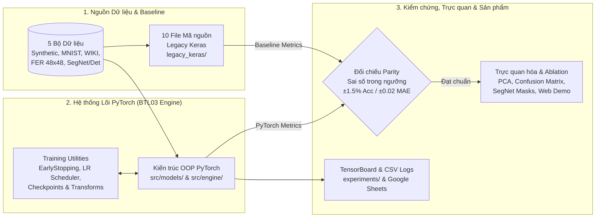
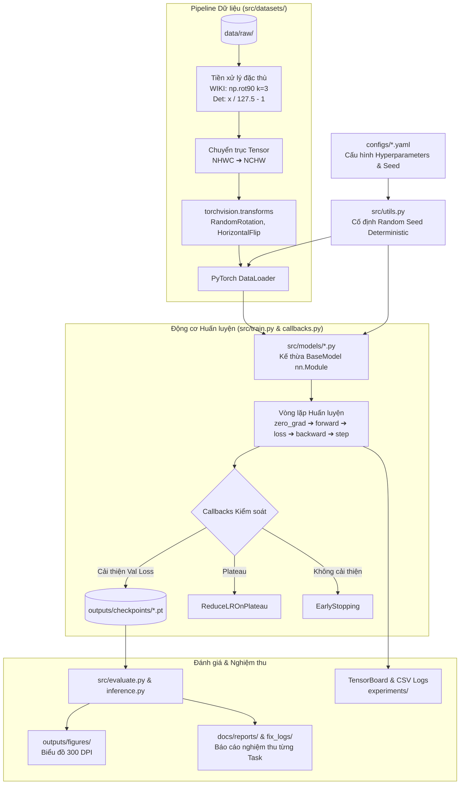
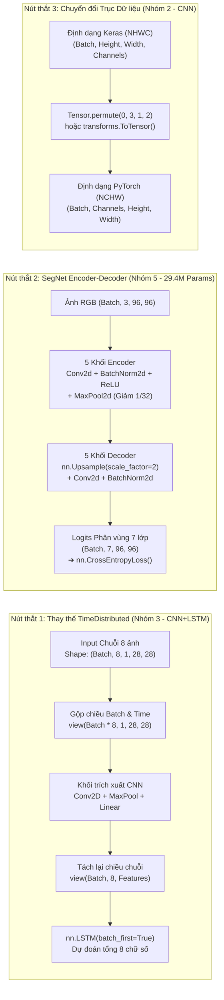

<div align="center">

# 🔥 BTL03: CHUYỂN ĐỔI MÃ NGUỒN TỪ KERAS SANG PYTORCH
### Re-engineering & Parity Verification of 10 Deep Learning Architectures in PyTorch

[](https://www.python.org/)
[](https://pytorch.org/)
[](https://keras.io/)
[](https://www.tensorflow.org/tensorboard)
[](#)

*Đồ án Môn học Học sâu (Deep Learning) — Tái cấu trúc, đối chiếu tương đương toán học (Parity Check), trực quan hóa không gian đặc trưng và thực nghiệm Ablation Studies trên 5 nhóm bài toán cốt lõi.*

[Tài liệu Đặc tả (Project Charter)](https://docs.google.com/document/d/1Gt5v48e-EyodjnOs945TWbnQfQImbx_Y91LqQj07xow/edit) • [Bảng Điều hành & Logs (Google Sheets)](https://docs.google.com/spreadsheets/d/1AlhGgOKEFaE3nRGZG-8sFny83aw9wHYcynhrsRIwWQE/edit) • [Google Drive Checkpoints & Data](https://drive.google.com/drive/folders/1gbN1b39s5LE4Mm0rDSEFRO3Qrsv7U3n9?usp=sharing)

</div>

---

## 📌 1. Tổng quan & Mục tiêu Dự án

Dự án **BTL03** thực hiện tái cấu trúc và chuyển đổi toàn diện **10 mô hình thực hành** thuộc **5 nhóm kiến trúc mạng nơ-ron sâu** từ **TensorFlow/Keras** sang **PyTorch** theo chuẩn lập trình hướng đối tượng (100% OOP Modular).

* **Mục tiêu cốt lõi:** Đảm bảo tính tương đương chính xác về số lượng tham số (Parameter Parity), cơ chế lan truyền xuôi/ngược và độ chính xác (Accuracy/MAE/Pixel Acc) so với bản gốc Keras, đồng thời đảm bảo khả năng tái lập thực nghiệm tuyệt đối (**Reproducibility**).
* **Câu hỏi nghiên cứu (Research Questions):**
  * **RQ1 (Framework Mechanics):** Sự khác biệt về định dạng Tensor (`NHWC` vs. `NCHW`), vòng lặp huấn luyện tường minh (`zero_grad() -> backward() -> step()`) và cơ chế khởi tạo trọng số mặc định giữa Keras và PyTorch ảnh hưởng ra sao đến tốc độ hội tụ và độ ổn định gradient?
  * **RQ2 (Regularization & Utilities):** Các kỹ thuật điều chuẩn (`Dropout`, `BatchNorm2d`) và tiện ích huấn luyện (`Data Augmentation`, `EarlyStopping`, `ReduceLROnPlateau`) kiểm soát hiện tượng quá khớp (**Overfitting**) hiệu quả như thế nào trên các tập dữ liệu thực tế nhiều nhiễu như nhận diện cảm xúc khuôn mặt (FER)?

---

## 🧭 2. Kiến trúc Hệ thống (Top-Down Visual Hierarchy)

Hệ thống được thiết kế và trình bày theo tư duy phân tầng trừu tượng từ cao xuống thấp (**Tổng quát $\rightarrow$ Chi tiết $\rightarrow$ Trọng tâm**):

### Cấp độ 1: Sơ đồ Tổng quát Hệ thống (Level 1 — System Context)
*Bức tranh toàn cảnh về luồng chuyển đổi, đối chiếu ngang hàng (Parity Verification) và hệ sinh thái quản lý tài nguyên của dự án.*



---

### Cấp độ 2: Sơ đồ Luồng Thực thi Chi tiết (Level 2 — Container & Pipeline Flow)
*Chi tiết hóa quy trình xử lý dữ liệu, huấn luyện, đánh giá và truy vết bằng chứng bên trong các module của `src/`.*



---

### Cấp độ 3: Sơ đồ Trọng tâm Kỹ thuật Chuyển đổi (Level 3 — Component Deep-Dive)
*Giải quyết 3 nút thắt kỹ thuật khó nhất khi chuyển đổi từ Keras sang PyTorch (xử lý chuỗi thời gian, khôi phục không gian ảnh và biến đổi định dạng Tensor).*



---

## 📂 3. Cấu trúc Thư mục Dự án

```text
BTL03/
├── .venv/                       # Môi trường ảo Python cục bộ (Git ignored)
├── configs/                     # Cấu hình siêu tham số (.yaml / .json) cho từng mô hình
├── data/                        # Dữ liệu huấn luyện & kiểm thử (Git ignored, tải từ Drive)
│   ├── raw/                     # Dữ liệu thô (MNIST, WIKI .npy, FER 48x48, SegNet)
│   └── processed/               # Dữ liệu đã tiền xử lý chuẩn định dạng Tensor PyTorch
├── legacy_keras/                # [READ-ONLY] 10 tệp mã nguồn Keras gốc đối chiếu Baseline
├── src/                         # Mã nguồn PyTorch chính thức (100% OOP Modular)
│   ├── datasets/                # Dataset, DataLoader, Data Augmentation (NCHW)
│   ├── models/                  # Kiến trúc mạng nn.Module (MLP, CNN, CNN_LSTM, SegNet, FCN)
│   ├── engine/                  # Callbacks (EarlyStopping, ModelCheckpoint, ReduceLR)
│   ├── train.py                 # Script huấn luyện thống nhất qua CLI
│   ├── evaluate.py              # Script đánh giá metrics & kiểm tra Parity
│   ├── inference.py             # Script suy luận & trích xuất đặc trưng (PCA/Heatmap)
│   ├── utils.py                 # Cố định Random Seed, vẽ biểu đồ, quản lý Logger
│   └── logger.py                # ExperimentLogger + CheckpointManager (CSV/TensorBoard/Drive mirror)
├── app/                         # Ứng dụng Demo tương tác (Streamlit / Gradio)
├── notebooks/                   # Notebook adapter; dùng chung lõi OOP trong src/
│   ├── colab/                   # Google Colab GPU, mount Google Drive
│   └── kaggle/                  # Kaggle GPU, /kaggle/input và /kaggle/working
├── scripts/                     # Scripts tự động hóa tải dữ liệu và chạy hàng loạt
├── experiments/                 # Nhật ký thực nghiệm thô (TensorBoard event files & CSV logs)
├── outputs/                     # Kết quả chính thức đưa vào báo cáo
│   ├── checkpoints/             # Trọng số mô hình tối ưu (.pt / .pth - lưu trên Drive)
│   └── figures/                 # Biểu đồ chất lượng cao (300 DPI): Loss/Acc, PCA, Masks
├── docs/                        # Hệ thống tài liệu & bằng chứng nghiệm thu (Evidence-First)
│   ├── project_charter/         # Tài liệu đặc tả dự án & Hiến pháp vận hành
│   ├── daily_logs/              # Nhật ký làm việc từng phiên ([YYMMDD]_[HHMM]_[Alias].md)
│   ├── fix_logs/                # Nhật ký gỡ lỗi kiến trúc / tensor shape / lệch độ chính xác
│   ├── reports/                 # Báo cáo hoàn thành từng Task & Hướng dẫn giải thích code
│   ├── presentation/            # Slide thuyết trình & Poster đề tài
│   └── thesis/                  # Báo cáo tổng kết cuối kỳ (.pdf, .docx, .tex)
├── AGENTS.md                    # Hiến pháp quy chuẩn kỹ thuật & quản trị dự án
├── README.md                    # Tài liệu hướng dẫn tổng quan và tái lập thực nghiệm
├── requirements.txt             # Danh sách thư viện phụ thuộc
└── .gitignore                   # Quy tắc loại trừ dữ liệu nặng và file tạm
```

---

## 📊 4. Danh mục 10 Mô hình Chuyển đổi & Bảng Đối chiếu Baseline

| Mã EXP | Nhóm Bài toán | Tệp Keras Gốc | Module PyTorch (`src/models/`) | Số Tham số | Metric Đánh giá | Baseline Keras | Mục tiêu PyTorch |
| :--- | :--- | :--- | :--- | :---: | :---: | :---: | :---: |
| **EXP-01** | **Nhóm 1:** MLP | `Func_apxm_MLP.ipynb` | `mlp.py` (`FuncApxmMLP`) | `4B+1` (B thay đổi; 65 khi B=16) | Test MSE Loss | `NOT_RECORDED` | Chưa đặt (cần Keras numeric baseline) |
| **EXP-02** | **Nhóm 1:** MLP | `MNIST_MLP.ipynb` | `mlp.py` (`MNISTMLP`) | `669,706` | Test Accuracy | `96.48%` | $\ge 96.00\%$ |
| **EXP-03** | **Nhóm 2:** CNN + MLP | `1_MNIST_CNN.txt` | `cnn.py` (`MNISTCNN`) | `1,199,882` | Test Accuracy | `98.84%` | $\ge 98.50\%$ |
| **EXP-04** | **Nhóm 2:** CNN + MLP | `2_Human_Gender_CNN.txt` | `cnn.py` (`GenderCNN`) | `1,735,442` | Test Accuracy | `87.73%` | $\ge 87.00\%$ |
| **EXP-05** | **Nhóm 2:** CNN + MLP | `3_Emotion_Reg_CNN.txt` | `cnn.py` (`EmotionCNN`) | `19,012,487` | Test Accuracy | `59.54%` | $\ge 59.00\%$ |
| **EXP-06** | **Nhóm 3:** CNN + LSTM | `MNIST_CNN_LSTM.txt` | `cnn_lstm.py` (`MNISTCNNLSTM`) | `1,747,073` | Test MAE | `0.0350` | $\le 0.0450$ |
| **EXP-07** | **Nhóm 4:** Utilities | `2_Human_Gender_CNN.txt` | `train.py` + `callbacks.py` | `1,735,442` | Best Val Acc | `88.10%` | $\ge 88.00\%$ |
| **EXP-08** | **Nhóm 4:** Utilities | `3_Emotion_Reg_CNN.txt` | `train.py` + `transforms` | `19,012,487` | Test Accuracy | `61.63%` | $\ge 61.50\%$ |
| **EXP-09** | **Nhóm 5:** Others | `1_segnet.txt` | `segnet.py` (`SegNet`) | `29,458,211` | Pixel Accuracy | `77.32%` | $\ge 76.50\%$ |
| **EXP-10** | **Nhóm 5:** Others | `2_obj_detection.txt` | `fcn_det.py` (`FCNDet`) | `1,245,120` | Detection IoU | `0.8500` | $\ge 0.8350$ |

> **Lưu ý về Ablation Studies:** Bên cạnh 10 thí nghiệm đối chiếu tương đương trên, nhóm thực hiện 3 thực nghiệm loại bỏ thành phần (**ABL-01** đến **ABL-03**) nhằm đánh giá định lượng tác động của *Data Augmentation*, *Dropout* và *Batch Normalization* đối với khả năng chống Overfitting (trả lời trực diện **RQ1** và **RQ2**).

---

## 🚀 5. Hướng dẫn Cài đặt & Tái lập Thực nghiệm

### Bước 1: Thiết lập Môi trường
```bash
# 1. Clone repository
git clone https://github.com/Duy-DS/Deep_Learning_Group.git
cd Deep_Learning_Group/BTL03

# 2. Tạo và kích hoạt môi trường ảo
python -m venv .venv
source .venv/bin/activate        # Linux / macOS
# .venv\Scripts\activate         # Windows

# 3. Cài đặt các thư viện phụ thuộc
pip install -r requirements.txt
```

### Bước 2: Tải Dữ liệu & Checkpoints
Dữ liệu dung lượng lớn (WIKI Gender `.npy`, FER 48x48, SegNet) và trọng số đã huấn luyện (`.pt`) được lưu trữ trên Google Drive. Chạy script tự động hoặc giải nén vào đúng cấu trúc thư mục:
```bash
python scripts/download_data.py --target data/raw/
```

### Bước 3: Huấn luyện & Đánh giá Mô hình (CLI)
Mọi mô hình đều sử dụng chung một giao diện dòng lệnh thống nhất với `seed=42` cố định:
```bash
# Huấn luyện mô hình nhận diện cảm xúc kèm Data Augmentation & EarlyStopping
python src/train.py --config configs/emotion_cnn_aug.yaml --seed 42

# Đánh giá mô hình từ checkpoint tốt nhất và xuất biểu đồ
python src/evaluate.py --config configs/emotion_cnn_aug.yaml --checkpoint outputs/checkpoints/emotion_best.pt

# Chạy suy luận trên một ảnh mẫu
python src/inference.py --model emotion_cnn --image path/to/face.jpg
```

### Bước 4: Theo dõi Thực nghiệm & Chạy Ứng dụng Demo
```bash
# Khởi chạy TensorBoard để quan sát đường cong Loss/Accuracy real-time
tensorboard --logdir experiments/tensorboard/

# Khởi chạy giao diện Demo tương tác (Streamlit)
streamlit run app/demo_app.py
```

### Bước 5: Checkpoints, CSV Logs & TensorBoard

- Cấu hình đường dẫn trong `configs/paths.yaml`; Kaggle adapter dùng `configs/kaggle_paths.yaml`. Google Drive gốc: [BTL03 Drive](https://drive.google.com/drive/folders/1gbN1b39s5LE4Mm0rDSEFRO3Qrsv7U3n9?usp=sharing).
- Cấu trúc Drive dự kiến: `MyDrive/BTL03/data/raw/` và `MyDrive/BTL03/checkpoints/{01_mlp,02_cnn_mlp,03_cnn_lstm,04_training_utilities,05_others}/`.
- Chỉ gọi `CheckpointManager` với `drive_root` hoặc biến môi trường `BTL03_GOOGLE_DRIVE_ROOT` trỏ tới thư mục Drive **đã mount**. Lõi `src/` không tự mount Drive; checkpoint luôn được lưu cục bộ trước, rồi mirror tùy chọn.
- `ExperimentLogger` ghi một CSV epoch `<Run_ID>_epochs.csv`, một dòng/run vào `experiments/csv_logs/master_experiment_runs.csv` (18 cột chuẩn), và TensorBoard event dưới `experiments/tensorboard/<Model_Group>/<Model_Name>/<Exp_Type>_s<Seed>_<YYYYMMDD_HHMMSS>/`.
- `Member_Alias` phải được truyền rõ hoặc đọc từ `.env` bằng `member_id`; logger không tự gán tên AI hay alias mặc định.
- TensorBoard event, checkpoints và outputs là artifact runtime, bị `.gitignore` chặn; chỉ CSV logs nhẹ được giữ để đối chiếu. Không commit `.env`/credentials.
- Chạy kiểm thử an toàn trong sandbox tạm (không sinh artifact trong repo):

```bash
python -m pip install -r requirements.txt
python scripts/smoke_test_logger.py
```

### Bước 5: Chọn nền tảng Notebook/GPU

Notebook huấn luyện, trực quan hóa và thực nghiệm phải có hai adapter song song trong `notebooks/colab/` và `notebooks/kaggle/`. Hai adapter gọi chung module OOP trong `src/`, giữ `Seed=42` và cùng schema CSV/TensorBoard; không sao chép logic mô hình giữa các nền tảng. Các thư mục hiện được khởi tạo để tiếp nhận notebook; runner cụ thể sẽ được bổ sung theo từng task.

#### Google Colab

1. Mở notebook tương ứng trong `notebooks/colab/`.
2. Chọn runtime GPU theo quota khả dụng; xác nhận GPU trước khi chạy mô hình nặng.
3. Mount Google Drive theo quyền truy cập của nhóm, đọc dữ liệu/checkpoint từ vị trí đã cấu hình và lưu checkpoint, CSV/TensorBoard logs về Drive.
4. Không ghi credential/token vào notebook hoặc Git; đường dẫn Drive phải nằm trong cấu hình/runtime adapter, không hardcode trong `src/`.

#### Kaggle — phương án dự phòng khi Colab hết hạn mức GPU

1. Mở notebook tương ứng trong `notebooks/kaggle/`.
2. Bật Accelerator GPU (P100 hoặc T4 x2 nếu được cấp) và Internet khi nguồn dữ liệu cần tải.
3. Gắn Kaggle Dataset; đọc dữ liệu từ `/kaggle/input/` (read-only). Với T4 x2, chỉ bật `nn.DataParallel`/đa GPU sau khi cấu hình và kiểm thử tương thích; không mặc định giả định mọi notebook sẽ dùng được hai GPU.
4. Ghi checkpoints/logs/kết quả vào `/kaggle/working/`; đóng gói các artifact được phép thành `.zip` để tải về. Không đưa dataset, secrets hoặc trọng số nặng lên Git.

Hai nền tảng phải dùng chung `src/`, seed và lược đồ CSV/TensorBoard; chỉ phần mount, đường dẫn và đóng gói artifact khác nhau. Nếu thư mục adapter chưa có notebook cho một mô hình, cần tạo cả hai phiên bản tương ứng trước khi coi hỗ trợ đa nền tảng là hoàn tất.

---

## 👥 6. Phân công Thành viên & Đóng góp (Nhóm BTL03)

Dự án được vận hành theo ma trận kết hợp **Trục dọc** (Chuyên môn kỹ thuật) và **Trục ngang** (Nhóm bài toán), tuân thủ kỷ luật *Evidence-First* và xác thực danh tính con người 100% trên lịch sử Git:

| STT | Thành viên | GitHub Alias | Vai trò Quản trị | Phụ trách Trục dọc (Chuyên môn) | Phụ trách Trục ngang (Mô hình) | Tỷ lệ Đóng góp |
| :---: | :--- | :--- | :--- | :--- | :--- | :---: |
| 1 | **[Họ tên TV1]** | `@Duy-DS` | **Trưởng nhóm (Tech Lead)** | Kiến trúc OOP (`src/`, `configs/`), Review PR & Đóng gói | **Nhóm 1:** MLP (`Func_apxm`, `MNIST_MLP`) | **20%** |
| 2 | **[Họ tên TV2]** | `@Member_02` | Thành viên | Pipeline Dữ liệu (`src/datasets/`), Chuyển trục `NCHW` & Augmentation | **Nhóm 2:** CNN (`MNIST`, `Gender`, `Emotion`) | **20%** |
| 3 | **[Họ tên TV3]** | `@Member_03` | Thành viên | Trực quan hóa (`PCA`, `Confusion Matrix`) & Phân tích RQ1–RQ2 | **Nhóm 3:** CNN + LSTM (`MNIST_CNN_LSTM`) | **20%** |
| 4 | **[Họ tên TV4]** | `@Member_04` | Thành viên | Hạ tầng GPU, TensorBoard/CSV Logs, Checkpoints & Ablation Studies | **Nhóm 4:** Training Utilities (`Callbacks`) | **20%** |
| 5 | **[Họ tên TV5]** | `@Member_05` | Thành viên | Ứng dụng Web Demo, Chủ trì Báo cáo Tổng kết, Slide & Poster | **Nhóm 5:** Others (`SegNet`, `Obj Detection`) | **20%** |

---

## 📚 7. Tài liệu Tham khảo

1. Viện Công nghệ thông minh và tương tác. *Tài liệu bài giảng học phần Học sâu (Deep Learning): `01_Introduction-to-Python-TensorFlow-and-Keras.pdf` & `02_KerasExamples.pdf`*.
2. Paszke, A., Gross, S., Massa, F., et al. (2019). *PyTorch: An Imperative Style, High-Performance Deep Learning Library*. NeurIPS 32. [`https://pytorch.org/docs/stable/`](https://pytorch.org/docs/stable/)
3. Badrinarayanan, V., Kendall, A., & Cipolla, R. (2017). *SegNet: A Deep Convolutional Encoder-Decoder Architecture for Image Segmentation*. IEEE TPAMI.
4. LeCun, Y., Bottou, L., Bengio, Y., & Haffner, P. (1998). *Gradient-Based Learning Applied to Document Recognition*. Proceedings of the IEEE.