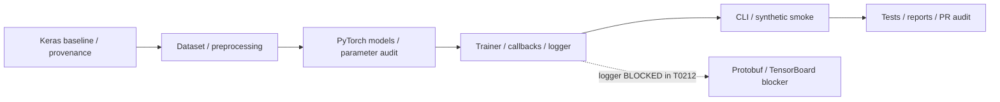

# B?O C?O T?NG K?T BTL03 ? SNAPSHOT T0212

> **B?n th?o Markdown, ch?a ph?i b?n n?p cu?i.** Ph?m vi evidence: commit `33dcd74599e86404bbc8128c8057afba82810093`, report T0212 ng?y 2026-11-23. Th?ng tin ph?p l? th?nh vi?n v? t? l? ??ng g?p c?n c?n nh?m x?c nh?n. T0212 c? tr?ng th?i t?ng th? **BLOCKED**.

## Th?ng tin ?? t?i v? nh?m

- **?? t?i:** Chuy?n ??i m? ngu?n Deep Learning t? Keras sang PyTorch & Ph?n t?ch th?c nghi?m
- **M? d? ?n:** BTL03
- **Snapshot / commit ngu?n / ng?y ch?t:** T0212 / `33dcd74599e86404bbc8128c8057afba82810093` / 2026-11-23
- **Tr??ng/khoa/l?p/gi?ng vi?n:** [C?N NH?M X?C NH?N]
- **Alias th?nh vi?n theo task evidence:** `Duy-DS`, `nguyenthanhdat180905-cloud`, `nguyen-cong-tri`, `TonOfWeight072501`, `CHIVY2005`
- **H? t?n/MSSV, vai tr? t?ng k?t, t? l? ??ng g?p:** [C?N NH?M X?C NH?N T? DANH S?CH CH?NH TH?C; t?ng 100%]
- **Ng??i t?ng h?p:** [TH?NH VI?N TH?T DO NH?M CH? ??NH]

## T?m t?t

BTL03 t?i c?u tr?c m??i c?u h?nh thu?c n?m nh?m Keras sang PyTorch. T?i T0212, report ghi parameter-count audit cho m??i c?u h?nh v? 10/10 synthetic one-epoch smoke cases. ??y l? ki?m tra c?u tr?c/wiring, kh?ng ph?i hu?n luy?n khoa h?c tr?n d? li?u th?t. Logger b? BLOCKED do protobuf/TensorBoard; full suite theo c?c shard ghi 78 passed v? 4 failed tr?n 82 test. V? v?y T0212 ch?a ?? ?i?u ki?n nghi?m thu/merge. T0201 (36 sweep c?u h?nh) v? T0202 (m?t MNIST MLP run 30 epoch) l? k?t qu? ri?ng, kh?ng ??i di?n cho full training c?a c? m??i c?u h?nh.

**T? kh?a:** Keras; PyTorch; parameter audit; reproducibility; synthetic smoke-test; provenance.

## Danh m?c vi?t t?t

| Vi?t t?t | ? ngh?a |
|---|---|
| CNN | Convolutional Neural Network |
| FCN | Fully Convolutional Network; project d?ng score-map model theo legacy |
| NCHW/NHWC | Batch?channel?height?width / batch?height?width?channel |
| OOP | L?p tr?nh h??ng ??i t??ng |
| PR | Pull Request / nh?nh t?ch h?p ???c audit |
| RQ | C?u h?i nghi?n c?u |

## C?u h?i nghi?n c?u (ch? ?i?n sau khi x?c minh ngu?n ch?nh th?c)

Project Charter Markdown ??ng t?n v? RQ nguy?n v?n ch?a ???c x?c minh trong snapshot; kh?ng d?ng RQ t? README. M?i RQ ch? ???c k?t lu?n sau khi x?c ??nh run/evidence t??ng ?ng.

| RQ ID | C?u h?i nguy?n v?n | Evidence c?n | Tr?ng th?i |
|---|---|---|---|
| [RQ ID] | [Ch? x?c minh charter ch?nh th?c] | [Report/run/test] | [Ch?a k?t lu?n n?u thi?u run] |

## M? ??u

### B?i c?nh v? m?c ti?u

BTL03 kh?o s?t chuy?n ??i m? h?nh th?c h?nh Keras sang PyTorch OOP. B?o c?o t?p trung v?o snapshot T0212 v? ph?n bi?t implementation v?i th?c nghi?m c?n b? ch?n.

### ??i t??ng, ph?m vi v? ph??ng ph?p

??i t??ng g?m m??i c?u h?nh trong n?m nh?m; ph?m vi d?ng t?i commit T0212. Ph??ng ph?p l? ??i chi?u task reports, notebook/CSV provenance, source/config, tests v? Git history; kh?ng suy di?n metric thi?u ngu?n.

### C?u tr?c b?o c?o

C?c ch??ng tr?nh b?y n?n t?ng framework, thi?t k?/pipeline, ki?m to?n v? k?t qu? theo evidence, r?i th?o lu?n h?n ch? v? h??ng ph?t tri?n.

## 1. Tổng quan và phạm vi

### 1.1 Mục tiêu

Dự án tổ chức việc chuyển đổi theo năm nhóm: (1) MLP; (2) CNN+MLP; (3) CNN+LSTM; (4) tiện ích huấn luyện/callbacks; (5) vision nâng cao SegNet và FCN score-map. Có mười cấu hình báo cáo; hai cấu hình nhóm 4 dùng lại kiến trúc Gender/Emotion với utilities, do đó “mười cấu hình” không có nghĩa “mười kiến trúc khác nhau” [E-CHARTER, E-BASELINE].

### 1.2 Phạm vi snapshot

Đây là báo cáo trạng thái theo evidence trong repository đến commit nguồn T0212. Báo cáo không thay thế nghiệm thu cuối kỳ, không khẳng định đã hoàn thành WP03/WP04, và không hồi tố các kết quả của giai đoạn sau. Kiểm toán branch/PR trong report T0212 là audit lịch sử tích hợp, không phải xác nhận metric thực nghiệm.

### 1.3 Câu hỏi nghiên cứu và giới hạn suy luận

Đề cương dự án đặt vấn đề về khác biệt framework, utilities/chống overfitting và thực nghiệm. Tuy nhiên, một smoke run synthetic hoặc parameter-count parity không trả lời các câu hỏi về hội tụ, accuracy, ablation, trực quan hóa hay overfitting. Các câu hỏi đó chỉ được kết luận khi có thiết kế và run thực tế, được ghi log có thể truy vết [E-CHARTER, E-T0212].

## 2. Cơ sở lý thuyết và khác biệt chuyển đổi

### 2.1 Vòng lặp huấn luyện và logits

PyTorch làm lộ rõ chu kỳ `zero_grad → forward → loss → backward → optimizer.step`; validation dùng eval/inference mode theo `BaseTrainer`. Với phân loại, cấu hình PyTorch trả logits để dùng `CrossEntropyLoss`, khác biểu diễn softmax + categorical cross-entropy ở Keras. Đối chiếu đúng phải thống nhất loss, nhãn, split, khởi tạo và protocol; việc hai model có cùng số tham số chưa đủ chứng minh cùng kết quả [E-T0106, E-T0203].

### 2.2 NHWC, NCHW và WIKI `np.rot90`

Keras vision thường lưu `(N,H,W,C)`, còn convolution PyTorch nhận `(N,C,H,W)`. Dataset chuyển layout bằng `permute(0,3,1,2)` và tạo tensor liên tục khi cần. Đối với WIKI, phải giữ phép xoay legacy `np.rot90(k=3, axes=(1,2))` trên ảnh NHWC trước khi đổi trục. Xoay không gian và hoán vị trục là hai phép toán khác nhau [E-T0102, E-T0204].

### 2.3 CNN-LSTM và thay `TimeDistributed`

Input chuỗi có dạng `(B,T,C,H,W)`. Có thể gộp `(B,T)` thành `B×T`, xử lý từng frame qua CNN, reshape đặc trưng thành `(B,T,F)`, rồi đưa vào các tầng LSTM. T0212 xác minh forward/train shape trên synthetic; không chứng minh MAE trên MNIST thật. Báo cáo legacy có validation loss nhưng không lưu test evaluate độc lập [E-T0206--07, E-BASELINE, E-T0212].

### 2.4 SegNet và upsampling

SegNet đối chiếu decoder `UpSampling2D` với `nn.Upsample`; output PyTorch là logits theo lớp cho từng pixel, target cho cross-entropy là class-index mask. Theo report nhóm 5, baseline tổng số tham số là 29,458,211, gồm 29,442,325 trainable và 15,886 non-trainable. Cần giữ quy ước đếm BatchNorm của báo cáo task; con số total không chứng minh chất lượng segmentation [E-T0210, E-BASELINE].

### 2.5 FCN score-map và chuẩn hóa

Notebook legacy Object Detection dùng chuẩn hóa `x/127.5 - 1.0`, đầu ra score regression và MSE. Giá trị `accuracy` được notebook in ra không phải IoU/mAP. PyTorch architecture/parity 83,367 params và smoke heatmap chỉ xác nhận wiring/shape, không xác nhận khả năng phát hiện xe [E-T0211, E-BASELINE, E-T0212].

### 2.6 Dữ liệu và giao thức

Không được gộp chuẩn hóa MNIST, WIKI và FER thành một quy tắc chung nếu legacy khác nhau. Một số notebook legacy dùng validation/public-test để vừa theo dõi vừa in kết quả “Test”; phải nêu rõ đó không phải independent holdout. Tại snapshot, WIKI/FER/SegNet/vehicle data thật chưa có trong workspace theo reports nhóm, vì vậy dummy/synthetic chỉ phục vụ kiểm tra phần mềm [E-T0102, E-T0204--05, E-T0210--11].

## 3. Thiết kế hệ thống và chuyển đổi PyTorch

### 3.1 Thành phần core

- `src/models/base_model.py`: `BaseMigratedModel` trừu tượng, kiểm tra shape NCHW, đếm total/trainable/non-trainable và quản lý feature hooks.
- `src/engine/trainer.py`: `BaseTrainer` cho train/validation, callback, logger và checkpoint; validation chạy ở inference mode.
- `src/utils.py`: helper seed/reproducibility; giá trị cấu hình phổ biến là seed 42.
- `src/engine/callbacks.py`, `src/logger.py`: callbacks, CSV/TensorBoard và checkpoint API. Việc code/API tồn tại không đồng nghĩa logger chạy thành công trong môi trường T0212.
- `src/train.py`, `configs/`, `scripts/`: YAML và CLI thống nhất; `--task all --smoke-test` gọi harness synthetic cách ly outputs.

Các mô tả trên căn cứ vào source code và reports core; không tuyên bố mọi đường chạy CLI đều hoàn tất [E-SOURCE, E-T0106, E-T0104, E-T0212].

### 3.2 Pipeline và giao diện thành phần

Luồng được kiểm toán có thể tóm tắt là `Keras baseline → Dataset/preprocessing → PyTorch model → BaseTrainer/callback/logger → CLI/test/report`. T0212 dùng synthetic fixtures để smoke; do đó sơ đồ kiến trúc/flowchart minh họa pipeline không được hiểu là bằng chứng full-data execution hoặc logger PASS. Mô-đun demo thuộc WP04 chỉ mô tả như roadmap cho tới khi có report nghiệm thu.

> Sơ đồ khái quát; mũi tên không khẳng định toàn bộ luồng full-data đã chạy thành công.

### 3.3 Ma trận nhóm

| Nhóm/cấu hình | Đầu vào/điểm chuyển đổi | Bằng chứng tại snapshot | Giới hạn |
|---|---|---|---|
| 1 — `FuncApxmMLP` | Vector 2 chiều; sweep hidden width B | T0201 có 36 cấu hình A/B/C và CSV/Run_ID; công thức `4B+1` | Keras không lưu metric số; không tuyên bố parity MSE |
| 1 — `MNISTMLP` | 28×28, Dense/Dropout, class-index + CrossEntropy | T0202 báo một run 30 epoch, 669,706 params và test metric/log | Protocol validation khác Keras; không đại diện model khác |
| 2 — `MNISTCNN` | NCHW, Conv/pool, feature hook `pool3` | Params 1,817,610 được đối chiếu | Full training PyTorch chưa được report xác nhận |
| 2 — `HumanGenderCNN` | WIKI xoay k=3 trước NCHW | Params 4,063,570 và dataset/model tests | Thiếu WIKI thật; không có PyTorch accuracy full run |
| 2 — `EmotionCNN` | FER 48×48, 7 lớp; preprocessing theo legacy | Params 19,028,287; shape/tests | Thiếu FER thật; train/accuracy PyTorch chưa chạy |
| 3 — `MNISTCNNLSTM` | 8 frame, CNN features → LSTM | T0206 ghi PyTorch 1,746,049; T0207 ghi bản đã sửa 1,747,073; T0212 lặp lại 1,747,073 | T0212 synthetic smoke không tự xác minh Keras parity; kiểm toán lại counting semantics và state của model trong từng snapshot |
| 4 — Gender callbacks | Kiến trúc Gender + callbacks | Code/tests callback; cùng 4,063,570 params | Runner/logger và full data run bị chặn |
| 4 — Emotion callbacks | Kiến trúc Emotion + utilities | Code/config/tests; cùng 19,028,287 params | Không có convergence PyTorch mới trong snapshot |
| 5 — `SegNet` | NCHW; mask 7 lớp; upsample decoder | 29,458,211 total params; model/data smoke | Không có full run trên segmentation data thật |
| 5 — `FCNObjectDetector` | RGB, chuẩn hóa legacy, score-map | 83,367 params; shape/heatmap tests | Không có data/metric detection thật; accuracy ≠ IoU/mAP |

Các thông số bảng dựa trên T0103 baseline provenance, reports từng task và T0212; xem manifest được lưu tại `docs/thesis/01_materials/evidence/evidence_sources_manifest.md` [E-BASELINE, E-T0201--07, E-T0210--12].

## 4. Kiểm toán T0212 và trạng thái thực nghiệm

### 4.1 Kiểm toán tích hợp

Report `docs/reports/T0212_261123_2130.md` ghi năm tip WP02 là ancestors trong history tích hợp và không merge lặp. Nhánh T0212 được tạo để review/smoke; report khuyến cáo chưa merge vào `main` do blocker. Nội dung audit này chỉ phản ánh lịch sử và kiểm tra repo như report ghi, không đánh giá độ chính xác mô hình [E-T0212].

### 4.2 Parameter-count audit

| Cấu hình | Keras params | PyTorch params | Lệch | Diễn giải |
|---|---:|---:|---:|---|
| `FuncApxmMLP`, B=16 | 65* | 65 | 0 | `4B+1`; legacy summary số không lưu, B biến thiên |
| `MNISTMLP` | 669,706 | 669,706 | 0 | |
| `MNISTCNN` | 1,817,610 | 1,817,610 | 0 | |
| `HumanGenderCNN` | 4,063,570 | 4,063,570 | 0 | |
| `EmotionCNN` | 19,028,287 | 19,028,287 | 0 | |
| `MNISTCNNLSTM` | 1,747,073 | T0206: 1,746,049; T0207 corrected: 1,747,073; T0212 summary: 1,747,073 | Chưa chốt | Legacy baseline ghi 1,747,073; T0206 và T0207 khác nhau 1,024 params. T0212 lặp số T0207 nhưng smoke tự thân không chứng minh Keras parity; cần đối chiếu state/counting semantics trước khi xác nhận. |
| Gender + callbacks | 4,063,570 | 4,063,570 | 0 | Dùng lại kiến trúc Gender |
| Emotion + callbacks | 19,028,287 | 19,028,287 | 0 | Dùng lại kiến trúc Emotion |
| `SegNet` | 29,458,211 | 29,458,211 | 0 | T0212 summary; xem riêng non-trainable BN |
| `FCNObjectDetector` | 83,367 | 83,367 | 0 | |

`*` Với FuncApxmMLP, 65 chỉ đúng tại B=16; notebook baseline không lưu `model.summary` hoặc kết quả MSE số. CNN-LSTM là ngoại lệ đang audit: baseline Keras và T0207 corrected ghi 1,747,073, nhưng T0206 ghi PyTorch 1,746,049; con số tổng hợp trong T0212 cần được kiểm tra lại từ model/source snapshot và quy ước đếm trước khi gọi là parity đã xác minh. Smoke T0212 chỉ xác nhận đường chạy, không tự kiểm chứng độc lập số Keras. Các bảng parameter count không phải bảng accuracy/parity đầu ra [E-BASELINE, E-T0206--07, E-T0212].

### 4.3 Smoke và test suite

- 10/10 case chạy một epoch train và validation bằng dữ liệu synthetic đúng shape: PASS.
- Parameter count báo cáo khớp cho 10/10 cấu hình.
- Logger 10/10 case: **BLOCKED**; TensorBoard SummaryWriter không khởi tạo do protobuf generated/runtime mismatch.
- Full suite chạy theo shards: **78 passed, 4 failed / 82 tests**; bốn lỗi liên quan cùng blocker logger.
- `python -m src.train --task all --smoke-test` trả exit code 2 theo thiết kế vì logger blocked; đây không phải overall pass.
- Master CSV chính không thay đổi trong smoke; runtime được mô tả trong report là CPU-only, không CUDA.

Đây là bằng chứng kiểm thử wiring/code, không phải accuracy, convergence hay runtime benchmark trên dataset thật [E-T0212].

### 4.4 Kết quả có trước T0212

**T0201:** report ghi sweep PyTorch 36 cấu hình, seed 42, SGD 0.01, batch 128; CSV có Train/Test-grid MSE, runtime và Run_ID. Baseline Keras gốc không lưu metric MSE số tương ứng, nên không thể tuyên bố parity định lượng Keras–PyTorch [E-T0201].

**T0202:** report ghi một run MNIST MLP 30 epoch, test accuracy 0.95870, test loss 0.13292970 và 150.24952 giây CPU; master CSV có Run_ID `T0202_MNISTMLP_s42_20261122_132545`, seed 42, 30 epoch, alias `Duy-DS`. Keras legacy ghi 0.9648 nhưng dùng test split làm validation; protocol khác nhau nên không quy chênh lệch chỉ cho framework [E-T0202].

### 4.5 Trạng thái task và giai đoạn tiếp theo

| Hạng mục | Trạng thái trong evidence | Việc cần làm |
|---|---|---|
| T0201 | Sweep 36 cấu hình có logs; Keras numeric MSE thiếu | Nếu cần parity, chạy baseline đối chứng có seed/protocol và lưu history |
| T0202 | MNIST MLP full run 30 epoch đã được report | Giữ caveat split; xác nhận và lưu evidence mới nếu cập nhật |
| T0203–T0205 | Code/parity/tests; full training thật chưa xác nhận trong reports | Cấp dữ liệu, chạy runner với split/config xác minh |
| T0206–T0207 | Dataset/model/shape test; full MNIST CNN-LSTM chưa xác nhận; parameter count mâu thuẫn giữa hai report | Đối chiếu commit/source và Keras/PyTorch counting semantics; sau đó chạy MNIST thật, đánh giá MAE theo protocol đã chốt |
| T0208–T0209 | Utilities/callback code và tests; full run bị blocker/thiếu data | Sửa logger dependency, chạy WIKI/FER thật, lưu curves |
| T0210–T0211 | Model/dataset/shape/parity tests; full data run chưa xác nhận | Cấp dữ liệu; dùng metric segmentation/detection đúng nghĩa |
| T0212 logger/full-suite | **BLOCKED**; 4 lỗi môi trường theo report | Tương thích dependency rồi chạy lại test/logger trước nghiệm thu |
| WP03 — full training, ablation, visualization, error analysis | **[CHƯA THỰC HIỆN - DỰ KIẾN Ở GIAI ĐOẠN TIẾP THEO]** các deliverable T0301–T0306 chưa có bằng chứng hoàn tất; workbook snapshot đánh dấu Todo | Chạy từng task, lưu seed/config/split/CSV/TensorBoard/checkpoint/figures và report; trả lời RQ bằng số liệu |
| WP04 — demo và đóng gói cuối | **[CHƯA THỰC HIỆN - DỰ KIẾN Ở GIAI ĐOẠN TIẾP THEO]** T0401–T0406 chưa nghiệm thu trong evidence hiện có | Xây dựng demo, hoàn thiện tài liệu/slide, xác nhận thông tin đóng góp và thực hiện final audit |

Mục WP03/WP04 là trạng thái snapshot, không kết luận không có thay đổi sau đó; kiểm tra lại workbook/report mới trước khi phát hành phiên bản mới [E-WBS, E-T0212].

## 5. Đánh giá, hạn chế, bài học và hướng phát triển

### 5.1 Điều evidence cho phép kết luận

Đến T0212, có kiến trúc/model code cho các nhóm, tests về shape/callbacks/parameter counting, parity count được ghi trong report, CLI smoke cho mười cấu hình và hai kết quả T0201/T0202 với phạm vi riêng. Không thể từ đó kết luận mười mô hình đều được train đầy đủ hoặc đạt metric baseline.

### 5.2 Kết quả, thảo luận và tính hợp lệ

T0212 xác nhận một phần luồng phần mềm và parity-count được báo cáo, nhưng không xác nhận chất lượng dự đoán. T0201 có PyTorch sweep nhưng numeric Keras MSE thiếu; T0202 có MNIST MLP run nhưng protocol validation khác Keras. Vì vậy hai kết quả không được gộp thành một benchmark chung.

| Evidence class | Có thể kết luận | Không thể kết luận |
|---|---|---|
| Parameter-count audit | Số lượng tham số được task reports ghi nhận; CNN-LSTM có nguồn bất đồng cần đối chiếu | Accuracy hoặc parity đầu ra/gradient |
| Synthetic smoke | Forward/train/validation wiring một epoch trên fixture shape-đúng | Generalization hoặc metric trên dữ liệu thật |
| Logger/full suite | Logger bị chặn; 78 passed/4 failed theo shard | T0212 overall PASS |
| T0201/T0202 | Kết quả run riêng có logs/report | Kết quả đại diện mười cấu hình hoặc protocol thống nhất |

Chi tiết evidence/source/run ID của mỗi hạng mục nằm trong `docs/thesis/01_materials/evidence/evidence_sources_manifest.md`. Bảng trên tổng hợp phạm vi suy luận, không thay thế các báo cáo task.

### 5.3 Hạn chế và validity threats

1. T0212 bị blocker protobuf/TensorBoard và có bốn test fail; logger của các smoke không hoàn tất.
2. Smoke dùng synthetic fixtures; không có CUDA. Dữ liệu thật cho nhiều nhóm chưa được cung cấp theo report.
3. Legacy baseline có trường `NOT_RECORDED`, metadata phần cứng thiếu và một số split validation/public-test bị reuse.
4. Parameter-count parity chỉ là một kiểm tra cấu trúc. Không chứng minh output, gradient trajectory, accuracy hoặc chất lượng semantic.
5. README tổng quan có số/diễn đạt không hoàn toàn trùng evidence task; báo cáo ưu tiên report chi tiết, CSV provenance và code, ghi chú mâu thuẫn thay vì hợp nhất im lặng.
6. Tên pháp lý/MSSV và tỷ lệ đóng góp cuối kỳ chưa được xác nhận; bản này không thay thế bảng thành viên chính thức.

### 5.4 Bài học kinh nghiệm

Phải kiểm tra protocol/split trước khi so sánh metric; đếm tham số cần ghi đúng semantics; logger cần được kiểm tra trong cùng runtime với lần huấn luyện; mỗi kết quả cần gắn task, run ID và nguồn có thể truy vết. Những nhận xét này là bài học về quy trình evidence, không phải kết luận thực nghiệm về mô hình.

### 5.5 Kiến nghị và hướng phát triển

- Khắc phục dependency TensorBoard/protobuf trong môi trường được nhóm duyệt; chạy lại logger tests, all-model smoke và full suite.
- Xác nhận dữ liệu, nguồn gốc, split, seed, protocol và môi trường cho từng model trước full training; lưu Run_ID, CSV, event/checkpoint và report.
- Thực hiện ablation và phân tích câu hỏi nghiên cứu với đối chứng được kiểm soát; không kết luận nhân quả từ một đường cong đơn lẻ.
- Tạo PCA/curves/segmentation/detection visualization từ prediction của model đã huấn luyện, kèm ground truth và metric phù hợp.
- Hoàn thiện ứng dụng demo, tài liệu tái lập, slide/poster, repository audit và đóng gói theo quy định môn học.

### 5.6 Kết luận snapshot

T0212 ghi nhận tiến độ chuyển đổi mã và kiểm toán tham số/luồng smoke đáng kể, nhưng nghiệm thu tích hợp còn **BLOCKED**. Các kết quả full training, logger hoạt động, ablation, phân tích thực nghiệm đầy đủ và demo cuối kỳ chỉ được báo cáo sau khi có evidence mới, không được suy ra từ bản thảo này.

## Tài liệu tham khảo

1. Paszke, A. và cộng sự (2019). *PyTorch: An Imperative Style, High-Performance Deep Learning Library*. NeurIPS 32.
2. Badrinarayanan, V., Kendall, A., & Cipolla, R. (2017). *SegNet: A Deep Convolutional Encoder-Decoder Architecture for Image Segmentation*. IEEE TPAMI, 39(12), 2481–2495. DOI: 10.1109/TPAMI.2016.2644615.
3. Nhóm BTL03 (2026). *T0212: WP02 PR review, parameter audit, CLI and smoke-test report*. `docs/reports/T0212_261123_2130.md`, snapshot commit `33dcd74599e86404bbc8128c8057afba82810093`.
4. Nguồn nội bộ khác được trích theo evidence ID và đường dẫn trong [`evidence_sources_manifest.md`](../../../01_materials/evidence/evidence_sources_manifest.md); các kết quả task-specific được giới hạn theo đúng report tương ứng.
