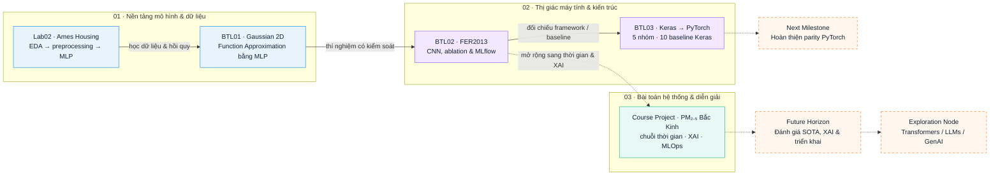
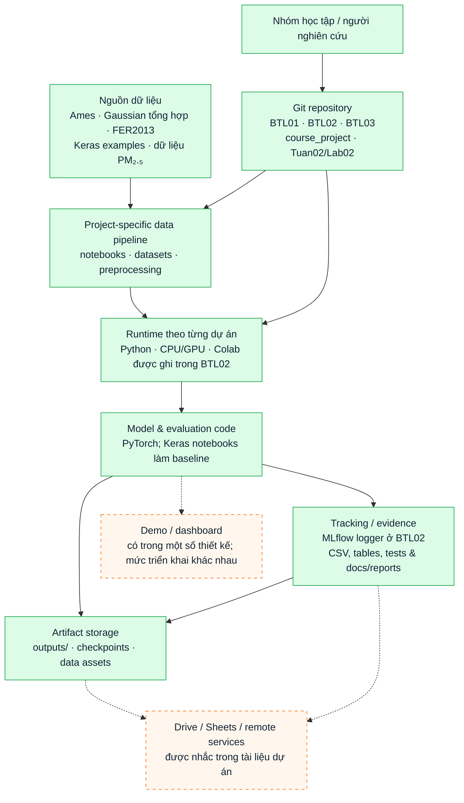

# 🌌 Deep Learning Odyssey

<div align="center">

### Từ những nơ-ron đầu tiên đến hệ thống học sâu có thể kiểm chứng

[](https://www.python.org/)
[](https://pytorch.org/)
[](https://keras.io/)
[](https://mlflow.org/)
[](#-đội-ngũ-thực-hiện)
[](#-the-next-horizon)

**Một workspace học tập và nghiên cứu Deep Learning — từ hồi quy, phân loại ảnh và chuyển đổi framework đến chuỗi thời gian, XAI và MLOps.**

</div>

---

## 🧭 Lời mở đầu — Hành trình thay vì một bộ sưu tập bài tập

`Deep_Learning_Group` lưu lại hành trình xây dựng năng lực theo từng lớp: bắt đầu với cách một MLP xấp xỉ một hàm liên tục; tiếp tục qua dữ liệu thực tế, CNN và quy trình đánh giá; rồi đi sâu vào đối chiếu Keras–PyTorch, mô hình chuỗi thời gian và các câu hỏi về khả năng giải thích, khả năng tái lập.

Các dự án trong workspace có **mức độ hoàn thiện khác nhau**. README này vì vậy tách bạch ba điều: mã nguồn đã có, kết quả có tài liệu/bằng chứng, và ý tưởng mới xuất hiện trong project charter. Một sơ đồ đẹp không thay thế cho một pipeline đã chạy — các nét đứt bên dưới chính là ranh giới đó.

> **Cách đọc nhanh:** bắt đầu ở [bản đồ hành trình](#-tầng-1--bản-đồ-hành-trình-tiến-hóa), chọn dự án trong [ma trận cột mốc](#-milestones-matrix--các-cột-mốc-kỹ-thuật), rồi xem README và tài liệu kiểm chứng của dự án tương ứng.

## 🧬 Tầng 1 — Bản đồ hành trình tiến hóa

<!-- [GUIDE FOR FUTURE UPDATES]: Khi thêm dự án, đặt node sau giai đoạn gần nhất về năng lực; nối bằng nét liền nếu đã có mã/bằng chứng, nét đứt nếu mới là kế hoạch. Cập nhật chú giải và trạng thái cùng lúc. -->



**Chú giải:** mũi tên liền biểu thị mối nối theo năng lực/artefact đã có trong workspace; mũi tên nét đứt biểu thị hướng mở rộng hoặc milestone chưa được xác nhận là đã triển khai. Đây là bản đồ khái niệm, không phải lịch sử commit hay quan hệ phụ thuộc bắt buộc.

## 🏛️ Tầng 2 — Workspace theo góc nhìn C4 (Context & Containers)

Sơ đồ sau mô tả **các thành phần nhìn thấy trong repo và tài liệu dự án**, không ngụ ý tất cả đã được tích hợp thành một nền tảng vận hành duy nhất.



**Đọc sơ đồ:** MLflow có mã logger và báo cáo run trong `BTL02`; BTL01 có pipeline thí nghiệm và bảng kết quả; các báo cáo BTL02 ghi nhận cả run thành công lẫn giới hạn (ví dụ một số ablation chỉ chạy một seed). Drive, Sheets và demo được vẽ nét đứt vì tài liệu có đề cập nhưng liên kết/tình trạng dịch vụ không được coi là đã xác minh toàn workspace.

## 🧊 Tầng 3 — Component Deep-Dive: đường đi từ Keras sang PyTorch

BTL03 là trọng tâm chuyển đổi framework của workspace. Hình dưới đây thể hiện **hợp đồng kỹ thuật mục tiêu** rút ra từ notebook Keras và project charter; pipeline PyTorch đầy đủ vẫn đang được phát triển.

```text
      ┌───────────────────────┐
     / Keras legacy baseline /│
    ┌───────────────────────┐ │    5 nhóm · 10 notebook
    │ NHWC / chuỗi / nhãn   │ │    MNIST · Gender · Emotion
    │ model.fit / callbacks │/     CNN+LSTM · SegNet · Detection
    └──────────┬────────────┘
               │  kiểm kê · giữ nguyên · đối chiếu
               ▼
       ┌───────────────────────┐
      / Dataset & transforms  /│
     ┌───────────────────────┐ │    shape, dtype, labels
     │ NHWC → NCHW           │ │    split & preprocessing
     │ (N,H,W,C) → (N,C,H,W) │/     không làm rò rỉ evaluation
     └──────────┬────────────┘
                │
                ▼
        ┌────────────────────────┐
       / PyTorch model components/│
      ┌────────────────────────┐ │   MLP · CNN · CNN+LSTM
      │ nn.Module / DataLoader │ │   Encoder–Decoder · FCN
      │ explicit train loop    │/    TimeDistributed → reshape
      └───────────┬────────────┘
                  │
                  ▼
          ┌───────────────────────┐
         / Verify & report       /│
        ┌───────────────────────┐ │   parameter / metric parity
        │ evaluate · tests · docs│ │   checkpoint · figures
        │ evidence per task      │/    reproducible configs
        └───────────────────────┘
```

| Nút thắt | Dữ kiện baseline đã quét | Ý nghĩa khi chuyển đổi |
|---|---|---|
| **Tensor layout** | CNN ảnh dùng đầu vào Keras dạng NHWC; object-detection notebook dùng ảnh RGB và chuẩn hóa `x / 127.5 - 1` | Đổi rõ ràng sang NCHW cho `Conv2d`, giữ đúng miền giá trị và thứ tự kênh. |
| **Chuỗi ảnh** | `MNIST_CNN_LSTM` sử dụng `TimeDistributed` | Gộp chiều batch–time qua CNN, sau đó dựng lại chuỗi feature trước LSTM. |
| **Dense prediction** | SegNet notebook có `img_h = img_w = 96`, 7 lớp và `UpSampling2D` | Giữ shape không gian, đổi decoder/upsampling và kiểm tra định dạng target segmentation. |
| **Parity** | Legacy README ghi nhận 10 notebook; cấu trúc `src/train.py` hiện là entry point chưa cấu hình pipeline | Chỉ báo parity đạt khi có phép đo chạy được và artefact/báo cáo tương ứng; checklist không thay thế bằng chứng. |

## 🗺️ Milestones Matrix — các cột mốc kỹ thuật

<!-- [GUIDE FOR FUTURE UPDATES]: Thêm dự án mới thành một hàng theo thứ tự hành trình; liên kết README/tài liệu có thật. Ghi trạng thái theo mã nguồn và báo cáo hiện có, không lấy nhãn trong đề cương làm bằng chứng hoàn thành. -->

| Giai đoạn / Mã | Dự án & bài toán | Kiến trúc / công nghệ lõi | Điểm nhấn có trong workspace | Trạng thái | Khám phá |
|---|---|---|---|---|---|
| Nền tảng · **Lab02** | Dự đoán `SalePrice` trên Ames Housing | EDA, preprocessing, baseline hồi quy, PyTorch MLP | Có pipeline notebook, module `HousePriceDataset`/`MLPRegressor` và bảng so sánh metric validation. | **Completed** · sản phẩm học tập có tài liệu | [README Lab02](./Tuan02/Lab02/README.md) · [Walkthrough](./Tuan02/Lab02/docs/reports/walkthrough.md) |
| BTL · **BTL01** | Xấp xỉ mật độ Gaussian 2D | PyTorch MLP, A/B/C experiments, runner, evaluator, visualizer | Có mã sinh dữ liệu/thí nghiệm, tổng hợp kết quả và báo cáo kiểm thử pipeline. | **Completed** · có báo cáo nghiệm thu | [README BTL01](./BTL01/README.md) · [T0702 report](./BTL01/docs/reports/T0702_261029_1136.md) · [Overall table](./BTL01/outputs/tables/summary_overall.csv) |
| BTL · **BTL02** | Nhận diện 7 cảm xúc FER2013 | PyTorch CNN, augmentation pipeline, MLflow logger, ablation | Có Small/Medium/LargeCNN, báo cáo run thực tế và giới hạn một seed ở một số so sánh; Transfer Learning/Grad-CAM/demo cần đối chiếu tình trạng từng task. | **In Progress** | [README BTL02](./BTL02/README.md) · [T0203 report](./BTL02/docs/experiences/EXP02_EXP03_261121_1022.md) · [T0205 report](./BTL02/docs/experiences/EXP08_261121_1900.md) |
| BTL · **BTL03** | Chuyển 10 bài thực hành Keras sang PyTorch | MLP, CNN, CNN+LSTM, utilities, SegNet/object detection | Có 10 notebook legacy đã nhóm theo bài toán; `src/` mới là scaffold, train/evaluate/inference chưa có pipeline cụ thể. | **In Progress** · baseline lưu trữ / chuyển đổi tiếp theo | [README BTL03](./BTL03/README.md) · [Legacy index](./BTL03/legacy_keras/README.md) |
| Course project · **DL-PM25-BJ / BPM25** | Dự báo PM₂.₅ Bắc Kinh từ dữ liệu không–thời gian | Đặc tả đề cập LSTM, DLinear, Informer, PatchTST, SHAP/IG, Streamlit và Docker | Có project charter, README và phân công; các tệp model/pipeline trong `src/` hiện rỗng và `requirements.txt` rỗng, nên đây là kiến trúc mục tiêu chứ chưa phải kết quả chạy. | **In Progress** · triển khai mô hình **Upcoming** | [README project](./course_project/README.md) · [AGENTS / work packages](./course_project/AGENTS.md) |

### Bằng chứng và chiều sâu

- **BTL01:** các file `summary_exp_*.csv`, `summary_overall.csv`, manifest dữ liệu và report task giúp truy vết kết quả thay vì chỉ dựa vào hình minh họa trong README.
- **BTL02:** `MLflowLogger` định nghĩa schema CSV 24 cột; các experience report nêu rõ seed, cấu hình, metric nguồn và giới hạn diễn giải.
- **BTL03:** [legacy index](./BTL03/legacy_keras/README.md) mô tả input/loss/optimizer và các điểm như `np.rot90`, `TimeDistributed`, `UpSampling2D`, chuẩn hóa `x / 127.5 - 1` dựa trên notebook đã kiểm tra.

## 🧰 Engineering DNA — kỷ luật vận hành

- **Modular trước, notebook sau:** notebook hữu ích cho EDA/thử nghiệm; thành phần tái sử dụng được đóng gói vào module và class theo phạm vi dự án.
- **Reproducibility có ngữ cảnh:** BTL01/BTL02/BTL03 quy định seed `42`; Course Project mô tả bộ seed `[42, 1024, 2026]`. Mỗi kết quả cần ghi đúng giao thức của dự án, không gộp thành một cam kết chung.
- **WBS và ownership:** dự án lớn dùng Task ID/Work Package để chia phạm vi; đọc AGENTS và project charter trước khi thay đổi kiến trúc.
- **Evidence-first:** báo cáo, log, bảng kết quả và test được lưu cạnh dự án trong `docs/`, `outputs/` hoặc thư mục thí nghiệm phù hợp.
- **Git hygiene:** làm việc trên nhánh theo quy ước riêng của dự án; không đưa dữ liệu nặng, secrets, môi trường ảo hay checkpoint cục bộ vào commit.
- **Tuyên bố theo bằng chứng:** phân biệt “đã có trong source”, “được report xác nhận” và “được đặc tả/đề xuất”; báo cáo một seed không đại diện cho kết luận thống kê nhiều seed.

## 🌅 The Next Horizon — kiến trúc mở

<!-- [GUIDE FOR FUTURE UPDATES]: Chọn milestone kế tiếp có nguồn trong task/charter hoặc được nhóm thống nhất; gắn nhãn Proposed/Upcoming nếu chưa có mã và bằng chứng. Thêm một dòng bảng và nối từ node phù hợp bằng nét đứt trước khi chuyển sang nét liền. -->

Các hướng dưới đây là **cửa mở**, không phải cam kết rằng chúng đã được triển khai:

1. **BTL03 — từ baseline đến parity:** hoàn thiện từng dataset/model, kiểm thử shape và tham số, rồi mới báo cáo metric đối chiếu.
2. **BTL02 — từ CNN đến giải thích:** tiếp tục các task còn lại về transfer learning, phân tích lỗi và giao diện; gắn mọi kết luận với report/artefact chạy thật.
3. **PM₂.₅ — từ charter đến pipeline:** triển khai preprocessing chống leakage, baseline chạy được, đánh giá đa seed; sau đó mới mở rộng sang Transformer/XAI/serving.
4. **Xa hơn:** Transformers, LLMs và GenAI chỉ trở thành cột mốc chính thức khi có đề bài, mã nguồn và phạm vi được nhóm xác nhận.

## 👥 Đội ngũ thực hiện

Workspace có các tài liệu dự án nêu quy mô **5 thành viên**. Project charter PM₂.₅ ghi các tên dưới đây trong ma trận Work Package; danh sách này phản ánh **tài liệu của course project**, không tự động khẳng định phân công chung cho mọi BTL.

| Thành viên theo project charter | Work Package được ghi trong charter |
|---|---|
| Nguyễn Thành Đạt | WP01 — Data Pipeline & Preprocessing |
| Trần Chí Vỹ | WP02 — Baseline Model Development |
| Đinh Thái Toàn | WP03 — SOTA Model & Fine-Tuning; cùng tham gia WP06 |
| Nguyễn Tấn Duy | WP04 — XAI Integration |
| Nguyễn Công Trí | WP05 — Web Demo & UI/UX; cùng tham gia WP06 |

**Đại diện/đầu mối toàn workspace:** `[Cập nhật theo phân công chính thức của nhóm]` · **Thông tin liên hệ:** `[Bổ sung nếu nhóm muốn công khai]`.

---

<div align="center">

*Một mô hình tốt trả lời được câu hỏi. Một dự án tốt còn cho biết dữ liệu đến từ đâu, kết quả được tạo ra thế nào và người khác có thể kiểm chứng ra sao.*

</div>