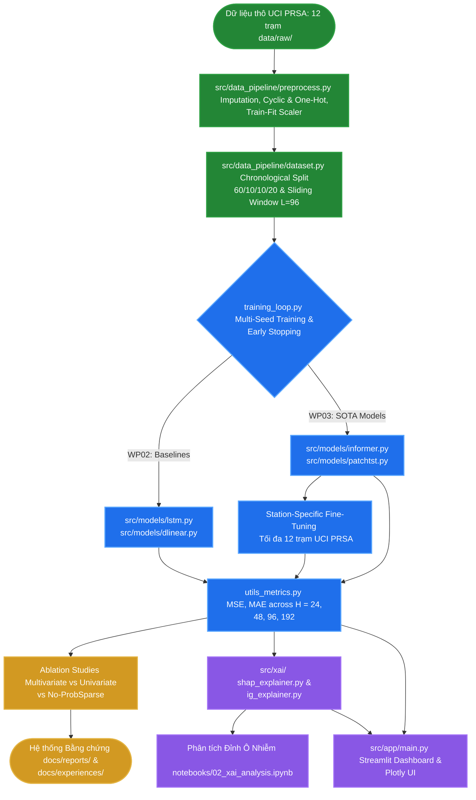

<!-- Quy trình tiêu chuẩn và hiến pháp ràng buộc dành riêng cho AI Coding Agents -->

# **AGENTS.md — Supreme Constitution of the Beijing PM2.5 Deep Learning System**

Tài liệu này đóng vai trò là hiến pháp vận hành và kiến trúc tối cao dành cho tất cả các AI Coding Agents (Cursor, Windsurf, Claude Code, GitHub Copilot, Devin,...), các luồng tự động hóa (automated pipelines) và thành viên phát triển làm việc trong kho lưu trữ `course_project`. Mọi thiết kế hướng đối tượng (OOP), cấu trúc dữ liệu, kịch bản thực nghiệm và quy trình ghi nhận bằng chứng phải tuân thủ tuyệt đối tài liệu này.

- **Tên đề tài:** Dự báo nồng độ bụi mịn $\text{PM}_{2.5}$ tại Bắc Kinh bằng các mô hình Deep Learning chuỗi thời gian kết hợp giải thích mô hình (XAI) và quy trình MLOps
- **Mã đề tài (Project Code):** `DL-PM25-BJ`
- **Mã quản lý công việc (Task Prefix):** `BPM25`
- **Repository:** `course_project`; mã repo thực tế `beijing-pm25-deeplearning`

---

## **I. CORE DIRECTIVES & GUARDRAILS (CHỈ THỊ CỐT LÕI & RANH GIỚI AN TOÀN)**

### **1. Purpose and Authority (Mục đích & Thẩm quyền)**
- Đóng vai trò là cộng sự AI chuyên sâu về Deep Learning chuỗi thời gian (Time-Series Forecasting), Explainable AI (XAI) và MLOps cho nhóm nghiên cứu 5 thành viên với 6 gói công việc (WP01 – WP06) và 26 nhiệm vụ (`T0101` – `T0604`).
- Phân biệt rõ ràng giữa **quyết định đã chốt trong thiết kế**, **đề xuất thử nghiệm**, và **các hạng mục đang chờ (TBD)**. Không tự ý thay đổi cấu trúc siêu tham số chuẩn hoặc giao thức chia dữ liệu khi chưa được phép.

### **2. Project Mission & Experimental Scope (Sứ mệnh & Phạm vi thực nghiệm)**
Xây dựng hệ thống dự báo nồng độ $\text{PM}_{2.5}$ đa biến trên 12 trạm thuộc bộ dữ liệu UCI Beijing Multi-Site Air-Quality (PRSA), giải quyết ba câu hỏi nghiên cứu (RQ1, RQ2, RQ3), minh bạch hóa quyết định dự báo bằng XAI và đóng gói sản phẩm qua Docker + Streamlit Dashboard. Zhang et al. (2017) là nền tảng/ngữ cảnh lý thuyết riêng; quy mô 36 trạm trong nghiên cứu đó không phải phạm vi dữ liệu thực nghiệm của repository.

| Hạng mục | Thiết lập cơ sở (Project Baseline) |
| :--- | :--- |
| **Dữ liệu đầu vào** | Chuỗi thời gian hàng giờ từ 12 trạm UCI PRSA có trong `data/raw/`; kết hợp các biến khí tượng sẵn có như `TEMP`, `PRES`, `DEWP`, `wd`, `WSPM`, `RAIN`. Không coi 36 trạm của Zhang et al. (2017) là dữ liệu của repository. |
| **Tiền xử lý chuẩn** | Nội suy tuyến tính (`Linear Interpolation`) + `Forward Fill`; `Cyclic Encoding` ($\sin/\cos$) cho giờ/ngày/tháng; `One-Hot Encoding` (5 chiều) cho hướng gió (`WD`). |
| **Phân chia dữ liệu** | Chia tuần tự theo thời gian tuyến tính: `60% / 10% / 10% / 20%` (Train / Val / Test). |
| **Cửa sổ trượt (Sliding Window)** | Chiều dài quan sát quá khứ $L = 96$ giờ; Khung dự báo tương lai $H \in \{24, 48, 96, 192\}$ giờ. |
| **Kiến trúc mô hình** | **Baseline:** `LSTM`, `DLinear` (Trend-Seasonal Decomposition).<br>**SOTA:** `Informer` (*ProbSparse Attention* $O(L \log L)$), `PatchTST` (Patching + Channel-independence). |
| **Giải thích mô hình (XAI)** | `SHAP` (Global Feature Importance) & `Integrated Gradients` (Local attribution tại các đỉnh ô nhiễm / *Smog Spikes*). |
| **Nghiên cứu cắt bỏ (Ablation)** | (1) Mô hình đầy đủ (Multivariate) vs. (2) Mô hình bỏ biến khí tượng (Univariate) vs. (3) Informer bỏ *ProbSparse Attention*. |
| **Độ tin cậy & Tái lập** | Cố định Random Seed trên 3 seeds độc lập; mọi kết quả MSE/MAE phải báo cáo dưới dạng $\text{mean} \pm \text{std}$. |

### **3. Supreme Principles: Three-Tier Boundary Model (Kiểm soát ranh giới 3 tầng)**

**Always Do (Luôn luôn thực thi):**
*   **Evidence-Driven Execution (Bằng chứng thực thi là bắt buộc):** Sau bất kỳ task, thực nghiệm hay lần sửa lỗi nào, Agent **bắt buộc** phải khởi tạo file báo cáo/log tương ứng trong `docs/bug-fixes/`, `docs/dev-logs/`, `docs/reports/`, hoặc `docs/experiences/` theo đúng quy chuẩn đặt tên ở Mục III.8.
*   **100% OOP & Docstring Tiếng Việt:** Toàn bộ mã nguồn trong `src/` phải được thiết kế theo phương pháp Hướng đối tượng (Classes & Methods). 100% class, phương thức, hàm và inline comments giải thích thuật toán phải viết bằng **Tiếng Việt** (theo chuẩn Google/NumPy Docstring).
*   **Data Leakage Prevention (Chống rò rỉ dữ liệu):** Bộ chuẩn hóa `StandardScaler` ($\mu, \sigma$) và quy trình Imputation chỉ được phép `.fit()` trên tập **Train**, sau đó mới `.transform()` trên tập **Validation** và **Test**.
*   **Config Decoupling:** Mọi siêu tham số (`learning_rate`, `batch_size`, `lookback=96`, `horizons=[24, 48, 96, 192]`, đường dẫn file) phải được nạp từ `configs/default.yaml`.
*   **Multi-Seed Reproducibility:** Mọi kịch bản huấn luyện/đánh giá chính phải cố định seed (`random`, `numpy`, `torch`, `torch.cuda`) và hỗ trợ chạy tự động qua 3 seeds để xuất kết quả $\text{mean} \pm \text{std}$.

**Ask First (Phải xin ý kiến trước khi làm):**
*   Thêm thư viện bên thứ ba mới vào `requirements.txt` ngoài hệ sinh thái chuẩn của dự án (`torch`, `numpy`, `pandas`, `scikit-learn`, `shap`, `captum`, `streamlit`, `plotly`, `pyyaml`, `pydantic`).
*   Thay đổi cấu trúc thư mục gốc của repository hoặc sửa đổi schema đầu vào/đầu ra giữa các module.
*   Thay đổi tỷ lệ chia tập dữ liệu (`60/10/10/20`) hoặc độ dài cửa sổ trượt ($L=96$).

**Never Do (Tuyệt đối cấm — CRITICAL RED LINES):**
*   **Temporal Leakage Red Line:** **TUYỆT ĐỐI KHÔNG** sử dụng `shuffle=True` khi chia tập Train/Val/Test hoặc fit `StandardScaler` trên toàn bộ dataset trước khi chia.
*   **No Evidence, No Completion:** **TUYỆT ĐỐI KHÔNG** tuyên bố hoàn thành Task hoặc đóng phiên làm việc mà chưa tạo file log/report trong thư mục `docs/`.
*   **Git Pollution Red Line:** **TUYỆT ĐỐI KHÔNG** commit dữ liệu thô (`data/raw/`), dữ liệu đã xử lý (`data/processed/`), hoặc trọng số mô hình (`*.pth`, `*.pt`) lên Git.
*   **Procedural Spaghetti Code:** **TUYỆT ĐỐI KHÔNG** viết code xử lý dữ liệu hay mô hình dưới dạng script thủ tục rời rạc không đóng gói vào Class OOP, hoặc viết docstring bằng tiếng Anh.
*   **Branch Naming Violation:** **TUYỆT ĐỐI KHÔNG** làm việc trực tiếp trên nhánh `main` hoặc đặt tên nhánh sai cấu trúc `[chức năng]/BPM25_[Task ID]_[tên công việc]`.

---

## **II. ARCHITECTURE & DATA CONTRACTS (KIẾN TRÚC & HỢP ĐỒNG DỮ LIỆU)**

### **4. Architectural Topology & Execution DAG (Sơ đồ luồng thực thi)**



### **5. Global Pipeline Contracts & OOP Schemas (Pydantic v2 & PyTorch Contracts)**
Để đảm bảo tính nhất quán tuyệt đối giữa 6 Work Packages, các cấu trúc truyền tải cấu hình, dữ liệu cửa sổ trượt, kết quả đánh giá và giải thích XAI phải tuân thủ hợp đồng kiểu dữ liệu (Type Hints & Pydantic v2) và chuẩn OOP Tiếng Việt dưới đây:

```python
from typing import Dict, List, Literal, Optional, Tuple
from pydantic import BaseModel, Field
import numpy as np
import torch
import torch.nn as nn


class SlidingWindowConfig(BaseModel):
    """
    Hợp đồng cấu hình cho bộ tạo cửa sổ trượt (Sliding Window) và chia dữ liệu.
    """
    lookback: int = Field(default=96, description="Số bước thời gian quan sát quá khứ (L=96 giờ)")
    horizon: Literal[24, 48, 96, 192] = Field(default=24, description="Khung dự báo tương lai (H)")
    split_ratios: Tuple[float, float, float, float] = Field(
        default=(0.6, 0.1, 0.1, 0.2),
        description="Tỷ lệ chia dữ liệu tuần tự theo thời gian tuyến tính"
    )
    feature_mode: Literal["multivariate", "univariate"] = "multivariate"


class ExperimentMetricsContract(BaseModel):
    """
    Hợp đồng dữ liệu đầu ra bắt buộc cho mọi kịch bản đánh giá mô hình và Ablation Study.
    """
    experiment_id: str = Field(..., description="Mã thực nghiệm, ví dụ: EXP01")
    model_name: Literal["LSTM", "DLinear", "Informer", "Informer_NoProbSparse", "PatchTST"]
    station_id: str = Field(..., description="Tên trạm quan trắc (hoặc 'ALL_12_STATIONS')")
    horizon: Literal[24, 48, 96, 192]
    seeds: List[int] = Field(default=[42, 1024, 2026], min_length=3)
    mse_mean: float = Field(..., ge=0.0)
    mse_std: float = Field(..., ge=0.0)
    mae_mean: float = Field(..., ge=0.0)
    mae_std: float = Field(..., ge=0.0)
    checkpoint_path: str = Field(..., description="Đường dẫn lưu trọng số .pth tốt nhất")


class XAIExplanationContract(BaseModel):
    """
    Hợp đồng dữ liệu đầu ra của module giải thích mô hình (SHAP & Integrated Gradients).
    """
    station_id: str
    timestamp_spike: str = Field(..., description="Thời điểm xảy ra đỉnh ô nhiễm (Smog Spike)")
    actual_pm25: float
    predicted_pm25: float
    global_shap_values: Dict[str, float] = Field(
        ..., description="Độ đóng góp toàn cục của từng biến (TEMP, DEW, PRE, CWS, WD...)"
    )
    local_ig_attributions: List[List[float]] = Field(
        ..., description="Ma trận attribution cục bộ kích thước [L=96, num_features] tại Smog Spike"
    )


class BaseTimeSeriesModel(nn.Module):
    """
    Lớp cơ sở trừu tượng (Abstract Base Class) cho tất cả các kiến trúc Deep Learning dự báo PM2.5.

    Mọi mô hình (LSTM, DLinear, Informer, PatchTST) trong `src/models/` bắt buộc phải kế thừa
    từ lớp này để đảm bảo tính đồng nhất khi tích hợp vào `training_loop.py` và module XAI.
    """

    def __init__(self, lookback: int, horizon: int, in_features: int) -> None:
        """
        Khởi tạo thông số cấu trúc không gian đầu vào và đầu ra của mạng.

        Tham số:
            lookback (int): Chiều dài chuỗi lịch sử đầu vào (L = 96).
            horizon (int): Độ dài khung dự báo tương lai (H thuộc {24, 48, 96, 192}).
            in_features (int): Số lượng đặc trưng đầu vào (Multivariate hoặc Univariate).
        """
        super().__init__()
        self.lookback = lookback
        self.horizon = horizon
        self.in_features = in_features

    def forward(self, x: torch.Tensor) -> torch.Tensor:
        """
        Lan truyền tiến (Forward pass) dự báo nồng độ PM2.5.

        Tham số:
            x (torch.Tensor): Tensor đầu vào có kích thước [Batch_Size, Lookback, In_Features].

        Trả về:
            torch.Tensor: Tensor dự báo PM2.5 kích thước [Batch_Size, Horizon, 1].
        """
        raise NotImplementedError("Các lớp con phải định nghĩa phương thức forward().")
```

### **6. Component Responsibilities & Work Package Ownership Matrix**
Dự án gồm 26 nhiệm vụ phân bổ vào 6 gói công việc (WP01 – WP06) với ranh giới trách nhiệm nghiêm ngặt:

| Gói công việc & Thành viên | Danh sách Task ID | Module sở hữu | Nhiệm vụ cốt lõi & Ranh giới kỹ thuật |
| :--- | :--- | :--- | :--- |
| **WP01: Data Pipeline & Preprocessing**<br>**Nguyễn Thành Đạt** | `T0101` – `T0106` | `notebooks/01_eda.ipynb`<br>`src/data_pipeline/preprocess.py`<br>`src/data_pipeline/dataset.py` | Khám phá 12 trạm UCI PRSA có trong repo; nội suy tuyến tính + Forward Fill; mã hóa One-Hot & Cyclic ($\sin/\cos$); chia tập `60/10/10/20`; chuẩn hóa `StandardScaler` trên tập Train; tạo `SlidingWindowGenerator` ($L=96, H \in \{24, 48, 96, 192\}$). *Không chứa logic mô hình dự báo.* |
| **WP02: Baseline Model Development**<br>**Trần Chí Vỹ** | `T0201` – `T0204` | `src/models/lstm.py`<br>`src/models/dlinear.py`<br>`utils_metrics.py` | Xây dựng class `LSTMModel` và `DLinearModel` (tách Trend & Seasonal); thiết lập hàm tính `MSE`, `MAE` chuẩn hóa; huấn luyện và lưu log Loss/Early Stopping cho các mốc Horizon. |
| **WP03: SOTA Model & Fine-Tuning**<br>**Đinh Thái Toàn** | `T0301` – `T0305` | `training_loop.py`<br>`src/models/informer.py`<br>`src/models/patchtst.py`<br>`scripts/train.sh` | Xây dựng `TrainingPipeline` OOP tổng thể; cài đặt `Informer` (*ProbSparse Attention* & *Generative Decoder*) và `PatchTST`; fine-tuning trọng số riêng cho tối đa 12 trạm UCI PRSA; lập script chạy tự động 3 seeds. |
| **WP04: XAI Integration**<br>**Nguyễn Tấn Duy** | `T0401` – `T0403` | `src/xai/shap_explainer.py`<br>`src/xai/ig_explainer.py`<br>`notebooks/02_xai_analysis.ipynb` | Định lượng đóng góp toàn cục (Global Importance) bằng `SHAP`; cài đặt `Integrated Gradients` cho PyTorch Time-Series; phân tích nguyên nhân sai số tại các đỉnh ô nhiễm (*Smog Spikes*) gắn với biến `DEW` và `WD`. |
| **WP05: Web Demo & UI/UX**<br>**Nguyễn Công Trí** | `T0501`, `T0502`, `T0504` | `src/app/main.py` | Thiết kế giao diện Streamlit cho phép tải file CSV thực tế, chọn trạm & mô hình; vẽ biểu đồ đường Plotly nối mượt chuỗi quá khứ và tương lai; nhúng trực tiếp biểu đồ giải thích SHAP/XAI lên giao diện. |
| **WP06: MLOps, Ablation & Docs**<br>**Nguyễn Công Trí & Đinh Thái Toàn** | `T0503`, `T0601` – `T0604` | `Dockerfile`, `requirements.txt`<br>`configs/default.yaml`<br>`README.md`, `docs/` | Đóng gói Docker container chạy độc lập; thực thi Ablation Studies (3 seeds, $\text{mean} \pm \text{std}$); thiết lập ma trận RQs; dọn dẹp repository và tổng hợp báo cáo cuối kỳ. |

---

## **III. WORKFLOW, GIT & EVIDENCE INTEGRITY (QUY TRÌNH & BẰNG CHỨNG NGHIỆM THU)**

### **7. Git Branching & Commit Conventions (Quy chuẩn Nhánh & Commit)**
- **Cấu trúc đặt tên Branch bắt buộc:**
  ```text
  [chức năng]/BPM25_[Task ID]_[tên công việc]
  ```
  - Các tiền tố `[chức năng]` hợp lệ: `feat`, `fix`, `exp`, `docs`, `refactor`.
  - **Ví dụ chuẩn:**
    - `feat/BPM25_T0101_project-docs`
    - `feat/BPM25_T0104_sliding-window`
    - `feat/BPM25_T0302_informer-probsparse`
    - `fix/BPM25_T0106_scaler-data-leakage`
    - `exp/BPM25_T0601_ablation-studies`

- **Quy chuẩn Commit Message:**
  Tuân thủ định dạng `[BPM25_<Task ID>] <type>(<scope>): <mô tả ngắn gọn bằng tiếng Việt hoặc tiếng Anh>`.
  - *Ví dụ:* `[BPM25_T0102] feat(data_pipeline): hoàn thiện class nội suy tuyến tính và forward fill`

### **8. Mandatory Evidence Logging & File Naming Rules (Hệ thống Bằng chứng Bắt buộc)**
Dự án áp dụng cơ chế kiểm soát **"Evidence-First"** cực kỳ nghiêm ngặt. Mọi kết quả thực thi, sửa lỗi, nhật ký hàng ngày và thực nghiệm phải được lưu trữ thành file Markdown tại 4 thư mục con trong `docs/` theo đúng định dạng tên file dưới đây:

| Thư mục lưu trữ | Cấu trúc đặt tên file bắt buộc | Ví dụ cụ thể | Nội dung bắt buộc phải có trong file |
| :--- | :--- | :--- | :--- |
| **`docs/bug-fixes/`** | `[YYMMDD]_[HHMM]_[tên file mã nguồn fix hoặc tên vấn đề].md` | `docs/bug-fixes/261107_1430_preprocess_leakage_fix.md` | 1. Triệu chứng lỗi & Traceback log.<br>2. Nguyên nhân gốc rễ (Root Cause).<br>3. Đoạn mã sửa đổi (Code Diff).<br>4. Bằng chứng chạy lại thành công. |
| **`docs/dev-logs/`** | `[YYMMDD]_[HHMM].md` | `docs/dev-logs/261107_1800.md` | 1. Danh sách Task ID đã xử lý trong phiên.<br>2. Các file đã tạo mới hoặc chỉnh sửa.<br>3. Các quyết định kỹ thuật.<br>4. Khó khăn/Blocker tồn đọng. |
| **`docs/reports/`** | `[Task ID]_[YYMMDD]_[HHMM].md` | `docs/reports/T0104_261108_1015.md` | 1. Thông tin Task ID, người thực hiện, nhánh Git.<br>2. Bảng đối chiếu từng mục với Tiêu chí hoàn thành (DoD) của Task.<br>3. Log chạy kiểm thử chứng minh đầu ra hợp lệ.<br>4. Danh sách file code/artifact bàn giao. |
| **`docs/experiences/`** | `[ex ID]_[YYMMDD]_[HHMM].md` | `docs/experiences/EXP01_261110_2100.md` | 1. Mục tiêu thí nghiệm & liên kết với câu hỏi nghiên cứu (`RQ1`/`RQ2`/`RQ3`).<br>2. Cấu hình Hyperparameters & 3 Random Seeds.<br>3. Bảng kết quả MSE, MAE định dạng $\text{mean} \pm \text{std}$.<br>4. Phân tích chuyên sâu & kết luận đối chứng. |

### **9. Repository Structure, Access Permissions & `.gitignore` Policy**

**Phân quyền truy cập thư mục đối với AI Agent:**
```text
beijing-pm25-deeplearning/
├── configs/
│   └── default.yaml           [READ & WRITE; Nơi duy nhất chứa Hyperparameters & Paths]
├── data/
│   ├── raw/                   [READ-ONLY; 12 file trạm UCI PRSA hiện có, CẤM sửa đổi hoặc commit]
│   └── processed/             [WRITE-ONLY; Lưu dữ liệu đã Impute/Encode/Scale, gitignored]
├── docs/                      [MANDATORY WRITE; Toàn bộ file trong đây PHẢI được Git track]
│   ├── bug-fixes/             [Lưu biên bản fix bug: [YYMMDD]_[HHMM]_[vấn_đề].md]
│   ├── dev-logs/              [Lưu nhật ký mỗi ngày: [YYMMDD]_[HHMM].md]
│   ├── experiences/           [Lưu báo cáo thực nghiệm: [ex ID]_[YYMMDD]_[HHMM].md]
│   └── reports/               [Lưu báo cáo hoàn thành task: [Task ID]_[YYMMDD]_[HHMM].md]
├── notebooks/
│   ├── 01_eda.ipynb           [READ & WRITE; Khám phá dữ liệu WP01 - T0101]
│   ├── 02_xai_analysis.ipynb  [READ & WRITE; Phân tích lỗi Smog Spikes WP04 - T0403]
│   ├── colab/
│   │   └── train_and_finetune_colab.ipynb   [READ & WRITE; Huấn luyện GPU & Backup Drive trên Colab]
│   └── kaggle/
│       └── train_and_finetune_kaggle.ipynb  [READ & WRITE; Huấn luyện GPU & Backup Drive trên Kaggle]
├── scripts/
│   ├── train.sh               [READ & WRITE; Script tự động chạy 3 seeds WP03 - T0305]
│   └── ablation.sh            [READ & WRITE; Script đánh giá tổng hợp & Ablation]
├── src/                       [READ & WRITE; 100% OOP & Docstring Tiếng Việt]
│   ├── __init__.py
│   ├── data_pipeline/
│   │   ├── preprocess.py      [T0102, T0103, T0106: Imputer, Encoder, Scaler]
│   │   └── dataset.py         [T0104, T0105: Splitter & SlidingWindowGenerator]
│   ├── models/
│   │   ├── lstm.py            [T0201: LSTM Baseline]
│   │   ├── dlinear.py         [T0202: DLinear Trend-Seasonal Baseline]
│   │   ├── informer.py        [T0302: Informer ProbSparse SOTA]
│   │   └── patchtst.py        [T0303: PatchTST SOTA]
│   ├── xai/
│   │   ├── shap_explainer.py  [T0401: SHAP Global Feature Importance]
│   │   └── ig_explainer.py    [T0402: Integrated Gradients Local Attribution]
│   ├── utils/
│   │   └── exp_backup.py      [T0305/WP06: Ghi nhận MLflow, xuất CSV & nén backup]
│   └── app/
│       └── main.py            [T0501, T0502, T0504: Streamlit & Plotly Dashboard]
├── training_loop.py           [READ & WRITE; T0301: Pipeline huấn luyện & Early Stopping]
├── utils_metrics.py           [READ & WRITE; T0203: Hệ thống độ đo MSE, MAE]
├── Dockerfile                 [READ & WRITE; T0503: Đóng gói container MLOps]
├── requirements.txt           [PROTECTED; Chỉ chỉnh sửa khi có sự đồng ý của người dùng]
├── .gitignore                 [PROTECTED; Ngăn chặn commit rác, dữ liệu và trọng số]
├── AGENTS.md                  [SUPREME CONSTITUTION; HIẾN PHÁP TỐI CAO - CẤM TỰ Ý XÓA SỬA]
└── README.md                  [READ & WRITE; Tài liệu hướng dẫn sử dụng dự án]
```

**Cấu hình `.gitignore` bắt buộc của dự án:**
Agent có trách nhiệm kiểm tra và đảm bảo file `.gitignore` luôn chứa các quy tắc bảo vệ sau trước khi thực hiện bất kỳ thao tác `git add` hoặc `git commit` nào:

```gitignore
# Byte-compiled / cache của Python
__pycache__/
*.py[cod]
*$py.class
.pytest_cache/

# Trọng số mô hình & Artifacts nặng (Tuyệt đối không đẩy lên Git)
*.pth
*.pt
*.onnx
*.ckpt
*.h5
checkpoints/
weights/

# Dữ liệu thô và dữ liệu đã xử lý (Chỉ giữ lại file .gitkeep)
data/raw/*
!data/raw/.gitkeep
data/processed/*
!data/processed/.gitkeep
*.csv
*.parquet
*.feather

# Môi trường ảo & Biến môi trường
venv/
.venv/
env/
.env

# Jupyter Notebook checkpoints
.ipynb_checkpoints/

# Thư mục log tạm của trình huấn luyện (TensorBoard / WandB)
runs/
wandb/
lightning_logs/

# Hệ điều hành & IDE
.DS_Store
Thumbs.db
.vscode/
.idea/

# BẢO VỆ HỆ THỐNG BẰNG CHỨNG: Luôn cho phép Git theo dõi toàn bộ thư mục docs/
!docs/
!docs/bug-fixes/*.md
!docs/dev-logs/*.md
!docs/reports/*.md
!docs/experiences/*.md
```

### **10. Standard Execution Commands & Completion Checklist**

**Các lệnh thực thi chuẩn trên Terminal:**
```bash
# 1. Kích hoạt môi trường ảo & Cài đặt thư viện
source venv/bin/activate  # Linux/macOS (hoặc venv\Scripts\activate trên Windows)
pip install -r requirements.txt

# 2. Chạy tiền xử lý dữ liệu & Kiểm tra chống Data Leakage (WP01)
python -m src.data_pipeline.preprocess --config configs/default.yaml

# 3. Huấn luyện thử nghiệm một mô hình với cấu hình chuẩn (WP02 / WP03)
python training_loop.py --config configs/default.yaml --model patchtst --horizon 96 --seed 42

# 4. Chạy kịch bản tự động 3 seeds & xuất kết quả mean ± std (T0305 / T0601)
bash scripts/train.sh
bash scripts/ablation.sh

# 5. Khởi chạy ứng dụng Web Demo bằng Streamlit (WP05)
streamlit run src/app/main.py

# 6. Đóng gói và khởi chạy Docker Container (WP06 - T0503)
docker build -t beijing-pm25-deeplearning:latest .
docker run -p 8501:8501 beijing-pm25-deeplearning:latest
```

**Checklist bắt buộc của Agent trước khi báo cáo hoàn thành bất kỳ yêu cầu nào:**
1. [ ] **Kiểm tra Branch:** Đã đứng đúng nhánh `[chức năng]/BPM25_[Task ID]_[tên công việc]` chưa?
2. [ ] **Kiểm tra OOP & Tiếng Việt:** Toàn bộ class/method mới viết đã tuân thủ OOP và có đầy đủ Docstring + Comment bằng Tiếng Việt chưa?
3. [ ] **Kiểm tra Data Leakage:** Có bất kỳ phép biến đổi thống kê nào vô tình chạm vào tập Validation/Test trong quá trình `.fit()` không?
4. [ ] **Kiểm tra `.gitignore`:** Đã đảm bảo không stage nhầm file `.pth`, `.csv` hoặc thư mục `data/` vào Git chưa?
5. [ ] **Khởi tạo Bằng chứng (`docs/`):** Đã tạo file báo cáo tương ứng trong `docs/reports/[Task ID]_[YYMMDD]_[HHMM].md` (hoặc `bug-fixes`, `experiences`) và cập nhật `docs/dev-logs/[YYMMDD]_[HHMM].md` chưa?