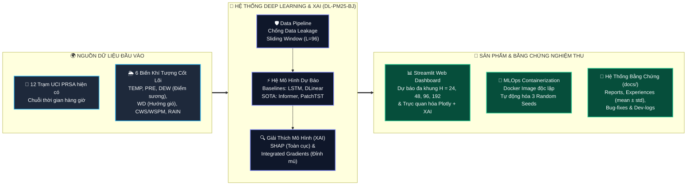
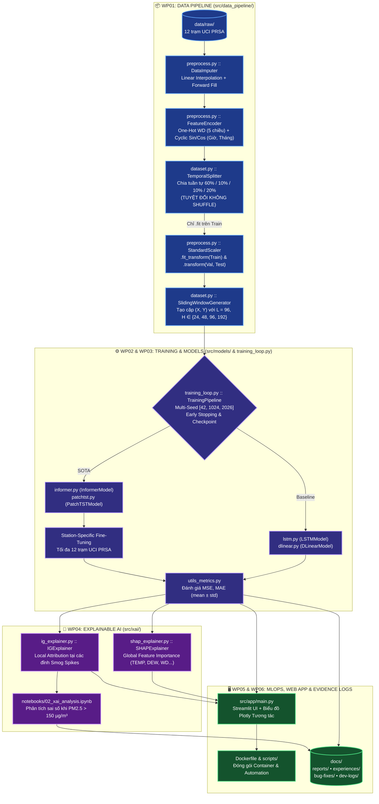
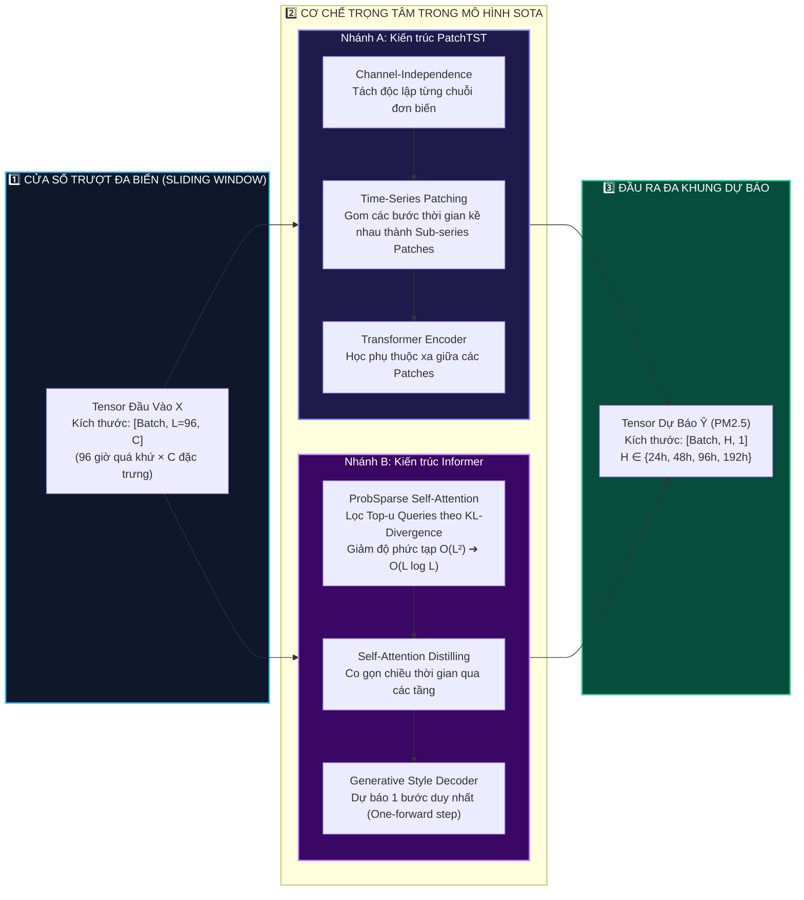
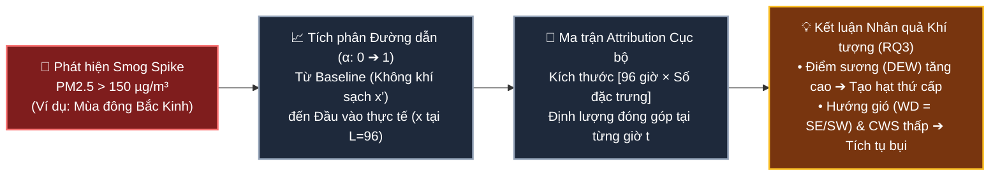

# 🌫️ DỰ BÁO NỒNG ĐỘ BỤI MỊN $\text{PM}_{2.5}$ TẠI BẮC KINH BẰNG DEEP LEARNING, XAI & MLOPS

[](#)
[](#)
[](#)
[](#)
[](#)
[](#)

> **Mã đề tài:** `DL-PM25-BJ` | **Mã quản lý công việc:** `BPM25` | **Repository:** `beijing-pm25-deeplearning`  
> **Phương pháp tiếp cận:** Dự báo đa biến trên 12 trạm UCI Beijing Multi-Site Air-Quality (PRSA) có trong `data/raw/` • Chuỗi thời gian dài ($L=96 \rightarrow H \in \{24, 48, 96, 192\}$) • Minh bạch hóa quyết định (SHAP & Integrated Gradients) • Quản trị dự án dựa trên bằng chứng (*Evidence-First*).

---

## 📖 MỤC LỤC
1. [Bối cảnh Khoa học & Câu hỏi Nghiên cứu (RQs)](#-1-bối-cảnh-khoa-học--câu-hỏi-nghiên-cứu-rqs)
2. [Kiến trúc Hệ thống Đa tầng (Top-Down Visual Hierarchy)](#-2-kiến-trúc-hệ-thống-đa-tầng-top-down-visual-hierarchy)
   - [Tầng 1 — Tổng quát (Level 1: System Context)](#21-tầng-1--góc-nhìn-tổng-quát-level-1-system-context--end-to-end-overview)
   - [Tầng 2 — Chi tiết (Level 2: Container & Pipeline Architecture)](#22-tầng-2--góc-nhìn-chi-tiết-level-2-container--data-model-pipeline)
   - [Tầng 3 — Trọng tâm (Level 3: Core Focus — SOTA Mechanisms & XAI)](#23-tầng-3--góc-nhìn-trọng-tâm-level-3-core-focus--sota-mechanisms--smog-spike-xai)
3. [Cấu trúc Kho lưu trữ (Repository Structure)](#-3-cấu-trúc-kho-lưu-trữ-repository-structure)
4. [Thiết lập Thực nghiệm & Ma trận Đối chứng (Ablation Studies)](#-4-thiết-lập-thực-nghiệm--ma-trận-đối-chứng-ablation-studies)
5. [Hướng dẫn Cài đặt & Thực thi (Quickstart & MLOps)](#-5-hướng-dẫn-cài-đặt--thực-thi-quickstart--mlops)
6. [Quy chuẩn Kỹ thuật, Git & Hệ thống Bằng chứng (Evidence-Driven)](#-6-quy-chuẩn-kỹ-thuật-git--hệ-thống-bằng-chứng-evidence-driven)
7. [Phân công Nhiệm vụ & Thành viên (Work Packages)](#-7-phân-công-nhiệm-vụ--thành-viên-work-packages)
8. [Tài liệu Tham khảo](#-8-tài-liệu-tham-khảo)

---

## 🔬 1. BỐI CẢNH KHOA HỌC & CÂU HỎI NGHIÊN CỨU (RQs)

Bắc Kinh và vùng đồng bằng Hoa Bắc (North China Plain) thường xuyên đối mặt với các đợt ô nhiễm bụi mịn $\text{PM}_{2.5}$ (đường kính khí động học $\le 2.5\ \mu\text{m}$) nghiêm trọng. **Zhang et al. (2017) được giữ làm nền tảng lý thuyết/ngữ cảnh nghiên cứu riêng biệt**; các con số và nhận định dưới đây mô tả nghiên cứu được trích dẫn (36 trạm chất lượng không khí và 15 trạm khí tượng), không mô tả tập dữ liệu hoặc quy mô thực nghiệm của repository. Dữ liệu thực nghiệm trong repository là 12 trạm UCI PRSA.
- **Hơn $70\%$ biến thiên của $\text{PM}_{2.5}$ bị chi phối bởi các yếu tố khí tượng**, đặc biệt là hiện tượng tạo hạt thứ cấp (*secondary generation*) khi độ ẩm/nhiệt độ điểm sương (**DEW**) cao kết hợp gió lặng và hướng gió (**WD**) thổi từ vùng công nghiệp phía Nam.
- Nghiên cứu được trích dẫn ghi nhận tính **phi tuyến mạnh**, **phụ thuộc xa theo thời gian** và **bất đối xứng theo không gian địa lý** trong phạm vi dữ liệu của nghiên cứu đó.

Dự án **`DL-PM25-BJ`** giải quyết bài toán thông qua 3 câu hỏi nghiên cứu cốt lõi:

| Mã RQ | Câu hỏi Nghiên cứu (Research Question) | Giả thuyết Khoa học & Hướng kiểm chứng |
| :--- | :--- | :--- |
| **RQ1** | Kiến trúc **PatchTST** có làm giảm đáng kể sai số $\text{MSE}/\text{MAE}$ ở khung dự báo dài hạn ($H = 96, 192$) so với **LSTM Baseline** không? | Cơ chế chia đoạn (*Patching*) và *Channel-Independence* giúp giữ thông tin cục bộ và bắt phụ thuộc xa tốt hơn cổng nhớ tuần tự của RNN. |
| **RQ2** | Tinh chỉnh trọng số riêng cho từng trạm (**Station-specific Fine-tuning**) có vượt trội hơn mô hình huấn luyện chung trên 12 trạm UCI PRSA không? | Đánh giá khả năng thích nghi với phân phối cục bộ của từng trạm trong phạm vi bộ dữ liệu thực nghiệm hiện có. |
| **RQ3** | Đặc trưng hướng gió (**WD**) và điểm sương (**DEW**) có cải thiện độ chính xác tại các đỉnh ô nhiễm (**Smog Spikes**, $\text{PM}_{2.5} > 150\ \mu\text{g/m}^3$) so với mô hình đơn biến không? | Biến khí tượng cung cấp tín hiệu sớm về sự tích tụ hoặc khuếch tán bụi mịn, được định lượng tường minh qua **SHAP** và **Integrated Gradients**. |

---

## 🏗️ 2. KIẾN TRÚC HỆ THỐNG ĐA TẦNG (TOP-DOWN VISUAL HIERARCHY)

Hệ thống được mô hình hóa theo tư duy **Levels of Abstraction (Mô hình C4)** đi từ bức tranh **Tổng quát (Context)** $\rightarrow$ **Chi tiết luồng kỹ thuật (Container/Pipeline)** $\rightarrow$ **Cơ chế lõi trọng tâm (Component/Core Focus)**.

---

### 2.1. Tầng 1 — Góc nhìn Tổng quát (Level 1: System Context & End-to-End Overview)
*Mức độ trừu tượng cao nhất: Mô tả bài toán đầu vào, hệ thống xử lý trung tâm và giá trị đầu ra cho người dùng cuối cùng cũng như quy trình kiểm toán dự án.*



---

### 2.2. Tầng 2 — Góc nhìn Chi tiết (Level 2: Container & Data-Model Pipeline)
*Mức độ trừu tượng trung bình: Phóng to vào bên trong hệ thống để thấy rõ luồng di chuyển của dữ liệu qua các module OOP (`src/`), cơ chế chống rò rỉ dữ liệu, luồng huấn luyện đa seed và kết nối giao diện.*



---

### 2.3. Tầng 3 — Góc nhìn Trọng tâm (Level 3: Core Focus — SOTA Mechanisms & Smog Spike XAI)
*Mức độ trừu tượng sâu nhất (Trọng tâm khoa học của đề tài): Đi sâu vào (A) Cách cửa sổ trượt biến đổi Tensor qua kiến trúc **PatchTST / Informer**, và (B) Cơ chế **Integrated Gradients** giải mã nguyên nhân bùng phát đỉnh bụi mịn (**Smog Spikes**).*

#### 🎯 Trọng tâm A: Cơ chế Cửa sổ trượt ($L=96$) kết hợp Kiến trúc SOTA (`PatchTST` & `Informer`)


#### 🎯 Trọng tâm B: Giải phẫu Đỉnh Ô nhiễm (*Smog Spikes*) bằng Integrated Gradients & SHAP
Khi nồng độ $\text{PM}_{2.5}$ vượt ngưỡng nguy hại ($> 150\ \mu\text{g/m}^3$), module `src/xai/` tính toán tích phân đạo hàm dọc theo đường thẳng từ trạng thái cơ sở (*baseline* $x'$) đến trạng thái thực tế ($x$):

$$\text{IG}_i(x) = (x_i - x'_i) \times \int_{\alpha=0}^{1} \frac{\partial F\left(x' + \alpha (x - x')\right)}{\partial x_i} \, d\alpha$$



---

## 📂 3. CẤU TRÚC KHO LƯU TRỮ (REPOSITORY STRUCTURE)

Toàn bộ dự án tuân thủ kiến trúc phân tầng nghiêm ngặt. Mã nguồn trong `src/` được lập trình **100% theo phương pháp Hướng đối tượng (OOP)** với **Docstring và chú thích bằng Tiếng Việt**:

```text
beijing-pm25-deeplearning/
├── configs/
│   ├── default.yaml           # Quản lý tập trung Hyperparameters (L=96, H, LR, Paths)
│   └── smoke_test.yaml        # Cấu hình kiểm thử nhanh End-to-End trên CPU (< 5 phút)
├── data/
│   ├── raw/                   # [READ-ONLY] 12 file trạm UCI PRSA hiện có (gitignored)
│   └── processed/             # [WRITE-ONLY] Dữ liệu đã Impute, Encode & Scale (gitignored)
├── docs/                      # [MANDATORY] HỆ THỐNG LƯU TRỮ BẰNG CHỨNG (Git Tracked 100%)
│   ├── bug-fixes/             # Biên bản sửa lỗi: [YYMMDD]_[HHMM]_[tên_vấn_đề].md
│   ├── dev-logs/              # Nhật ký phát triển hàng ngày: [YYMMDD]_[HHMM].md
│   ├── experiences/           # Báo cáo thực nghiệm & Ablation: [ex ID]_[YYMMDD]_[HHMM].md
│   └── reports/               # Báo cáo nghiệm thu Task: [Task ID]_[YYMMDD]_[HHMM].md
├── notebooks/
│   ├── 01_eda.ipynb           # [WP01 - T0101] Khám phá dữ liệu, missing values, chu kỳ
│   ├── 02_xai_analysis.ipynb  # [WP04 - T0403] Phân tích lỗi tại các đỉnh Smog Spikes
│   ├── colab/
│   │   ├── train_and_finetune_colab.ipynb   # Pipeline huấn luyện GPU & backup Drive trên Colab
│   │   └── smoke_test_colab.ipynb           # Kiểm thử nhanh E2E trên Colab CPU (< 5 phút)
│   └── kaggle/
│       ├── train_and_finetune_kaggle.ipynb  # Pipeline huấn luyện GPU & backup Drive trên Kaggle
│       └── smoke_test_kaggle.ipynb          # Kiểm thử nhanh E2E trên Kaggle CPU (< 5 phút)
├── scripts/
│   ├── train.sh               # [WP03 - T0305] Script tự động huấn luyện qua 3 Random Seeds
│   └── ablation.sh            # [WP06 - T0601] Script đánh giá tổng hợp & Ablation Studies
├── src/                       # [CORE] 100% OOP & Docstring Tiếng Việt
│   ├── __init__.py
│   ├── data_pipeline/
│   │   ├── preprocess.py      # [T0102, T0103, T0106] Imputer, Cyclic/One-Hot Encoder, Scaler
│   │   └── dataset.py         # [T0104, T0105] TemporalSplitter & SlidingWindowGenerator
│   ├── models/
│   │   ├── lstm.py            # [T0201] LSTM Baseline kế thừa BaseTimeSeriesModel
│   │   ├── dlinear.py         # [T0202] DLinear (Trend-Seasonal Decomposition) Baseline
│   │   ├── informer.py        # [T0302] Informer (ProbSparse Attention & Generative Decoder)
│   │   └── patchtst.py        # [T0303] PatchTST (Patching & Channel-Independence)
│   ├── xai/
│   │   ├── shap_explainer.py  # [T0401] SHAP Global Feature Importance
│   │   └── ig_explainer.py    # [T0402] Integrated Gradients Local Attribution
│   ├── utils/
│   │   └── exp_backup.py      # [T0305/WP06] Xuất log MLflow & đóng gói sao lưu thực nghiệm
│   └── app/
│       └── main.py            # [T0501, T0502, T0504] Streamlit Dashboard & Plotly Charts
├── training_loop.py           # [T0301] Pipeline huấn luyện tổng thể, Early Stopping
├── utils_metrics.py           # [T0203] Hệ thống độ đo MSE, MAE chuẩn hóa
├── Dockerfile                 # [T0503] Đóng gói container MLOps độc lập
├── requirements.txt           # Danh sách thư viện phụ thuộc (Protected)
├── .gitignore                 # Quy tắc ngăn chặn commit dữ liệu thô và trọng số (.pth)
├── AGENTS.md                  # Hiến pháp vận hành tối cao dành cho AI Coding Agents
└── README.md                  # Tài liệu tổng quan và hướng dẫn chính của dự án
```

---

## 🧪 4. THIẾT LẬP THỰC NGHIỆM & MA TRẬN ĐỐI CHỨNG (ABLATION STUDIES)

### 4.1. Thiết lập Chuẩn (Standardized Experimental Protocol)
- **Tỷ lệ phân chia dữ liệu:** Chia tuần tự theo thời gian tuyến tính `60% Train / 10% Validation / 10% Sub-test / 20% Test`. **Tuyệt đối không dùng `shuffle=True`** trước khi chia để ngăn chặn rò rỉ tương lai (*Temporal Data Leakage*).
- **Chuẩn hóa đặc trưng:** Bộ `StandardScaler` ($\mu, \sigma$) chỉ được `.fit()` trên tập **Train**, sau đó áp dụng `.transform()` cho tập **Val** và **Test**.
- **Kích thước cửa sổ trượt:** Quá khứ quan sát $L = 96$ giờ (4 ngày); Tương lai dự báo $H \in \{24, 48, 96, 192\}$ giờ.
- **Độ đo đánh giá:** Mean Squared Error ($\text{MSE}$) và Mean Absolute Error ($\text{MAE}$), báo cáo dưới dạng $\text{mean} \pm \text{std}$ qua **3 Random Seeds độc lập** (`[42, 1024, 2026]`):

$$\text{MSE} = \frac{1}{H} \sum_{t=1}^{H} \left(y_t - \hat{y}_t\right)^2, \qquad \text{MAE} = \frac{1}{H} \sum_{t=1}^{H} \left|y_t - \hat{y}_t\right|$$

### 4.2. Ma trận Nghiên cứu Cắt bỏ (Ablation Matrix — Task `T0601` & `T0604`)

| Mã Kịch bản | Biến thể Mô hình (Variant) | Đặc trưng Đầu vào | Cơ chế Attention / Kiến trúc | Mục tiêu Đối chứng |
| :--- | :--- | :--- | :--- | :--- |
| **EXP-01 (Full)** | `PatchTST` / `Informer` (Đầy đủ) | Đa biến ($\text{PM}_{2.5}$ + 6 biến khí tượng + Cyclic) | *Patching* / *ProbSparse Attention* $O(L \log L)$ | Chuẩn hiệu năng cao nhất của hệ thống (Kiểm chứng **RQ1**). |
| **EXP-02 (Ablation 1)** | Mô hình Đơn biến (*Univariate*) | Chỉ dùng lịch sử $\text{PM}_{2.5}$ (Bỏ biến khí tượng) | Giữ nguyên kiến trúc SOTA | Chứng minh vai trò thiết yếu của `DEW`, `WD`, `TEMP` tại đỉnh ô nhiễm (**RQ3**). |
| **EXP-03 (Ablation 2)** | `Informer_NoProbSparse` | Đa biến đầy đủ | Thay *ProbSparse* bằng *Canonical Full Attention* $O(L^2)$ | Đánh giá chi phí bộ nhớ, tốc độ hội tụ và hiệu quả lọc nhiễu của *ProbSparse*. |
| **EXP-04 (Ablation 3)** | Global Model vs. Fine-tuned trên 12 trạm UCI PRSA | Đa biến đầy đủ | Huấn luyện chung vs. *Station-specific Fine-tuning* | Định lượng mức cải thiện sai số khi cá nhân hóa trọng số cho từng trạm (**RQ2**). |

---

## 🚀 5. HƯỚNG DẪN CÀI ĐẶT & THỰC THI (QUICKSTART & MLOPS)

### 5.1. Cài đặt Môi trường Cục bộ (Local Environment)
```bash
# 1. Clone kho lưu trữ và di chuyển vào thư mục dự án
git clone <repository-url> beijing-pm25-deeplearning
cd beijing-pm25-deeplearning

# 2. Khởi tạo và kích hoạt môi trường ảo Python
python -m venv venv
source venv/bin/activate        # Trên Linux / macOS
# hoặc: venv\Scripts\activate   # Trên Windows

# 3. Cài đặt các thư viện phụ thuộc
pip install -r requirements.txt
```

### 5.2. Chạy Pipeline Dữ liệu, Huấn luyện & Đánh giá Đa Seed
```bash
# Bước 1: Chạy tiền xử lý dữ liệu (Imputation, Cyclic/One-Hot Encoding, Train-only Scaling)
python -m src.data_pipeline.preprocess --config configs/default.yaml

# Bước 2: Huấn luyện thử nghiệm một mô hình đơn lẻ với cấu hình YAML
python training_loop.py --config configs/default.yaml --model patchtst --horizon 96 --seed 42

# Bước 3: Chạy tự động toàn bộ thực nghiệm qua 3 Random Seeds và xuất bảng (mean ± std)
bash scripts/train.sh
bash scripts/ablation.sh
```

### 5.3. Khởi chạy Giao diện Web Demo (Streamlit Dashboard)
```bash
streamlit run src/app/main.py
```
> Truy cập `http://localhost:8501` trên trình duyệt để tải lên file CSV thực tế, chọn một trong tối đa 12 trạm UCI PRSA được cung cấp, lựa chọn mô hình (`LSTM`, `DLinear`, `Informer`, `PatchTST`) và tương tác trực tiếp với biểu đồ dự báo nối mượt quá khứ - tương lai kèm giải thích SHAP/IG.

### 5.4. Đóng gói & Khởi chạy bằng Docker (MLOps Containerization)
```bash
# Build Docker Image chuẩn từ Dockerfile
docker build -t beijing-pm25-deeplearning:latest .

# Chạy Container độc lập và ánh xạ cổng 8501 cho Streamlit Dashboard
docker run -d -p 8501:8501 --name pm25-dashboard beijing-pm25-deeplearning:latest
```

---

## 🛡️ 6. QUY CHUẨN KỸ THUẬT, GIT & HỆ THỐNG BẰNG CHỨNG (EVIDENCE-DRIVEN)

Dự án được vận hành dưới sự giám sát của hiến pháp **[`AGENTS.md`](./AGENTS.md)**. Mọi thành viên và AI Coding Agent tham gia dự án bắt buộc tuân thủ 3 trụ cột kỷ luật sau:

### 6.1. Nguyên tắc "Evidence-First" (Không có Bằng chứng = Chưa hoàn thành)
Bất kỳ hoạt động sửa lỗi, làm việc hàng ngày, hoàn thành task hay chạy thực nghiệm đều **bắt buộc** phải ghi nhận bằng file Markdown trong thư mục `docs/` (được theo dõi 100% bởi Git):

| Thư mục Bằng chứng | Cú pháp Đặt tên File Bắt buộc | Nội dung Bắt buộc trong Báo cáo |
| :--- | :--- | :--- |
| `docs/bug-fixes/` | `[YYMMDD]_[HHMM]_[tên file hoặc vấn đề].md`<br>*(VD: `261107_1430_preprocess_leakage_fix.md`)* | Mô tả triệu chứng lỗi, log traceback, nguyên nhân gốc rễ (*Root Cause*), diff code sửa đổi và log xác nhận đã pass test. |
| `docs/dev-logs/` | `[YYMMDD]_[HHMM].md`<br>*(VD: `261107_1800.md`)* | Danh sách Task ID đã thực hiện trong phiên, các file đã tạo/sửa, quyết định kỹ thuật và các blocker tồn đọng. |
| `docs/reports/` | `[Task ID]_[YYMMDD]_[HHMM].md`<br>*(VD: `T0104_261108_1015.md`)* | Đối chiếu trực tiếp từng tiêu chí với *Definition of Done (DoD)* của Task, log chạy kiểm thử và danh sách artifact bàn giao. |
| `docs/experiences/` | `[ex ID]_[YYMMDD]_[HHMM].md`<br>*(VD: `EXP01_261110_2100.md`)* | Mục tiêu thí nghiệm (gắn với RQ1/RQ2/RQ3), bộ siêu tham số, 3 seeds, bảng kết quả $\text{mean} \pm \text{std}$ và phân tích chuyên sâu. |

### 6.2. Tiêu chuẩn Lập trình OOP & Docstring Tiếng Việt
- **100% Hướng đối tượng (OOP):** Toàn bộ bộ tiền xử lý, bộ tạo cửa sổ trượt, các kiến trúc mạng thần kinh (kế thừa từ `BaseTimeSeriesModel`), vòng lặp huấn luyện và công cụ XAI đều phải đóng gói thành Class rõ ràng, tuân thủ hợp đồng dữ liệu Pydantic v2.
- **100% Tiếng Việt:** Toàn bộ Docstring (chuẩn Google/NumPy) và inline comments giải thích thuật toán phải được viết bằng Tiếng Việt.

### 6.3. Quy tắc Phân nhánh Git (Git Branching & Commit Rules)
- **Không commit trực tiếp vào nhánh `main`**. Mọi nhánh làm việc phải đặt tên theo đúng định dạng:
  ```text
  [chức năng]/BPM25_[Task ID]_[tên công việc]
  ```
  *Ví dụ:* `feat/BPM25_T0104_sliding-window`, `feat/BPM25_T0302_informer-probsparse`, `fix/BPM25_T0106_scaler-data-leakage`, `exp/BPM25_T0601_ablation-studies`.
- **Định dạng Commit Message:**
  ```text
  [BPM25_<Task ID>] <type>(<scope>): <mô tả ngắn gọn>
  ```
  *Ví dụ:* `[BPM25_T0102] feat(data_pipeline): hoàn thiện class nội suy tuyến tính và forward fill`

---

## 👥 7. PHÂN CÔNG NHIỆM VỤ & THÀNH VIÊN (WORK PACKAGES)

Dự án gồm **26 nhiệm vụ (`T0101` – `T0604`)** được chia thành **6 gói công việc (`WP01` – `WP06`)** cho 5 thành viên nghiên cứu & phát triển:

| Mã WP | Tên Gói Công Việc | Danh sách Task | Phạm vi Module Sở hữu | Thành viên Phụ trách |
| :--- | :--- | :---: | :--- | :--- |
| **WP01** | **Data Pipeline & Preprocessing** | `T0101` – `T0106` | `notebooks/01_eda.ipynb`<br>`src/data_pipeline/preprocess.py`<br>`src/data_pipeline/dataset.py` | **Nguyễn Thành Đạt** |
| **WP02** | **Baseline Model Development** | `T0201` – `T0204` | `src/models/lstm.py`<br>`src/models/dlinear.py`<br>`utils_metrics.py` | **Trần Chí Vỹ** |
| **WP03** | **SOTA Model & Fine-Tuning** | `T0301` – `T0305` | `training_loop.py`<br>`src/models/informer.py`<br>`src/models/patchtst.py`<br>`scripts/train.sh` | **Đinh Thái Toàn** |
| **WP04** | **XAI Integration** | `T0401` – `T0403` | `src/xai/shap_explainer.py`<br>`src/xai/ig_explainer.py`<br>`notebooks/02_xai_analysis.ipynb` | **Nguyễn Tấn Duy** |
| **WP05** | **Web Demo & UI/UX** | `T0501`, `T0502`, `T0504` | `src/app/main.py` | **Nguyễn Công Trí** |
| **WP06** | **MLOps, Ablation & Documentation** | `T0503`, `T0601` – `T0604` | `Dockerfile`, `requirements.txt`<br>`configs/default.yaml`<br>`README.md`, `docs/` | **Nguyễn Công Trí** &<br>**Đinh Thái Toàn** |

---

## 📚 8. TÀI LIỆU THAM KHẢO

1. **Zhang, S., Guo, B., Dong, A., He, J., Xu, Z., & Chen, S. X. (2017).** *Cautionary tales on air-quality improvement in Beijing.* Proceedings of the Royal Society A: Mathematical, Physical and Engineering Sciences, 473(2205), 20170457.
2. **Zhou, H., Zhang, S., Peng, J., Zhang, S., Li, J., Xiong, H., & Zhang, W. (2021).** *Informer: Beyond Efficient Transformer for Long Sequence Time-Series Forecasting.* Proceedings of the AAAI Conference on Artificial Intelligence (AAAI).
3. **Nie, Y., Nguyen, N. H., Sinthong, P., & Kalagnanam, J. (2023).** *A Time Series is Worth 64 Words: Long-term Forecasting with Transformers (PatchTST).* International Conference on Learning Representations (ICLR).
4. **Zeng, A., Chen, M., Zhang, L., & Xu, Q. (2023).** *Are Transformers Effective for Time Series Forecasting? (DLinear).* Proceedings of the AAAI Conference on Artificial Intelligence (AAAI).
5. **Lundberg, S. M., & Lee, S. I. (2017).** *A Unified Approach to Interpreting Model Predictions (SHAP).* Advances in Neural Information Processing Systems (NeurIPS).
6. **Sundararajan, M., Taly, A., & Yan, Q. (2017).** *Axiomatic Attribution for Deep Networks (Integrated Gradients).* International Conference on Machine Learning (ICML).